# 1.1 Delinea Platform Guard: Securing Remote Access

> **Bab 1. Delinea Platform Guard : Control** · Course e-learning, 6 lesson (5 video + 1 quiz)

## Daftar Lesson
| # | Lesson | Durasi | Inti |
|---|---|---|---|
| 1 | [Privileged Remote Access: Overview](#lesson-1) | 4:27 | Kenapa VPN tidak cukup; Zero Standing Access; 6 fitur PRA |
| 2 | [Secret Server Launchers](#lesson-2) | 4:30 | Credential injection; Protocol Handler; built-in vs custom launcher; direct vs proxied |
| 3 | [Secret Server Workflow](#lesson-3) | 4:47 | Access Request, Multi-Level Workflow, CheckOut (OTP), integrasi ticketing |
| 4 | [Credential & Connection Manager](#lesson-4) | 6:24 | One vault, two front doors: IT (RDP/SSH) vs business user (web app) |
| 5 | [Session Recording & Monitoring](#lesson-5) | 5:42 | Watch / message / terminate; video + keystrokes + metadata |
| 6 | Quiz | – | ⏳ |

## Gambar Besar: Alur Satu Sesi Akses Privileged
```
Vendor/admin login (MFA)                                  ← Lesson 1
  → Request akses ke Secret + nomor tiket (divalidasi)    ← Lesson 3
    → Approval (1 level / multi-level)                    ← Lesson 3
      → CheckOut (eksklusif, default 30 menit)            ← Lesson 3
        → Launcher / Connection Manager (proxied)         ← Lesson 2 & 4
          → Sesi dimonitor live & direkam                 ← Lesson 5
            → Check-in → password dirotasi                ← Lesson 3
```

## Ringkasan Satu Kalimat
> PRA mengganti **"akses permanen ke jaringan"** (VPN/jump host + password dipegang user) dengan **"akses ke satu sesi, sementara, di-approve, password tidak terlihat, dan direkam."**

---

<a id="lesson-1"></a>

## Lesson 1 — Privileged Remote Access (PRA): Overview

> **Sumber:** Delinea University → Learning Plan *Delinea Platform Guard: Control* → Course *Securing Remote Access* → Lesson 1
> **Tipe:** Video, 4:27 (tanpa subtitle; catatan disusun dari slide + deskripsi lesson)

### Learning Objectives
1. Memahami bagaimana remote/hybrid work mengubah ancaman identity security dan kenapa model akses tradisional (VPN) tidak cukup.
2. Mengenali kapabilitas utama PRA: MFA, credential injection + unified vaulting, secure file transfer, session monitoring & recording (keystroke logging, command filtering).
3. Menjelaskan value PRA: akses privileged berbasis browser yang menegakkan policy identitas, mendukung compliance, dan menyederhanakan manajemen untuk IT internal maupun vendor.


### Slide 1 — Identity Security Challenges
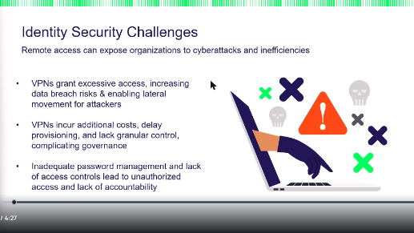

*"Remote access can expose organizations to cyberattacks and inefficiencies"*

| Masalah | Dampak |
|---|---|
| VPN memberi akses berlebihan | Risiko breach naik, attacker mudah lateral movement |
| VPN mahal, provisioning lambat, kontrol tidak granular | Governance sulit |
| Password management lemah, access control kurang | Akses tidak sah, tidak ada akuntabilitas |

**Insight:** VPN bekerja di **layer network** — sekali tersambung, user jadi "orang dalam" subnet. Padahal kebutuhannya cuma **satu sesi ke satu server**. Selisih antara akses yang *dibutuhkan* dan yang *diberikan* = attack surface.


### Slide 2 — 3 Pilar Delinea PRA
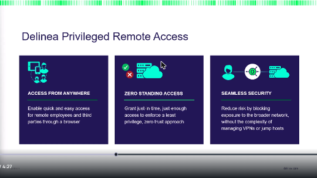

| Pilar | Isi | Makna |
|---|---|---|
| **Access from Anywhere** | Akses mudah via **browser** untuk karyawan remote & pihak ketiga | Tidak perlu VPN client di laptop vendor yang tidak kita kontrol |
| **Zero Standing Access** | **Just-in-time, just-enough** access, least privilege, zero trust | Konsep terpenting di lesson ini |
| **Seamless Security** | Blok exposure ke network luas tanpa kompleksitas **VPN / jump host** | User konek ke *sesi*, bukan ke *jaringan* |

#### Zero Standing Access (ZSA)
Default-nya **tidak ada yang punya akses permanen**. Akses hanya hidup saat dibutuhkan (JIT), sebatas yang diperlukan (JEA), lalu dicabut otomatis.

> **Analogi:** Standing access = karyawan pegang kunci ruang server 24/7 selama 5 tahun. ZSA = pinjam kunci ke security, dicatat, wajib kembali jam 5 sore.

Kalau akun vendor dibobol jam 2 pagi, akun itu **tidak punya akses apa pun** di jam tersebut → blast radius ≈ nol.

**Catatan:** Jump host juga termasuk standing access ke banyak server sekaligus — dan jump host sendiri jadi target bernilai tinggi.


### Slide 3 — Fitur PRA
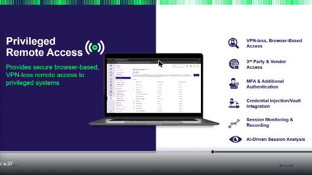

*"Provides secure browser-based, VPN-less remote access to privileged systems"*

1. **VPN-less, Browser-Based Access** — RDP/SSH dijalankan di browser
2. **3rd Party & Vendor Access** — use case utama
3. **MFA & Additional Authentication** — verifikasi identitas sebelum sesi dibuka
4. **Credential Injection / Vault Integration** — password diambil dari Secret Server dan disuntik ke sesi; **user tidak pernah melihat password**
5. **Session Monitoring & Recording** — termasuk keystroke logging & command filtering
6. **AI-Driven Session Analysis** — menandai sesi mencurigakan agar reviewer tidak perlu menonton semua rekaman *(tidak ada di learning objective → kemungkinan kecil keluar di quiz)*


### Ringkasan Satu Kalimat
> **PRA mengganti "akses permanen ke jaringan" (VPN/jump host + password dipegang user) dengan "akses ke satu sesi, sementara, terverifikasi, password tidak terlihat, dan direkam."**


### Catatan Senior Engineer (di luar materi video)
- **Command filtering bisa di-bypass** — sifatnya blacklist (script, encoding, alias). Anggap sebagai lapisan tambahan, bukan kontrol utama.
- **Recording tanpa review = cuma storage.** Yang bernilai adalah alert & review berbasis risiko.
- **PAM jadi crown jewel baru.** Kalau Secret Server jebol, semua kunci jebol → hardening, MFA admin PAM, prosedur break-glass wajib.
- **Konteks perbankan:** akses vendor ke sistem kritikal adalah temuan audit klasik. PRA + Workflow + Recording menjawab: *siapa, kapan, di-approve siapa, ngapain, mana buktinya?*
- **Integrasi SOC:** audit/session log Secret Server bisa dikirim ke SIEM (syslog/CEF) → use case: login vendor di luar maintenance window, command filter ter-trigger, akses tanpa approval.
- Video ini **level marketing**. Cara kerja teknis (Distributed Engine, launcher, workflow JIT) dibahas di lesson berikutnya.

### Cek Pemahaman
1. Kenapa memberi vendor VPN lebih berisiko daripada PRA? (2 kalimat)
2. Apa beda **credential injection** dengan "password disimpan di vault"?
3. Vendor upload script lewat PRA lalu script itu menghapus data — kontrol mana yang gagal, dan kontrol mana yang tetap memberi bukti?
4. Jelaskan Zero Standing Access dan beri satu skenario di bank di mana ZSA mencegah insiden yang tidak dicegah VPN.

[⬆ Kembali ke daftar lesson](#daftar-lesson)

---

<a id="lesson-2"></a>

## Lesson 2 — Secret Server Launchers: Overview

> **Sumber:** Delinea University → *Delinea Platform Guard: Control* → *Securing Remote Access* → Lesson 2
> **Tipe:** Video, 4:30 (tanpa subtitle; catatan disusun dari slide + deskripsi lesson)

### Learning Objectives
1. Use case utama Launcher: mengamankan remote access & autentikasi dengan **menyuntikkan credential dari vault** ke koneksi remote.
2. Jenis resource yang bisa dihubungkan: **server, workstation, network equipment, cloud account, website**.
3. Sesi yang di-launch dari Secret Server bisa **di-proxy, dimonitor, dan direkam** untuk compliance.


### Slide 1 — Use Case: Secure remote access for anything
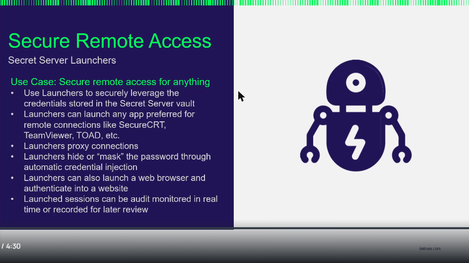

- Launcher memakai credential yang tersimpan di vault Secret Server
- Bisa menjalankan **aplikasi apa pun** yang dipakai user: SecureCRT, TeamViewer, TOAD, dll.
- Launcher bisa **mem-proxy** koneksi
- Password **disembunyikan / di-mask** lewat automatic credential injection
- Bisa membuka browser dan login ke website
- Sesi bisa **dimonitor real-time** atau **direkam** untuk review

**Definisi singkat:** Launcher = tombol "Launch" di sebuah Secret. Klik → aplikasi terbuka dalam kondisi **sudah login**, tanpa user pernah melihat password.

> **Analogi:** Vault = brankas kunci. Launcher = petugas yang membukakan pintu untuk kamu. Kamu masuk ruangan, tapi kunci tidak pernah berpindah ke tanganmu.


### Slide 2 — Protocol Handler
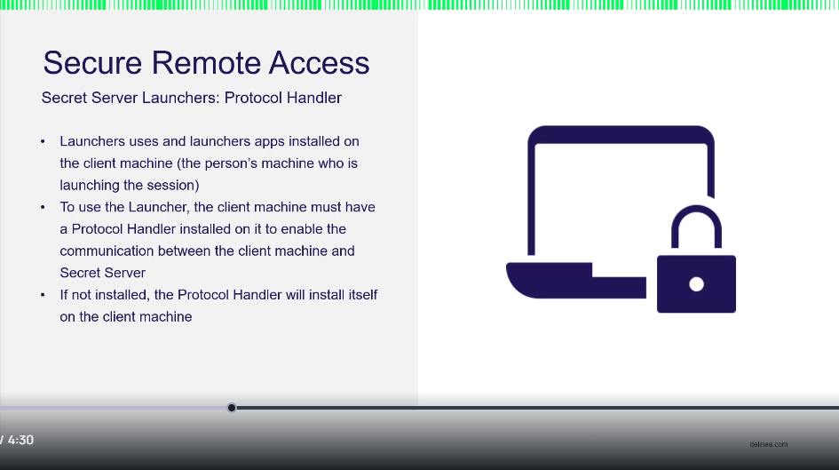

- Launcher memakai aplikasi yang **terinstal di client machine** (komputer orang yang membuka sesi)
- Client wajib punya **Protocol Handler** agar client ↔ Secret Server bisa berkomunikasi
- Kalau belum terinstal, Protocol Handler akan **meng-install dirinya sendiri**

**Cara kerja:** Secret Server berjalan di browser, tapi `mstsc.exe` / PuTTY / TOAD ada di laptop user. Protocol Handler adalah "jembatan" kecil di endpoint yang menerima perintah dari browser (via custom URI scheme) lalu menjalankan aplikasi lokal dengan credential dari vault.


### Slide 3 — Built-in Launchers
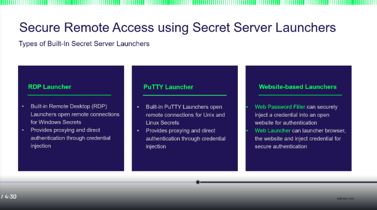

| Launcher | Untuk | Catatan |
|---|---|---|
| **RDP Launcher** | Secret Windows | Proxying & direct authentication via credential injection |
| **PuTTY Launcher** | Secret Unix/Linux | Proxying & direct authentication via credential injection |
| **Web Password Filler** | Website yang sudah terbuka | Menyuntikkan credential ke halaman login |
| **Web Launcher** | Website | Membuka browser + website + inject credential |


### Slide 4 — Custom Launchers
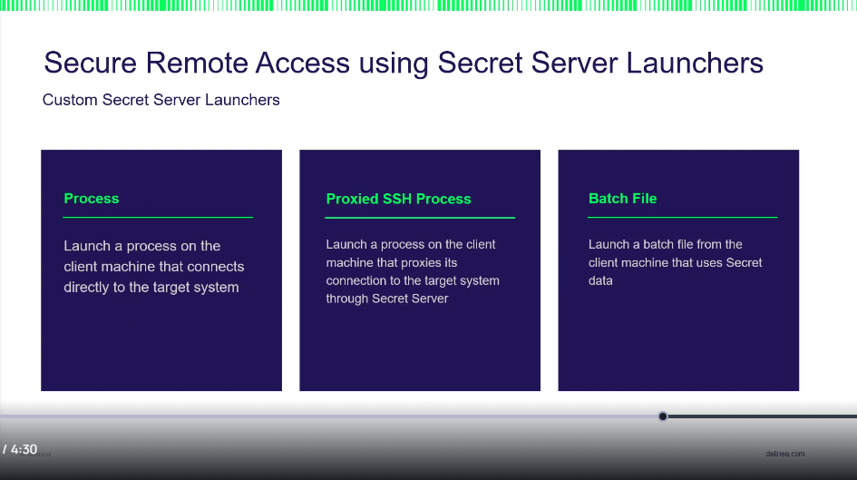

| Tipe | Fungsi | Contoh |
|---|---|---|
| **Process** | Menjalankan proses di client yang konek **langsung** ke target | SSMS, TOAD, WinSCP dengan argumen credential |
| **Proxied SSH Process** | Menjalankan proses di client yang koneksinya **di-proxy lewat Secret Server** | SecureCRT via SSH proxy |
| **Batch File** | Menjalankan batch file di client yang memakai data Secret | Script admin yang butuh credential |


### Konsep Kunci: Direct vs Proxied

| | **Direct** | **Proxied** |
|---|---|---|
| Jalur | Client → Target | Client → Secret Server proxy → Target |
| Credential | Diteruskan ke app di client | Disuntik di proxy |
| Target perlu terbuka dari client? | Ya | Tidak (cukup dari proxy) |
| Monitoring/recording | Terbatas (bergantung agent di client) | Lebih kuat, semua lewat satu titik |
| Rekomendasi untuk vendor | ❌ | ✅ |


### Catatan Senior Engineer (di luar materi video)
- **"Masked" ≠ "tidak pernah ada di endpoint".** Pada mode *direct*, credential tetap dikirim ke client untuk diberikan ke aplikasi lokal. User biasa tidak melihatnya, tapi orang dengan admin lokal + tool yang tepat berpotensi mengambilnya dari memory. Untuk pihak ketiga, **pakai mode proxied**.
- **Custom launcher bisa membocorkan password ke log.** Kalau password dioper sebagai argumen command line (`app.exe -u admin -p P@ss`), password muncul di process list, **Windows Event 4688 (command line logging)** dan **Sysmon Event ID 1**. Artinya password bisa masuk ke SIEM. Selalu cek bagaimana parameter dioper.
- **Protocol Handler "install itself" sering gagal di bank.** Endpoint biasanya dikunci (user non-admin, application whitelisting). Rencanakan deploy lewat SCCM/Intune dan masukkan ke whitelist.
- **Protocol Handler adalah software di endpoint** = attack surface tambahan → masuk patch management.
- **Web Password Filler lebih lemah** dari RDP/SSH proxy: credential berakhir di DOM halaman browser user.
- **Konteks bank:** TOAD/SQL Developer ke database core banking (Oracle) adalah kandidat utama custom launcher. DBA tidak perlu lagi tahu password `SYS`/`SYSTEM`.

### Cek Pemahaman
1. Apa fungsi Protocol Handler, dan kenapa dibutuhkan walaupun Secret Server diakses lewat browser?
2. Vendor eksternal perlu SSH ke server Linux produksi. Pilih **PuTTY direct** atau **proxied**? Jelaskan alasannya.
3. Tim DBA minta custom launcher TOAD dengan password di argumen command line. Apa risikonya dari sisi SOC?
4. Sebutkan 5 jenis resource yang bisa dihubungkan via Launcher.

[⬆ Kembali ke daftar lesson](#daftar-lesson)

---

<a id="lesson-3"></a>

## Lesson 3 — Secret Server Workflow: Access & Approval Workflows

> **Sumber:** Delinea University → *Delinea Platform Guard: Control* → *Securing Remote Access* → Lesson 3
> **Tipe:** Video, 4:47 (tanpa subtitle; catatan disusun dari slide + deskripsi lesson)

### Learning Objectives
1. Use case utama: membangun proses **formal dan bisa diaudit** untuk meminta & memberi akses privileged.
2. Bagaimana workflow mendukung **penegakan policy dan standarisasi** di organisasi.
3. Konsep kunci: **CheckOut, Multi-Level Workflow, integrasi ticketing system**.


### Slide 1 — Use Cases
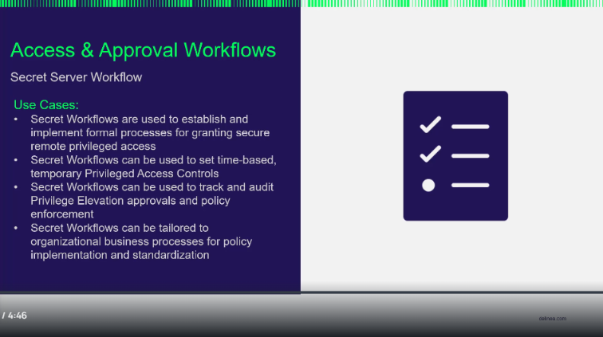

- Membangun proses formal untuk memberi akses remote privileged
- Membuat kontrol akses privileged yang **berbatas waktu & sementara**
- Melacak dan mengaudit **approval privilege elevation** serta penegakan policy
- Bisa disesuaikan dengan proses bisnis organisasi → standarisasi

**Posisi di gambar besar:** RBAC menjawab *"siapa BOLEH akses?"*. Workflow menjawab *"siapa yang MENGIZINKAN akses SEKARANG, untuk apa, dan berapa lama?"*. Workflow + CheckOut = implementasi nyata dari **Zero Standing Access / JIT** (Lesson 1).


### Slide 2 — 3 Mekanisme Inti
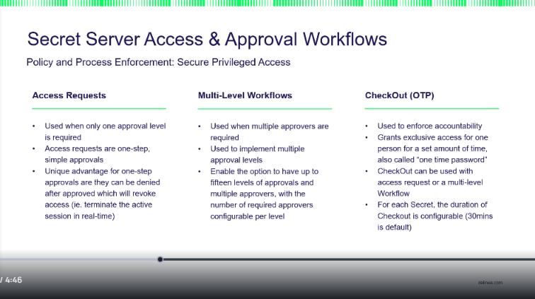

| | **Access Request** | **Multi-Level Workflow** | **CheckOut (OTP)** |
|---|---|---|---|
| Kapan dipakai | Cukup **1 level** approval | Butuh **banyak approver / level** | Menegakkan **akuntabilitas** |
| Ciri | One-step, simple | Hingga **15 level**, jumlah approver per level bisa diatur | Akses **eksklusif** untuk **1 orang** selama waktu tertentu ("one time password") |
| Keunggulan | Approval bisa **dibatalkan (deny) setelah di-approve** → **sesi aktif diputus real-time** | Cocok untuk sistem sangat kritikal | Bisa digabung dengan Access Request / Multi-Level |
| Default | – | – | Durasi CheckOut **30 menit** (bisa diatur per Secret) |

#### CheckOut, dijelaskan
- Saat satu orang check-out sebuah Secret, **orang lain tidak bisa memakainya** sampai di-check-in kembali.
- Jadi setiap aktivitas dengan akun itu di rentang waktu tersebut **pasti milik satu orang** → non-repudiation.
- Disebut "OTP" karena idealnya password **dirotasi saat check-in**, sehingga password yang sempat dipakai tidak berlaku lagi.


### Slide 3 — Integrasi Ticketing System
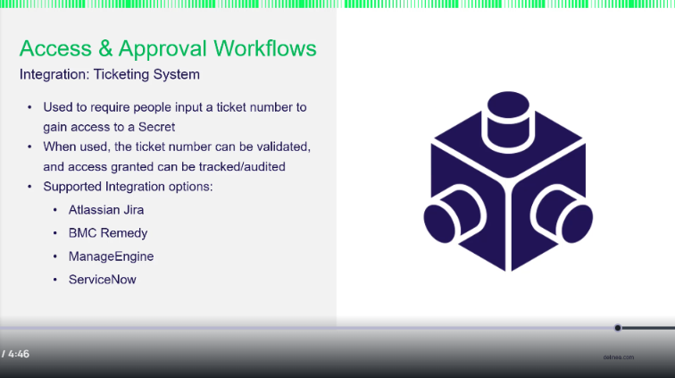

- User wajib memasukkan **nomor tiket** untuk mengakses Secret
- Nomor tiket bisa **divalidasi**, akses yang diberikan bisa dilacak/diaudit
- Integrasi yang didukung: **Atlassian Jira, BMC Remedy, ManageEngine, ServiceNow**


### Alur Lengkap (gabungan Lesson 1–3)
```
Vendor login (MFA)
  → Request akses ke Secret + nomor tiket (divalidasi ke ITSM)
    → Approval (1 level / multi-level)
      → CheckOut (eksklusif, 30 menit)
        → Launcher (proxied) → sesi direkam
          → Check-in → password dirotasi
```


### Catatan Senior Engineer (di luar materi video)
- **Prinsip 4-eyes / maker-checker.** Di bank ini sudah jadi bahasa audit. Pastikan **requester tidak bisa meng-approve dirinya sendiri** (approver group jangan berisi requester).
- **Approval fatigue.** Kalau approver menerima 50 request/hari, mereka akan klik "Approve" tanpa membaca. Ukur: waktu rata-rata approval, deny rate. Deny rate ≈ 0% = rubber stamp.
- **15 level itu kemampuan, bukan rekomendasi.** Lebih dari 2–3 level biasanya bikin proses macet dan orang mencari jalan pintas.
- **"Ticket validated" — validasi apa?** Cek apakah hanya format nomor, atau benar-benar memeriksa tiket **open, approved, assigned ke requester, dan dalam change window**. Kalau cuma format, siapa pun bisa mengetik nomor asal.
- **CheckOut tanpa rotasi saat check-in = bukan OTP.** Aktifkan rotasi password saat check-in untuk akun kritikal.
- **Break-glass.** Insiden jam 2 pagi, approver tidur → harus ada prosedur emergency access yang tercatat dan di-review sesudahnya. Tanpa ini, tim ops akan menyimpan password di luar vault "buat jaga-jaga".
- **Use case SOC/SIEM:**
  - Approval di luar jam kerja / di luar change window
  - Satu approver meng-approve volume tidak wajar
  - Request di-deny lalu akun yang sama tetap dipakai dari jalur lain
  - CheckOut diperpanjang berulang kali
  - Nomor tiket yang sama dipakai berkali-kali

### Cek Pemahaman
1. Apa beda **Access Request** dan **Multi-Level Workflow**, dan kapan memilih masing-masing?
2. Kenapa CheckOut disebut memberi **akuntabilitas**? Apa yang terjadi kalau dua admin bisa memakai akun `root` yang sama secara bersamaan?
3. Vendor sudah di-approve dan sedang dalam sesi. Tim SOC melihat aktivitas mencurigakan. Fitur workflow apa yang memungkinkan sesi diputus seketika?
4. Kenapa "CheckOut tanpa rotasi password saat check-in" tidak benar-benar memenuhi konsep OTP?

[⬆ Kembali ke daftar lesson](#daftar-lesson)

---

<a id="lesson-4"></a>

## Lesson 4 — Delinea Platform: Credential Manager & Connection Manager

> **Sumber:** Delinea University → *Delinea Platform Guard: Control* → *Securing Remote Access* → Lesson 4
> **Tipe:** Video, 6:24 (tanpa subtitle; catatan disusun dari slide + deskripsi lesson)
> ⚠️ Slide penutup berjudul **"Sales Enablement"** → materi ini aslinya untuk tim sales/partner. Isinya positioning, bukan teknis.

### Learning Objectives
1. Apa itu **Connection Manager** dan bagaimana ia menyederhanakan remote access ke server untuk IT/privileged admin.
2. Apa itu **Credential Manager** dan bagaimana ia memperluas akses aman ke aplikasi bisnis **di luar IT**.
3. Bagaimana keduanya bekerja lewat **satu vault**, beserta contoh penggunaannya.


### Overview — Dua Jalan Menuju Satu Vault
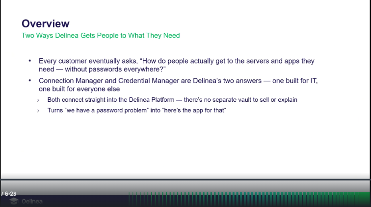

Pertanyaan yang pasti muncul dari setiap customer: *"Bagaimana orang bisa mengakses server & aplikasi yang mereka butuhkan tanpa password tersebar di mana-mana?"*
- **Connection Manager** → untuk **IT**
- **Credential Manager** → untuk **semua orang lainnya**
- Keduanya langsung terhubung ke **Delinea Platform** — tidak ada vault terpisah


### Connection Manager
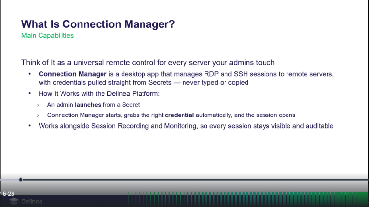

> *"Universal remote control untuk setiap server yang disentuh admin"*

- **Aplikasi desktop** yang mengelola sesi **RDP & SSH** ke banyak server; credential diambil langsung dari Secret — **tidak pernah diketik atau di-copy**
- Alur: admin **launch** dari Secret → Connection Manager terbuka → ambil credential otomatis → sesi terbuka
- Bekerja bersama **Session Recording & Monitoring**

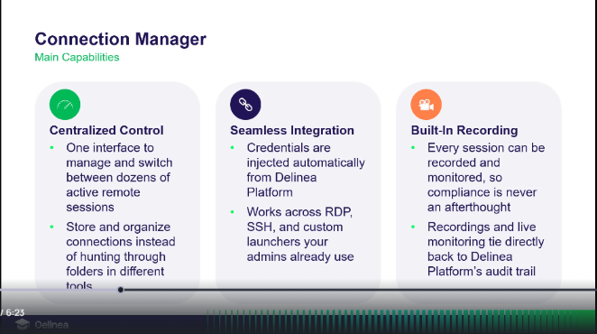

| Centralized Control | Seamless Integration | Built-In Recording |
|---|---|---|
| Satu interface untuk mengelola & berpindah antar puluhan sesi aktif | Credential disuntik otomatis dari Delinea Platform | Setiap sesi bisa direkam & dimonitor |
| Simpan & atur koneksi, tidak perlu cari di folder berbagai tool | Mendukung RDP, SSH, dan custom launcher | Rekaman & live monitoring terhubung ke audit trail platform |

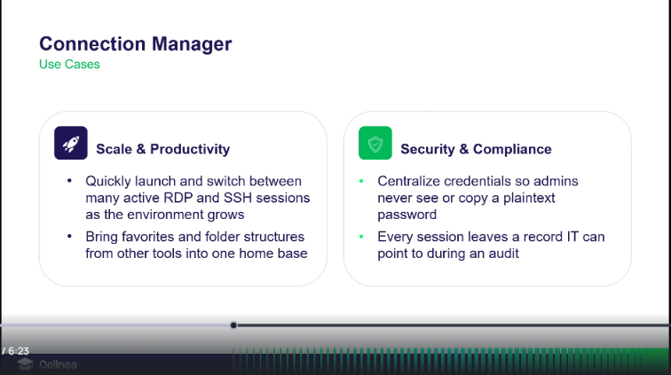

- **Scale & Productivity:** launch & berpindah antar banyak sesi RDP/SSH; impor favorites & struktur folder dari tool lain
- **Security & Compliance:** admin tidak pernah melihat/menyalin password plaintext; setiap sesi meninggalkan jejak untuk audit


### Credential Manager
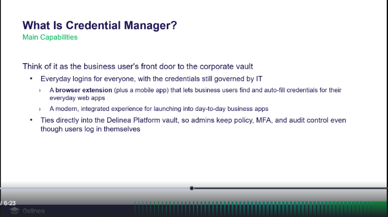

> *"Pintu depan user bisnis menuju vault perusahaan"*

- Login sehari-hari untuk semua orang, credential tetap **diatur IT**
  - **Browser extension** (+ mobile app) untuk mencari & auto-fill credential aplikasi web
  - Pengalaman terintegrasi untuk membuka aplikasi bisnis harian
- Terhubung langsung ke vault Delinea Platform → admin tetap pegang **policy, MFA, dan audit** walau user login sendiri

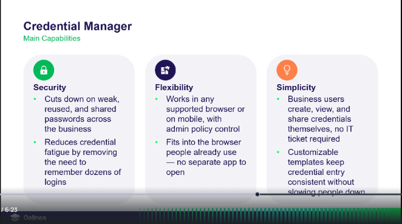

| Security | Flexibility | Simplicity |
|---|---|---|
| Mengurangi password lemah, reuse, dan shared | Jalan di browser yang didukung & mobile, dengan kontrol policy admin | User bisnis bisa **membuat, melihat, dan berbagi** credential sendiri tanpa tiket IT |
| Mengurangi *credential fatigue* | Masuk ke browser yang sudah dipakai | Template kustom menjaga konsistensi input |

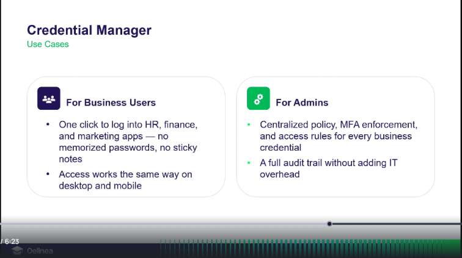

- **Business users:** satu klik ke aplikasi HR, finance, marketing — tanpa hafal password, tanpa sticky note; sama di desktop & mobile
- **Admins:** policy terpusat, MFA, aturan akses untuk setiap credential bisnis; audit trail tanpa beban IT tambahan


### Perbandingan
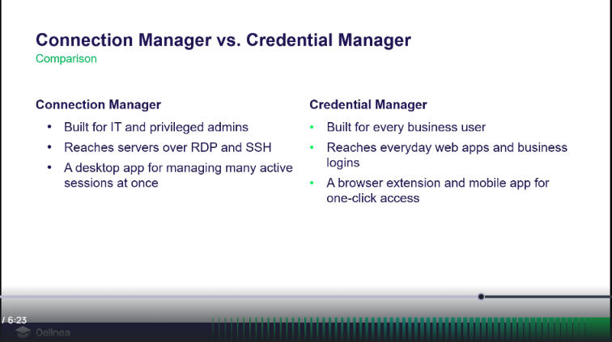

| | **Connection Manager** | **Credential Manager** |
|---|---|---|
| Untuk siapa | IT & privileged admin | Semua user bisnis |
| Target | Server via **RDP/SSH** | **Web app** & login bisnis |
| Bentuk | **Aplikasi desktop**, banyak sesi sekaligus | **Browser extension + mobile app**, one-click |

### One Vault, Two Front Doors
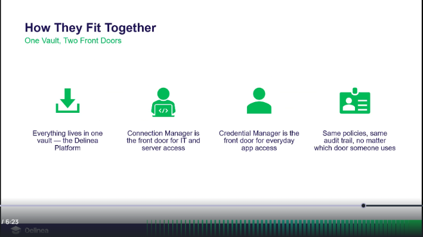

1. Semua tinggal di **satu vault** — Delinea Platform
2. Connection Manager = pintu untuk **IT & server**
3. Credential Manager = pintu untuk **aplikasi harian**
4. **Policy sama, audit trail sama**, apa pun pintunya

### Skenario
| | |
|---|---|
| 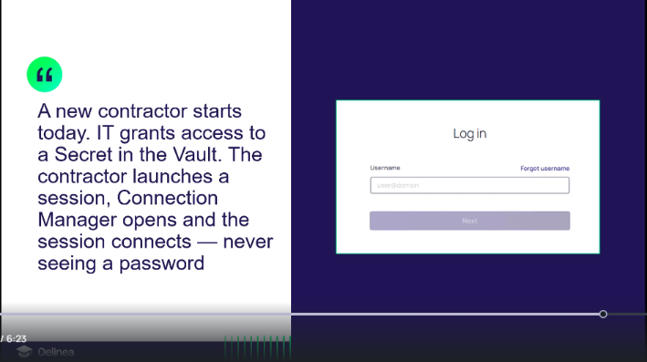 | 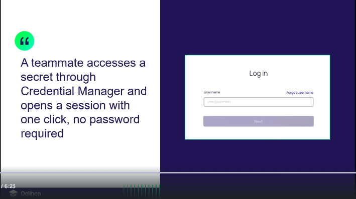 |
| Kontraktor baru → IT beri akses ke Secret → kontraktor launch sesi → Connection Manager terbuka dan sesi tersambung, **tanpa melihat password** | Rekan kerja mengakses Secret lewat Credential Manager → sesi terbuka **dengan satu klik**, tanpa password |

### Summary (Sales Enablement)
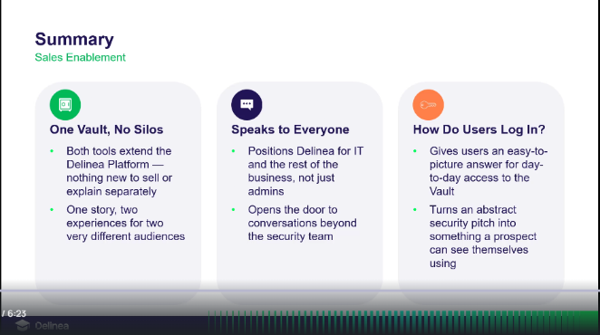
- **One vault, no silos** — keduanya perluasan Delinea Platform
- **Speaks to everyone** — Delinea diposisikan untuk IT *dan* bisnis
- **How do users log in?** — jawaban konkret untuk akses harian ke vault


### Posisi terhadap Lesson 2 (Launchers)
| | Launcher | Connection Manager |
|---|---|---|
| Apa | **Mekanisme** membuka 1 aplikasi dengan credential dari vault | **Aplikasi desktop** yang menampung banyak sesi RDP/SSH dalam satu jendela |
| Analogi | Petugas yang membukakan 1 pintu | Lobi dengan banyak pintu yang semuanya sudah dibukakan |


### Catatan Senior Engineer (di luar materi video)
- **Musuh sebenarnya Connection Manager: RDCMan, mRemoteNG, MobaXterm, Royal TS.** Tool ini menyimpan password **di file config lokal** laptop admin. Contoh nyata: `confCons.xml` milik mRemoteNG bisa didekripsi kalau master password tidak diset — teknik ini dipakai attacker & pentester. Satu laptop admin jebol = credential puluhan server ikut bocor.
- **Credential Manager = enterprise password manager** (kelasnya mirip 1Password/Bitwarden Business), bedanya terhubung ke vault PAM.
- **"User bisa share credential sendiri tanpa tiket IT"** = convenience sekaligus risiko governance. Tanpa review berkala, ini jadi *shadow sharing* yang rapi.
- **Credential Manager bukan pengganti SSO.** Kalau aplikasi mendukung SAML/OIDC, pakai SSO. Password manager untuk aplikasi yang **tidak** mendukung SSO (portal vendor, portal eksternal, akun bersama).
- **Blast radius.** Menaruh credential workforce dan credential privileged di platform yang sama memudahkan manajemen, tapi kalau platform kena, dampaknya lebih luas. Pisahkan dengan folder/policy dan role admin yang ketat.
- **Browser extension = attack surface** (malicious extension lain, XSS di halaman target). Kontrol daftar extension lewat policy browser.
- **Konteks bank:** akun bersama untuk portal eksternal (portal pelaporan, portal vendor, akun media sosial resmi) adalah kandidat paling cocok untuk Credential Manager — lengkap dengan MFA & audit siapa yang memakai.

### Cek Pemahaman
1. Apa beda Connection Manager dan Credential Manager dari sisi **user, target, dan bentuk aplikasi**?
2. Apa beda **Launcher** (Lesson 2) dengan **Connection Manager**?
3. Kenapa mengganti RDCMan/mRemoteNG dengan Connection Manager adalah peningkatan keamanan, bukan cuma kenyamanan?
4. Aplikasi HR internal sudah mendukung SAML. Perlu Credential Manager untuk aplikasi itu? Kenapa?

[⬆ Kembali ke daftar lesson](#daftar-lesson)

---

<a id="lesson-5"></a>

## Lesson 5 — Secret Server Vaulting: Session Recording & Monitoring

> **Sumber:** Delinea University → *Delinea Platform Guard: Control* → *Securing Remote Access* → Lesson 5
> **Tipe:** Video, 5:42 (tanpa subtitle; catatan disusun dari slide + deskripsi lesson)
> ⚠️ Slide penutup berjudul **"Sales Enablement"** → materi positioning, bukan deep-dive teknis.

### Learning Objectives
1. Definisi **session monitoring** dan kapabilitasnya: visibilitas real-time, pesan di tengah sesi, terminasi sesi.
2. Definisi **session recording** dan 3 komponen capture-nya: **video, keystrokes, metadata**.


### Overview
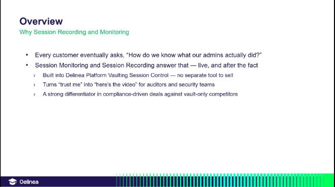

Pertanyaan yang pasti muncul: *"Bagaimana kita tahu apa yang sebenarnya dilakukan admin?"*
- Monitoring menjawabnya **saat kejadian (live)**, Recording menjawabnya **setelah kejadian**
- Sudah built-in di **Delinea Platform Vaulting Session Control** — tidak perlu tool terpisah
- Mengubah *"percayalah"* menjadi *"ini videonya"* untuk auditor & tim security


### Session Monitoring
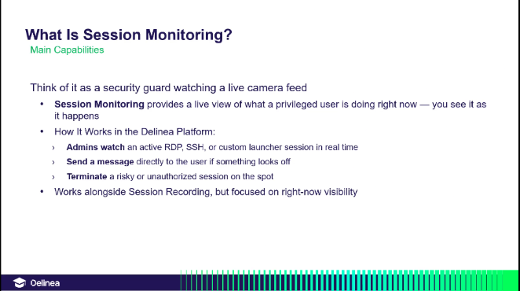

> *Analogi: satpam yang menonton CCTV secara live*

- Melihat **langsung** apa yang dilakukan privileged user saat ini
- Cara kerja di Delinea Platform:
  - Admin **menonton** sesi RDP, SSH, atau custom launcher secara real-time
  - **Mengirim pesan** langsung ke user kalau ada yang janggal
  - **Memutus** sesi berisiko/tidak sah saat itu juga

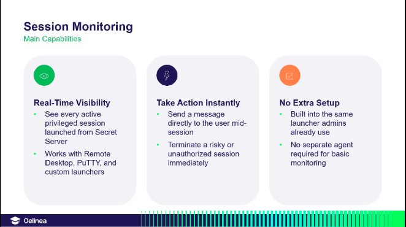

| Real-Time Visibility | Take Action Instantly | No Extra Setup |
|---|---|---|
| Lihat semua sesi privileged aktif yang di-launch dari Secret Server | Kirim pesan ke user di tengah sesi | Built-in di launcher yang sudah dipakai |
| Remote Desktop, PuTTY, custom launcher | Terminate sesi berisiko seketika | **Tidak perlu agent** untuk monitoring dasar |

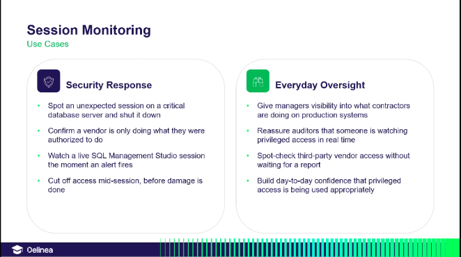

| Security Response | Everyday Oversight |
|---|---|
| Lihat sesi tak terduga di database server kritikal → matikan | Manajer bisa melihat apa yang dilakukan kontraktor di production |
| Pastikan vendor hanya melakukan yang diizinkan | Meyakinkan auditor bahwa akses privileged diawasi real-time |
| Tonton sesi SQL Management Studio saat alert muncul | Spot-check akses vendor tanpa menunggu laporan |
| Putus akses di tengah sesi sebelum kerusakan terjadi | Membangun keyakinan bahwa akses privileged dipakai dengan benar |


### Session Recording
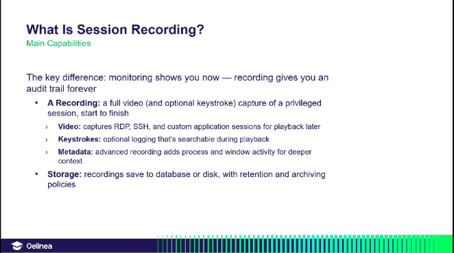

> *Monitoring = sekarang. Recording = audit trail selamanya.*

Rekaman penuh (video + keystroke opsional) dari awal sampai akhir sesi:

| Komponen | Isi |
|---|---|
| **Video** | Sesi RDP, SSH, dan custom application untuk diputar ulang |
| **Keystrokes** | Opsional; **bisa dicari (searchable)** saat playback |
| **Metadata** | *Advanced recording* menambahkan **aktivitas proses & window** untuk konteks forensik |
| **Storage** | Disimpan ke **database atau disk**, dengan kebijakan **retensi & arsip** |


### Monitoring vs Recording
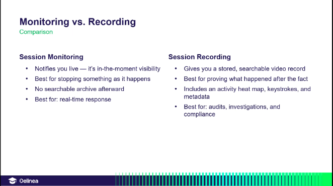

| | **Session Monitoring** | **Session Recording** |
|---|---|---|
| Sifat | Live, saat kejadian | Tersimpan, searchable |
| Terbaik untuk | **Menghentikan** sesuatu saat terjadi | **Membuktikan** apa yang terjadi |
| Arsip | Tidak ada arsip yang bisa dicari | Activity heat map, keystrokes, metadata |
| Use case | Respons real-time | Audit, investigasi, compliance |


### Skenario
| SOC Analyst | Auditor |
|---|---|
| 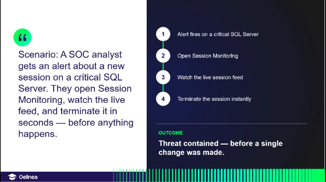 | 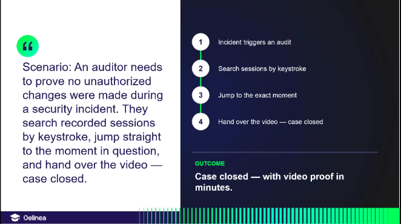 |
| 1. Alert di SQL Server kritikal → 2. Buka Session Monitoring → 3. Tonton live → 4. Terminate. **Hasil:** ancaman tertahan sebelum ada perubahan | 1. Insiden memicu audit → 2. Cari sesi berdasarkan keystroke → 3. Lompat ke momen yang dicari → 4. Serahkan video. **Hasil:** kasus selesai dengan bukti video dalam hitungan menit |

### Summary (Sales Enablement)
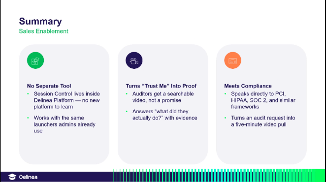
- **No separate tool** — ada di dalam Delinea Platform, pakai launcher yang sama
- **"Trust me" → proof** — auditor dapat video yang bisa dicari
- **Compliance** — PCI, HIPAA, SOC 2, dll.; permintaan audit jadi tarik video 5 menit


### Catatan Senior Engineer (di luar materi video)
- **Skenario SOC di video itu versi ideal.** Agar realistis butuh:
  1. **Sumber alert**: event Secret Server dikirim ke SIEM (syslog/CEF) → rule korelasi di SIEM
  2. **Hak akses**: analis SOC butuh role di Delinea untuk melihat & memutus sesi
  3. **Kecepatan manusia**: alert → buka console → menonton → memutuskan butuh menit. `DROP TABLE` butuh 1 detik. Monitoring live adalah **deteksi & containment**, bukan **pencegahan**. Pencegahan ada di workflow & least privilege.
- **Recording hanya merekam yang lewat PAM.** Kalau admin masih bisa RDP langsung ke server (bypass Delinea), rekaman bersih **bukan bukti** tidak ada perubahan. Wajib: firewall yang membuat **PAM satu-satunya jalur** ke server kritikal.
  - **Use case SOC emas:** logon ke server kritikal (Windows 4624 tipe 10 / SSH accepted) dengan source IP **bukan** dari proxy/engine Delinea = **bypass PAM** → alert prioritas tinggi.
- **Keystroke search punya celah.** Command yang di-*paste*, hasil tab-completion, atau script yang dijalankan tidak selalu muncul sebagai keystroke yang utuh. Pencarian "DROP" bisa luput.
- **Keystroke log menangkap password yang diketik** (mis. `sudo`, `mysql -p`, login ke sistem lain dalam sesi). Rekaman = **data sensitif** → batasi siapa yang boleh memutar ulang, dan setiap playback harus ter-audit.
- **Privasi & legal:** rekaman layar bisa memuat data pribadi nasabah → pertimbangkan UU PDP (UU 27/2022) dalam kebijakan akses & retensi rekaman.
- **Storage:** video privileged session besar. Menyimpan di database membuat DB membengkak; pakai disk/archive dengan retensi sesuai kebijakan retensi bank.
- **Integritas bukti:** kalau rekaman dipakai untuk investigasi/hukum, pastikan proteksi dari modifikasi dan jejak siapa yang mengakses (chain of custody).
- **Basic vs Advanced:** monitoring/recording dasar tanpa agent; metadata proses & window (*advanced recording*) umumnya butuh komponen tambahan di target → cek di dokumentasi sebelum desain.

### Cek Pemahaman
1. Sebutkan **3 aksi** yang bisa dilakukan admin lewat Session Monitoring.
2. Sebutkan **3 komponen** Session Recording dan fungsi masing-masing.
3. Monitoring vs Recording: mana untuk **menghentikan**, mana untuk **membuktikan**?
4. Auditor bilang: "Rekaman PAM bersih, berarti tidak ada perubahan tidak sah." Apa sanggahan Anda?
5. Rancang 1 rule SIEM untuk mendeteksi **bypass PAM** ke server kritikal.

[⬆ Kembali ke daftar lesson](#daftar-lesson)
