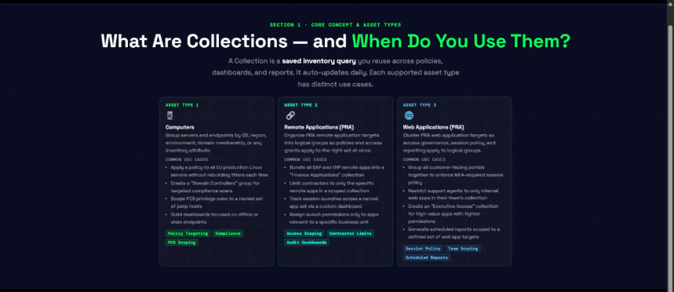
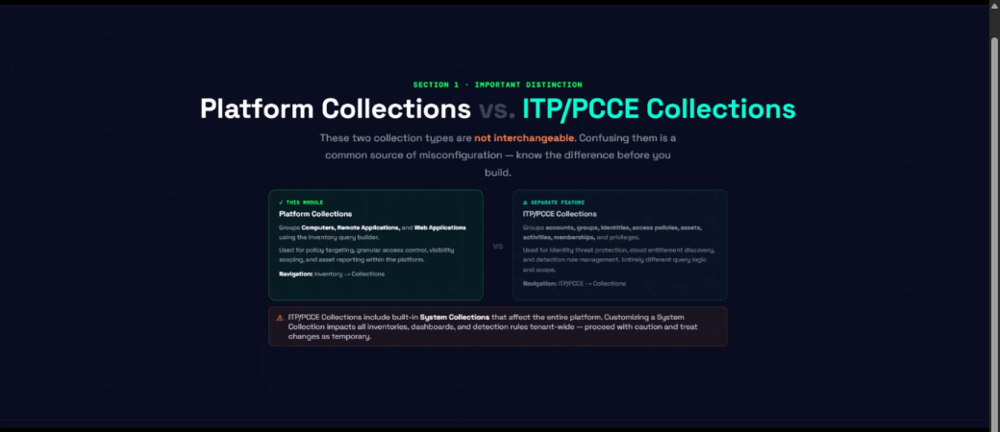
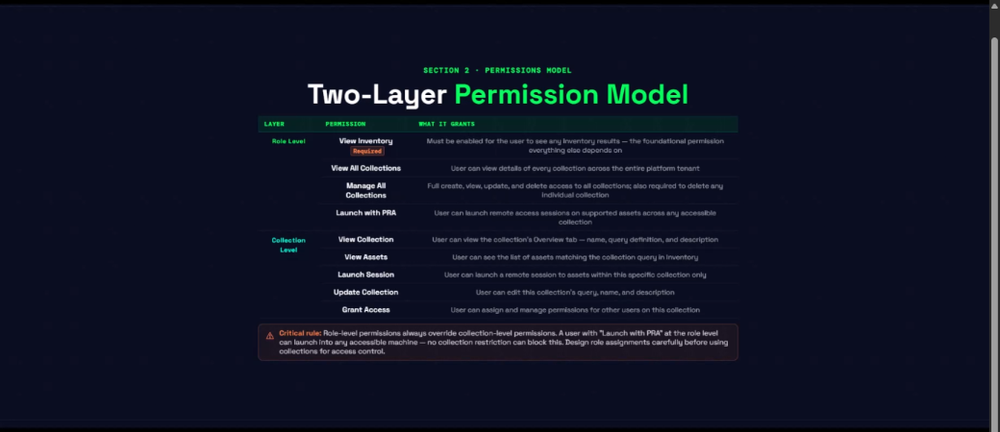
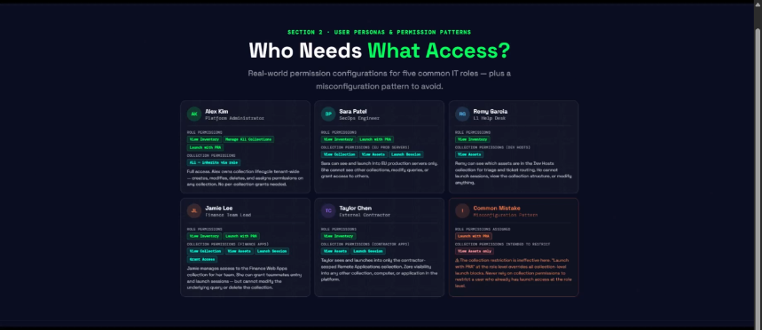
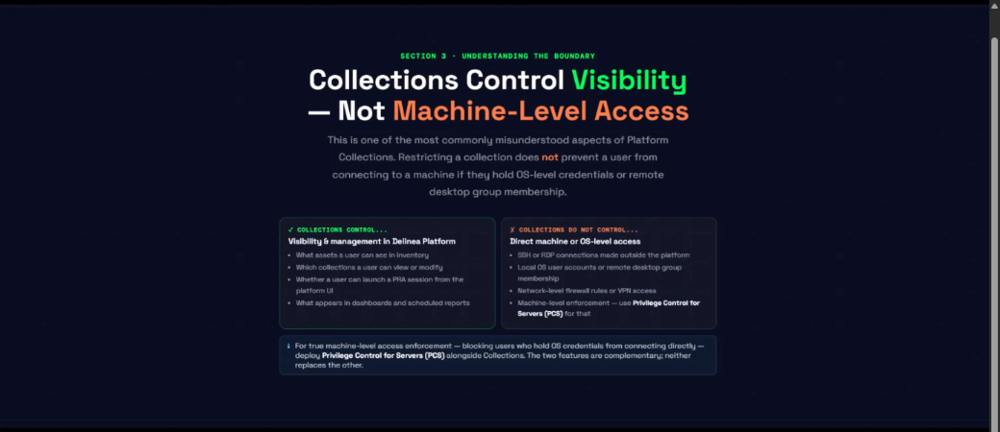

# 1.2 Delinea Platform Guard: Collections

> **Bab 1. Delinea Platform Guard : Control** · Course e-learning, 2 lesson (1 video + 1 quiz)

## Daftar Lesson
| # | Lesson | Durasi | Inti |
|---|---|---|---|
| 1 | [Platform Collections: Concepts, Terminology, and Use Cases](#lesson-1) | 7:07 | Collection = saved inventory query; Platform vs ITP/PCCE Collections; two-layer permission model; collections ≠ machine-level access |
| 2 | Quiz | – | ⏳ |

## Ringkasan Satu Kalimat
> **Collection adalah "saved search" atas inventory** — dipakai untuk menargetkan policy, dashboard, report, dan izin akses ke sekelompok aset. Collection mengatur **apa yang terlihat & bisa dikelola di platform**, **bukan** siapa yang secara fisik bisa konek ke mesin.

---

## Lesson 1 — Platform Collections: Concepts, Terminology, and Use Cases

> **Sumber:** Delinea University → *Delinea Platform Guard: Control* → *Collections* → Lesson 1
> **Tipe:** Video, 7:07 (tanpa subtitle; catatan disusun dari slide + deskripsi lesson)

### Learning Objectives
1. Mendefinisikan platform collections sebagai **saved inventory query** yang membuat penargetan & pengelolaan aset lebih efisien.
2. Memberi contoh use case nyata: pengelompokan berdasarkan **OS, region geografis, domain, atau tipe aplikasi**.
3. Membedakan **Platform Collections** dan **ITP/PCCE Collections** — apa yang dikelompokkan masing-masing dan kenapa tidak bisa saling menggantikan.

### Section 1 — What Are Collections & When Do You Use Them?

**Definisi:** Collection = **saved inventory query** yang dipakai ulang di policy, dashboard, dan report. **Auto-update harian.**

> **Analogi:** Seperti *smart playlist* di Spotify atau filter label di Gmail. Kamu tidak memasukkan lagu satu per satu — kamu menulis aturan ("genre = jazz, tahun > 2020"), dan isinya ikut berubah sendiri.

| | **Asset Type 1: Computers** | **Asset Type 2: Remote Applications (PRA)** | **Asset Type 3: Web Applications (PRA)** |
|---|---|---|---|
| Fungsi | Kelompokkan server & endpoint berdasarkan OS, region, environment, domain membership, atau atribut inventory lain | Kelompokkan target remote app PRA agar policy & akses berlaku sekaligus | Kelompokkan target web app PRA untuk access governance, session policy, dan reporting |
| Contoh | Policy untuk semua server Linux production di EU tanpa bikin filter ulang | Gabungkan semua remote app SAP & ERP ke collection "Finance Applications" | Kelompokkan semua portal customer-facing → wajib MFA saat sesi |
| | Grup "Domain Controllers" untuk compliance scan | Batasi kontraktor hanya ke remote app tertentu | Batasi agen support hanya ke web app internal timnya |
| | Batasi aturan privilege PCS ke sekumpulan jump host | Pantau session launch lewat custom dashboard | Collection "Executive Access" untuk app bernilai tinggi dengan izin lebih ketat |
| | Dashboard khusus endpoint offline/stale | Beri izin launch hanya untuk app milik unit bisnis tertentu | Scheduled report untuk sekumpulan web app |
| Tag | Policy Targeting · Compliance · PCS Scoping | Access Scoping · Contractor Limits · Audit Dashboards | Session Policy · Team Scoping · Scheduled Reports |

### Section 1 — Platform Collections vs ITP/PCCE Collections

Dua tipe collection ini **tidak bisa saling menggantikan** — salah paham di sini adalah sumber misconfiguration yang umum.

| | **Platform Collections** (modul ini) | **ITP/PCCE Collections** (fitur terpisah) |
|---|---|---|
| Mengelompokkan | **Computers, Remote Applications, Web Applications** (via inventory query builder) | **Accounts, groups, identities, access policies, assets, activities, memberships, privileges** |
| Dipakai untuk | Policy targeting, kontrol akses granular, visibility scoping, reporting aset | Identity threat protection, cloud entitlement discovery, detection rule management |
| Navigasi | Inventory → Collections | ITP/PCCE → Collections |

> ⚠️ ITP/PCCE punya **System Collections** bawaan yang berdampak ke **seluruh tenant**. Mengubah System Collection memengaruhi semua inventory, dashboard, dan detection rule — lakukan dengan hati-hati dan anggap perubahan sebagai sementara.

**Cara ingat:** Platform Collections = kelompok **mesin & aplikasi** (*di mana*). ITP/PCCE Collections = kelompok **identitas & hak akses** (*siapa & punya hak apa*).

### Section 2 — Two-Layer Permission Model

| Layer | Permission | Yang diberikan |
|---|---|---|
| **Role Level** | **View Inventory** *(Required)* | Wajib aktif agar user bisa melihat hasil inventory apa pun — fondasi untuk semua permission lain |
| | View All Collections | Melihat detail **semua** collection di seluruh tenant |
| | Manage All Collections | Create, view, update, delete **semua** collection; juga diperlukan untuk menghapus collection individual |
| | **Launch with PRA** | Launch sesi remote ke aset yang didukung di **semua** collection yang bisa diakses |
| **Collection Level** | View Collection | Melihat tab Overview collection (nama, query, deskripsi) |
| | View Assets | Melihat daftar aset yang cocok dengan query collection |
| | Launch Session | Launch sesi remote **hanya** ke aset di collection ini |
| | Update Collection | Mengubah query, nama, dan deskripsi collection |
| | Grant Access | Mengatur permission user lain di collection ini |

> 🚨 **Critical rule:** **Permission di level role SELALU mengalahkan permission di level collection.** User dengan "Launch with PRA" di level role bisa launch ke mesin mana pun yang bisa diakses — **tidak ada restriksi collection yang bisa memblokirnya.** Rancang role assignment dengan hati-hati sebelum mengandalkan collection untuk kontrol akses.

> **Analogi:** Role-level = kunci master gedung. Collection-level = kartu akses per lantai. Kalau seseorang pegang kunci master, pembatasan kartu lantai tidak ada artinya.

### Section 2 — Who Needs What Access? (Persona)

| Persona | Role permissions | Collection permissions | Hasil |
|---|---|---|---|
| **Alex Kim** — Platform Administrator | View Inventory, Manage All Collections, Launch with PRA | All (inherit dari role) | Akses penuh; mengelola lifecycle collection di seluruh tenant |
| **Sara Patel** — SecOps Engineer | View Inventory, Launch with PRA | *EU Prod Servers:* View Collection, View Assets, Launch Session | (Menurut slide) hanya bisa lihat & launch ke server production EU |
| **Remy Garcia** — L1 Help Desk | View Inventory | *Dev Hosts:* View Assets | Hanya melihat aset di Dev Hosts untuk triage; tidak bisa launch/mengubah |
| **Jamie Lee** — Finance Team Lead | View Inventory, Launch with PRA | *Finance Apps:* View Collection, View Assets, Launch Session, Grant Access | Mengelola akses tim ke Finance Web Apps; tidak bisa ubah query/hapus collection |
| **Taylor Chen** — External Contractor | View Inventory | *Contractor Apps:* View Assets, Launch Session | Hanya melihat & launch ke app kontraktor; nol visibilitas ke yang lain |
| ❌ **Common Mistake** | **Launch with PRA** | "View Assets only" (niatnya membatasi) | **Restriksi tidak berlaku** — role-level Launch with PRA mengalahkan semua batasan collection |

### Section 3 — Collections Control Visibility, Not Machine-Level Access

Ini salah satu hal yang **paling sering disalahpahami**: membatasi collection **tidak** mencegah user konek ke mesin kalau dia punya credential OS atau keanggotaan grup remote desktop.

| ✅ Collections MENGONTROL | ❌ Collections TIDAK MENGONTROL |
|---|---|
| Aset apa yang terlihat di Inventory | Koneksi SSH/RDP **di luar** platform |
| Collection mana yang bisa dilihat/diubah | Akun lokal OS atau membership grup Remote Desktop |
| Apakah user bisa launch sesi PRA dari UI | Firewall rule atau akses VPN |
| Apa yang muncul di dashboard & scheduled report | Enforcement di level mesin → pakai **Privilege Control for Servers (PCS)** |

> ℹ️ Untuk enforcement sungguhan di level mesin (memblokir user yang punya credential OS agar tidak konek langsung), pakai **PCS** bersama Collections. Keduanya **saling melengkapi**, tidak saling menggantikan. → dibahas di sub-bab 1.3.

### Catatan Senior Engineer (di luar materi video)
- **⚠️ Slide persona tidak konsisten dengan critical rule-nya sendiri.** Sara (SecOps) dan Jamie (Finance) diberi **Launch with PRA di level role**, padahal slide yang sama bilang role-level Launch with PRA mengalahkan semua restriksi collection — persis pola "Common Mistake". Kalau aturannya benar, Sara sebenarnya bisa launch ke **semua** mesin, bukan cuma EU Prod. **Pola yang benar justru Taylor Chen:** role cuma View Inventory, launch diberikan di level collection. Uji di lab sebelum percaya slide.
- **Prinsip desain:** "Launch with PRA" di level role **hanya** untuk platform admin. Semua orang lain dapat launch lewat **Launch Session** di level collection.
- **Auto-update harian = celah hingga 24 jam.** Server production baru tidak otomatis masuk collection yang menjadi target policy sampai refresh berikutnya. Untuk policy keamanan kritikal, pahami jadwal refresh-nya.
- **Collection dinamis = "garbage in, garbage out".** Query bergantung pada atribut inventory (OS, domain, tag, region). Kalau atributnya salah/kosong, aset bisa lolos dari policy tanpa ada yang sadar. Kebersihan data inventory = keamanan.
- **"Manage All Collections" / "Update Collection" itu privilege berbahaya.** Mengubah query bisa **mengeluarkan** server dari collection yang terikat ke policy MFA/recording — policy bypass tanpa menyentuh policy-nya. → **Use case SIEM:** alert setiap perubahan query collection, terutama collection yang dipakai policy.
- **Menyembunyikan ≠ mengamankan.** Collection adalah kontrol di level UI/platform. Selama admin masih pegang password lokal, ada di grup Remote Desktop Users, atau firewall membuka RDP/SSH langsung, collection tidak menghentikan apa pun. Ini nyambung dengan rule **bypass PAM** di sub-bab 1.1.
- **System Collections ITP/PCCE** berdampak tenant-wide → perlakukan seperti perubahan produksi: lewat change management.

### Cek Pemahaman
1. Apa itu collection, dan kenapa disebut "saved inventory query"?
2. Sebutkan 3 asset type yang bisa dikelompokkan Platform Collections.
3. Apa beda Platform Collections dan ITP/PCCE Collections? Kapan memakai masing-masing?
4. User punya **Launch with PRA** di level role dan **View Assets** saja di collection "Dev Hosts". Bisakah dia launch ke server production? Kenapa?
5. Tim ops bilang: "Vendor aman, kita sudah batasi lewat collection." Tapi vendor masih punya password lokal Administrator server. Apa sanggahan Anda?
6. Kenapa perubahan query collection perlu dimonitor SOC?

[⬆ Kembali ke daftar lesson](#daftar-lesson)
