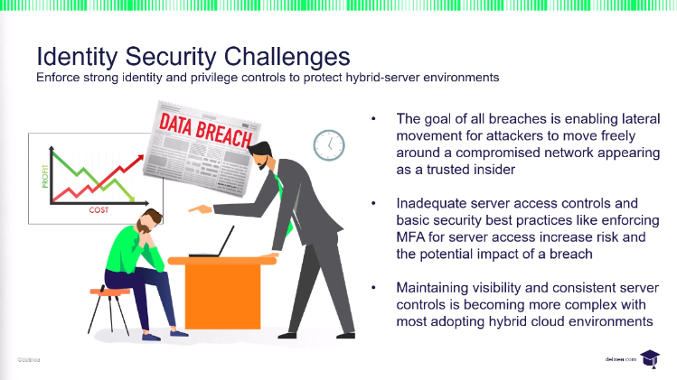
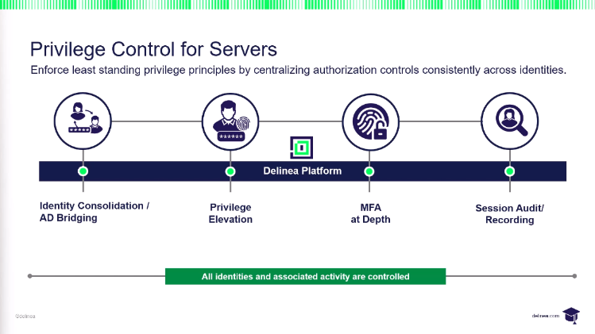
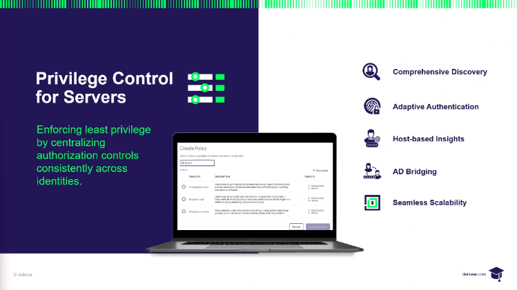
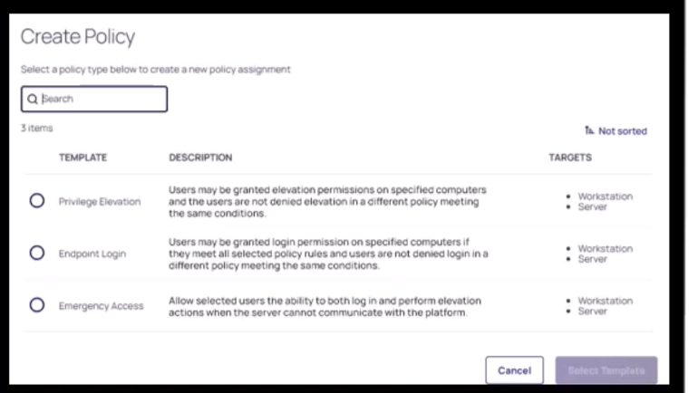
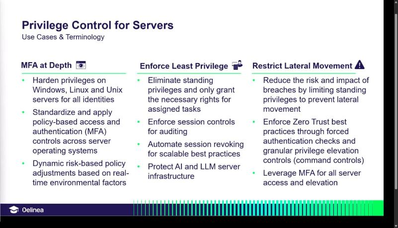
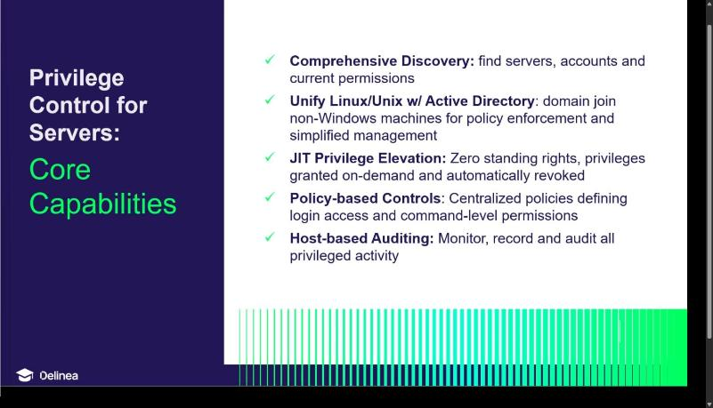
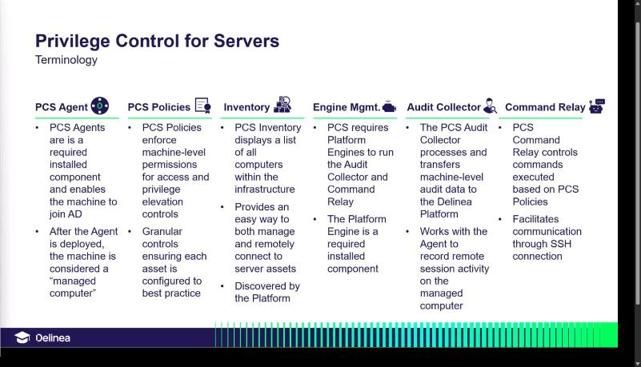
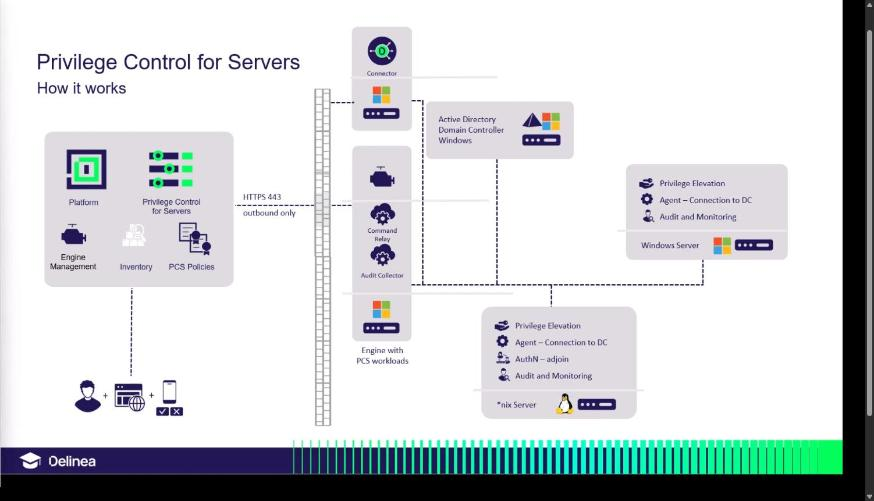
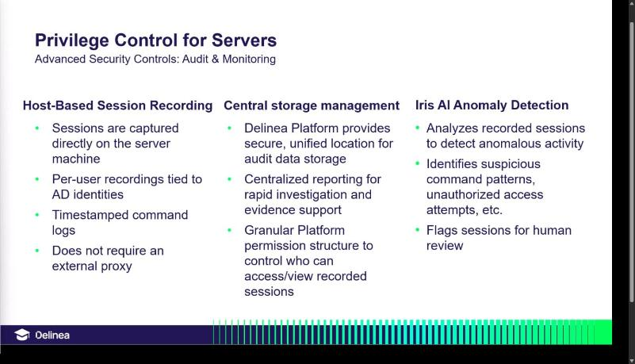

# 1.3 Delinea Platform Guard: Privilege Control for Servers (PCS)

> **Bab 1. Delinea Platform Guard : Control** · Course e-learning, 3 lesson (2 video + 1 quiz)

## Daftar Lesson
| # | Lesson | Durasi | Inti |
|---|---|---|---|
| 1 | [Privilege Control for Servers: Overview](#lesson-1) | 4:57 | Kenapa standing privilege berbahaya; 4 pilar PCS; policy template (Privilege Elevation, Endpoint Login, Emergency Access) |
| 2 | [Privilege Control for Servers: Concepts, Terminologies, and Use Cases](#lesson-2) | 7:46 | 3 use case (MFA at depth, least privilege, lateral movement); 5 core capabilities; 6 istilah kunci; arsitektur; audit & Iris AI |
| 3 | Quiz | – | ⏳ |

## Ringkasan Satu Kalimat
> **PCS adalah penegak aturan di dalam server itu sendiri.** Kalau Secret Server/PRA mengatur *jalan menuju* server, PCS mengatur *siapa boleh login dan siapa boleh jadi admin* **di mesinnya**, bahkan kalau orang itu datang tanpa lewat platform.

---

<a id="lesson-1"></a>

## Lesson 1 — Privilege Control for Servers: Overview

> **Sumber:** Delinea University → *Delinea Platform Guard: Control* → *Privilege Control for Servers (PCS)* → Lesson 1
> **Tipe:** Video, 4:57 (tanpa subtitle; catatan disusun dari slide + deskripsi lesson)

### Learning Objectives
1. Memahami bagaimana credential yang salah kelola dan **standing privilege berlebih** memungkinkan attacker bergerak lateral dan menaikkan akses.
2. Menjelaskan bagaimana PCS **mengonsolidasikan identitas** sehingga admin IT memakai **satu identitas utama** di berbagai OS server.
3. Menjelaskan bagaimana PCS menegakkan **zero trust** lewat **just-in-time access** dan **penghapusan standing privilege**.

### Identity Security Challenges


*"Enforce strong identity and privilege controls to protect hybrid-server environments"*

- Tujuan setiap breach adalah **lateral movement**: bergerak bebas di jaringan yang sudah ditembus sambil **terlihat seperti orang dalam yang sah**
- Kontrol akses server yang lemah dan tidak diterapkannya best practice dasar (mis. **MFA untuk akses server**) menaikkan risiko & dampak breach
- Menjaga visibilitas dan kontrol server yang konsisten makin sulit karena mayoritas organisasi sudah **hybrid cloud**

### 4 Pilar PCS


*"Enforce least standing privilege principles by centralizing authorization controls consistently across identities."*

| Pilar | Artinya |
|---|---|
| **Identity Consolidation / AD Bridging** | Server Linux/Unix & Windows memakai **satu identitas AD** — tidak perlu akun lokal terpisah di tiap server |
| **Privilege Elevation** | User login sebagai user biasa; hak admin/root diberikan **per perintah/per waktu** sesuai policy (pengganti `sudoers` & local admin permanen) |
| **MFA at Depth** | MFA bukan cuma di pintu depan (vault), tapi juga **saat login ke server dan saat elevasi privilege** |
| **Session Audit / Recording** | Aktivitas di server tercatat dan terekam |

Semuanya terhubung ke **Delinea Platform** → *"All identities and associated activity are controlled."*

> **Analogi:** Secret Server = resepsionis gedung yang memegang kunci. PCS = **kunci pintu di setiap ruangan** yang mengecek ID-mu sendiri, plus satpam di dalam ruangan yang harus mengizinkan setiap kali kamu mau membuka lemari arsip.

### Kapabilitas PCS


- **Comprehensive Discovery** — menemukan server, akun, dan privilege yang ada
- **Adaptive Authentication** — MFA/autentikasi yang menyesuaikan konteks risiko
- **Host-based Insights** — visibilitas dari agent di host
- **AD Bridging** — identitas AD untuk Linux/Unix
- **Seamless Scalability** — skala ke banyak server hybrid

### Policy Templates (dari screenshot UI "Create Policy")


| Template | Fungsi | Target |
|---|---|---|
| **Privilege Elevation** | User bisa diberi izin elevasi di komputer tertentu, **asal tidak di-deny** di policy lain dengan kondisi sama | Workstation, Server |
| **Endpoint Login** | User bisa diberi izin login di komputer tertentu jika memenuhi semua rule policy **dan tidak di-deny** di policy lain | Workstation, Server |
| **Emergency Access** | Mengizinkan user tertentu login **dan** elevasi **saat server tidak bisa berkomunikasi dengan platform** | Workstation, Server |

**Dua hal penting dari deskripsi template:**
1. **Deny menang atas allow.** Izin hanya berlaku kalau tidak ada policy lain yang men-deny pada kondisi yang sama.
2. **Ada mode darurat (offline).** Emergency Access = break-glass ketika agent di server kehilangan koneksi ke platform.

### Posisi PCS di Gambar Besar (Bab 1)
| Sub-bab | Mengontrol | Celah kalau berdiri sendiri |
|---|---|---|
| 1.1 Secret Server / PRA | Jalan masuk lewat platform: credential, approval, recording | User yang punya credential lain bisa konek langsung (bypass) |
| 1.2 Collections | Apa yang terlihat & bisa di-launch dari platform | Tidak mengontrol akses di level mesin |
| **1.3 PCS** | **Login & elevasi di mesin itu sendiri** | Butuh agent di setiap server |

→ PCS menutup celah "collections ≠ machine-level access" dari sub-bab 1.2.

### Catatan Senior Engineer (di luar materi video)
- **Latar belakang:** Delinea lahir dari merger **Thycotic** (Secret Server) dan **Centrify** (server PAM / AD bridging). PCS adalah warisan kemampuan Centrify — itu sebabnya konsep AD bridging sangat sentral.
- **AD bridging = AD jadi crown jewel untuk Linux juga.** Kalau domain admin jebol, server Linux yang di-bridge ikut terdampak. Hardening AD (tiering, proteksi Domain Admin) jadi prasyarat, bukan pilihan.
- **Hapus akun lokal, atau PCS tidak ada artinya.** Selama `root` lokal / local Administrator dengan password lama masih aktif, attacker cukup memakai itu. Rotasi/vault akun lokal (Secret Server) + PCS = kombinasi yang benar.
- **Deny-wins itu bagus, tapi butuh desain.** Satu deny policy yang terlalu luas bisa mengunci admin dari ratusan server. Uji policy di grup kecil dulu.
- **Emergency Access = celah yang disengaja.** Wajib: daftar user sangat terbatas, audit setiap pemakaian, dan review sesudahnya. Pertimbangkan juga skenario attacker sengaja memutus koneksi server ke platform untuk memicu mode darurat.
- **Agent-based = beban operasional.** Deploy ke ratusan server, kompatibilitas OS/kernel, patching agent. Agent juga attack surface.
- **Use case SOC/SIEM:**
  - Elevasi privilege di luar change window / jam kerja
  - MFA gagal berulang saat elevasi
  - **Pemakaian Emergency Access** (selalu alert)
  - **Service agent PCS berhenti/di-uninstall** di server → kemungkinan upaya mematikan kontrol
  - Login dengan akun lokal ke server yang seharusnya hanya menerima identitas AD

### Cek Pemahaman
1. Apa beda kontrol yang diberikan **Collections (1.2)** dan **PCS (1.3)**?
2. Jelaskan **AD bridging** dan satu risiko yang ia bawa.
3. Apa arti "MFA at depth"? Kenapa MFA di vault saja tidak cukup?
4. Di template policy, apa yang terjadi kalau satu policy meng-allow elevasi dan policy lain men-deny untuk kondisi yang sama?
5. Kapan Emergency Access dipakai, dan kontrol apa yang wajib menyertainya?

[⬆ Kembali ke daftar lesson](#daftar-lesson)

---

<a id="lesson-2"></a>

## Lesson 2 — Privilege Control for Servers: Concepts, Terminologies, and Use Cases

> **Sumber:** Delinea University → *Delinea Platform Guard: Control* → *Privilege Control for Servers (PCS)* → Lesson 2
> **Tipe:** Video, 7:46 (tanpa subtitle; catatan disusun dari slide + deskripsi lesson)

### Learning Objectives
1. Menjelaskan risiko **standing server privilege yang terlalu luas** dan bagaimana **satu credential curian** bisa dipakai untuk lateral movement ke seluruh organisasi.
2. Menjelaskan kenapa **menghapus standing admin rights** adalah kebutuhan kritikal, termasuk untuk **server yang menjalankan workload AI/LLM**.
3. Mengenali kapabilitas utama PCS: **platform discovery, AD bridging, on-demand privilege elevation, policy-based controls, session recording + host-based auditing**.

### Use Cases


| **MFA at Depth** | **Enforce Least Privilege** | **Restrict Lateral Movement** |
|---|---|---|
| Hardening privilege di server Windows, Linux, Unix untuk semua identitas | Hapus standing privilege; beri hak yang diperlukan untuk tugas tertentu saja | Kurangi risiko & dampak breach dengan membatasi standing privilege |
| Standarisasi kontrol akses & autentikasi (MFA) berbasis policy di semua OS server | Terapkan session control untuk audit | Zero Trust lewat **forced authentication check** dan **kontrol elevasi granular (command controls)** |
| Penyesuaian policy berbasis risiko secara dinamis sesuai faktor lingkungan real-time | **Otomatis mencabut sesi** untuk best practice yang skalabel | **MFA untuk semua akses server dan elevasi** |
| | **Lindungi infrastruktur server AI & LLM** | |

### Core Capabilities


| Kapabilitas | Penjelasan |
|---|---|
| **Comprehensive Discovery** | Menemukan server, akun, dan permission yang ada saat ini |
| **Unify Linux/Unix w/ Active Directory** | *Domain join* mesin non-Windows untuk penegakan policy & manajemen yang lebih sederhana |
| **JIT Privilege Elevation** | **Zero standing rights** — privilege diberikan *on-demand* dan **dicabut otomatis** |
| **Policy-based Controls** | Policy terpusat yang mengatur **akses login** dan **permission di level perintah** |
| **Host-based Auditing** | Memantau, merekam, dan mengaudit semua aktivitas privileged |

### Terminologi (wajib hafal untuk quiz)


| Istilah | Definisi |
|---|---|
| **PCS Agent** | Komponen **wajib** yang diinstal di mesin; memungkinkan mesin **join ke AD**. Setelah agent terpasang, mesin disebut **"managed computer"** |
| **PCS Policies** | Menegakkan permission di level mesin untuk **akses** dan **kontrol elevasi privilege**; memastikan tiap aset dikonfigurasi sesuai best practice |
| **Inventory** | Daftar semua komputer di infrastruktur; cara mudah mengelola & remote ke aset server; **ditemukan oleh Platform (discovery)** |
| **Engine Mgmt.** | PCS butuh **Platform Engine** untuk menjalankan Audit Collector dan Command Relay; Platform Engine = komponen **wajib** yang diinstal |
| **Audit Collector** | Memproses dan mengirim **data audit level mesin** ke Delinea Platform; bekerja dengan Agent untuk **merekam aktivitas sesi remote** di managed computer |
| **Command Relay** | Mengontrol **perintah yang dieksekusi** berdasarkan PCS Policies; memfasilitasi komunikasi lewat **koneksi SSH** |

### Cara Kerja (Arsitektur)


```
        [ Delinea Platform (cloud) ]
        Platform · PCS · Engine Mgmt · Inventory · PCS Policies
                      ▲
                      │ HTTPS 443 — OUTBOUND ONLY
   ───────── firewall ┼────────────────────────────────────
                      │
   [ Connector ]   [ Engine with PCS workloads ]      [ AD Domain Controller ]
                   (Command Relay + Audit Collector)            │
                      │                                         │
          ┌───────────┴───────────────┬─────────────────────────┘
   [ Windows Server ]            [ *nix Server ]
   - Privilege Elevation         - Privilege Elevation
   - Agent → koneksi ke DC       - Agent → koneksi ke DC
   - Audit & Monitoring          - AuthN — adjoin
                                 - Audit & Monitoring

   User → browser + MFA (ponsel) → Platform
```

Poin penting:
- Komponen on-prem (Connector & Engine) **hanya membuka koneksi keluar HTTPS 443** ke platform — **tidak perlu port inbound** dari internet.
- Agent di Windows & *nix **terhubung ke Domain Controller**; server *nix melakukan **adjoin** (join ke AD).
- **Engine** menjalankan dua workload PCS: **Command Relay** dan **Audit Collector**.

### Advanced Security Controls: Audit & Monitoring


| **Host-Based Session Recording** | **Central Storage Management** | **Iris AI Anomaly Detection** |
|---|---|---|
| Sesi direkam **langsung di server** | Delinea Platform = lokasi terpusat & aman untuk data audit | Menganalisis rekaman sesi untuk mendeteksi aktivitas anomali |
| Rekaman per user, **terikat ke identitas AD** | Reporting terpusat untuk investigasi cepat & bukti | Mengidentifikasi pola perintah mencurigakan, percobaan akses tidak sah, dll. |
| **Command log ber-timestamp** | Struktur permission granular untuk mengatur siapa yang boleh melihat rekaman | **Menandai sesi** untuk direview manusia |
| **Tidak butuh external proxy** | | |

### Proxy-based (1.1) vs Host-based (1.3) Recording
| | **Proxy-based** (Secret Server / PRA, sub-bab 1.1) | **Host-based** (PCS, sub-bab 1.3) |
|---|---|---|
| Lokasi perekaman | Di proxy/launcher | **Di server itu sendiri** (agent) |
| Merekam sesi yang **bypass platform**? | ❌ Tidak | ✅ Ya — semua login ke server |
| Identitas | Akun dari Secret | **Identitas AD** user sebenarnya |
| Kelemahan | Buta terhadap akses langsung | Bisa diganggu oleh root lokal (agent dimatikan) |

→ Keduanya **saling melengkapi**. Host-based recording menutup celah "rekaman PAM bersih ≠ bukti tidak ada perubahan" dari sub-bab 1.1.

### Catatan Senior Engineer (di luar materi video)
- **Satu credential curian → seluruh organisasi.** Inilah alasan inti PCS: kalau akun `svc_backup` punya admin di 500 server, satu credential = 500 server. JIT elevation membuat credential curian **tidak punya hak admin** saat dicuri.
- **"Outbound 443 only" bagus untuk firewall, tapi Engine jadi pivot point.** Engine punya jalur ke semua server *dan* ke cloud. Segmentasi & hardening engine wajib; perlakukan seperti tier-0.
- **Data audit & rekaman disimpan di platform cloud.** Untuk bank di Indonesia, cek dulu ketentuan OJK soal penempatan sistem elektronik/data di luar negeri sebelum memilih SaaS vs on-prem — ini sering jadi blocker legal, bukan teknis.
- **AD jadi dependency login server.** DC down atau agent kehilangan koneksi ke DC → login bisa terganggu. Ini sebabnya template **Emergency Access** (lesson 1) ada. Uji skenario DC outage sebelum produksi.
- **Server AI/LLM** sering diberi akses root/sudo longgar ke data scientist "biar cepat". Padahal server ini memegang model & data sensitif — kandidat utama JIT elevation.
- **Iris AI = asisten, bukan pengganti deteksi.** Anggap sebagai prioritisasi review; tetap kirim event ke SIEM agar bisa dikorelasikan dengan sumber lain.
- **Use case SOC/SIEM tambahan:**
  - Elevasi via JIT yang tidak dicabut otomatis (durasi abnormal)
  - Perintah yang diblok Command Relay (indikasi percobaan di luar policy)
  - Server di Inventory yang **tidak** berstatus "managed computer" (tanpa agent) → coverage gap
  - Login ke server *nix memakai akun lokal padahal sudah di-adjoin ke AD

### Cek Pemahaman
1. Sebutkan 3 use case utama PCS.
2. Sebutkan 5 core capabilities PCS.
3. Apa itu **"managed computer"**?
4. Komponen apa yang menjalankan **Audit Collector** dan **Command Relay**?
5. Port/arah koneksi apa yang dibutuhkan antara komponen on-prem dan Delinea Platform?
6. Apa keunggulan **host-based recording** dibanding proxy-based recording dari sub-bab 1.1?
7. Kenapa server AI/LLM disebut secara khusus sebagai target perlindungan PCS?

[⬆ Kembali ke daftar lesson](#daftar-lesson)
