# 2.1 Delinea Platform Guard: Auditing, Analytics, and Alerting

> **Bab 2. Delinea Platform Guard : Posture** · Course e-learning, 4 lesson (3 video + 1 quiz)

## Daftar Lesson
| # | Lesson | Durasi | Inti |
|---|---|---|---|
| 1 | [Delinea Platform: Auditing, Analytics, and Alerting](#lesson-1) | 6:16 | Baseline perilaku per user; User Risk Score; Platform Alerting; Analytics Cases (Brute Force, MFA Bombing, Suspicious Behavior) |
| 2 | [Secret Server Auditing and Reporting: Overview](#lesson-2) | 5:45 | Audit otomatis (who/when/what); 50+ built-in report; custom report SQL; Dual Controls; Security Hardening & User Audit Report |
| 3 | [Delinea Platform: Event Subscriptions & Pipelines](#lesson-3) | 5:37 | Subscriptions = alert saja; Pipelines = trigger + filter + task (aksi otomatis); skenario UVAM & offboarding |
| 4 | Quiz | – | ⏳ |

## Ringkasan Satu Kalimat
> Empat pilar — **auditing, reporting, analytics, alerting** — dipakai untuk **mencegah, mendeteksi, dan menghentikan breach berbasis identitas** dengan menangkap tanda-tanda awal ancaman secara real time.

---

<a id="lesson-1"></a>

## Lesson 1 — Delinea Platform: Auditing, Analytics, and Alerting

> **Sumber:** Delinea University → *Delinea Platform Guard: Posture* → *Auditing, Analytics, and Alerting* → Lesson 1
> **Tipe:** Video, 6:16 (tanpa subtitle; catatan disusun dari slide + deskripsi lesson)

### Learning Objectives
1. Menjelaskan bagaimana **Platform Analytics** membangun **baseline perilaku** dan memakainya untuk mendeteksi aktivitas mencurigakan & breach autentikasi.
2. Memahami **risk analysis**: bagaimana dihitung dan dipakai untuk menegakkan **adaptive security policy**.
3. Mengenali **Analytics Cases**, bagaimana mereka mengurangi **alert fatigue**, dan contoh tipe case seperti **Brute Force** dan **MFA Bombing**.

### Core Use Cases
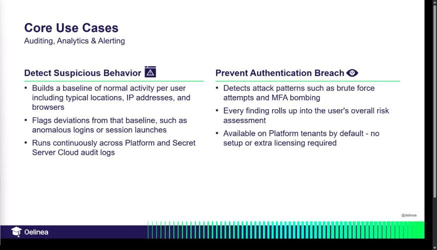

| **Detect Suspicious Behavior** | **Prevent Authentication Breach** |
|---|---|
| Membangun **baseline aktivitas normal per user**: lokasi, IP address, browser yang biasa dipakai | Mendeteksi pola serangan seperti **brute force** dan **MFA bombing** |
| Menandai **deviasi** dari baseline, mis. login atau session launch yang anomali | Setiap temuan **digulung ke risk assessment** user secara keseluruhan |
| Berjalan terus-menerus di audit log **Platform** dan **Secret Server Cloud** | **Tersedia default** di Platform tenant — tanpa setup atau lisensi tambahan |

> **Analogi:** Seperti bank yang hafal kebiasaan kartu kreditmu. Kamu biasa belanja di Jakarta pakai HP yang sama — tiba-tiba ada transaksi dari negara lain pakai perangkat baru jam 3 pagi → ditandai.

### Key Capabilities
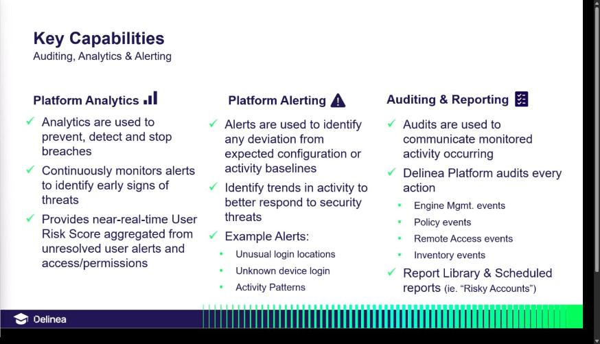

| **Platform Analytics** | **Platform Alerting** | **Auditing & Reporting** |
|---|---|---|
| Analytics dipakai untuk **mencegah, mendeteksi, dan menghentikan** breach | Alert mengidentifikasi **deviasi dari konfigurasi yang diharapkan atau baseline aktivitas** | Audit mengomunikasikan aktivitas yang dipantau |
| Memantau alert terus-menerus untuk menangkap tanda awal ancaman | Mengenali **tren aktivitas** untuk respons yang lebih baik | Delinea Platform **mengaudit setiap aksi**: Engine Mgmt., Policy, Remote Access, Inventory events |
| **User Risk Score near-real-time**, diagregasi dari **alert user yang belum di-resolve** + **akses/permission** yang dimiliki | Contoh alert: **unusual login location**, **unknown device login**, **activity patterns** | **Report Library** & **Scheduled Reports** (mis. "Risky Accounts") |

### Hierarki: Event → Alert → Case → Risk Score
```
Audit event (setiap aksi tercatat)
   └─► Alert (deviasi dari baseline/konfigurasi)
          └─► Analytics Case (alert terkait diagregasi & dikorelasikan)
                 └─► User Risk Score (alert belum di-resolve + akses yang dimiliki)
                        └─► Adaptive policy (mis. minta MFA tambahan / tolak akses)
```

### Analytics Cases
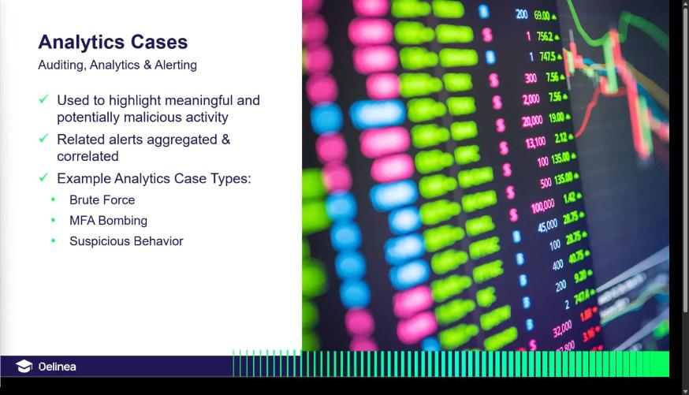

- Menyorot aktivitas yang **bermakna dan berpotensi berbahaya**
- Alert yang terkait **diagregasi & dikorelasikan** jadi satu case → mengurangi **alert fatigue**
- Contoh tipe case:
  - **Brute Force**
  - **MFA Bombing**
  - **Suspicious Behavior**

| Tipe Case | Pola | MITRE ATT&CK |
|---|---|---|
| Brute Force | Banyak percobaan password gagal | T1110 — Brute Force |
| MFA Bombing | Push MFA dikirim berulang sampai user menyetujui karena lelah/terganggu | T1621 — Multi-Factor Authentication Request Generation |
| Suspicious Behavior | Deviasi dari baseline (lokasi, IP, device, pola aktivitas) | Bergantung konteks (mis. T1078 — Valid Accounts) |

### Catatan Senior Engineer (di luar materi video)
- **Ini UEBA versi Delinea.** Konsepnya sama dengan UEBA di SIEM: baseline per user → deviasi → skor risiko. Bedanya, datanya **khusus aktivitas identitas & akses privileged** di Delinea — konteks yang sering tidak dimiliki SIEM.
- **Masalah klasik baseline:**
  - **Cold start** — user/vendor baru belum punya baseline → banyak false positive di minggu-minggu awal.
  - **Egress IP terpusat** — kalau semua karyawan keluar lewat proxy/VPN yang sama, sinyal "lokasi & IP" jadi lemah.
  - **Perjalanan dinas** & ganti perangkat memicu alert yang sah.
- **MFA bombing itu nyata**, contoh terkenal: breach Uber 2022 memakai teknik MFA fatigue. Mitigasi terbaik ada di sisi MFA: **number matching**, rate limit push, dan edukasi user untuk melapor push yang tidak diminta.
- **Brute force ≠ password spraying.** Spraying (1 password ke banyak akun, pelan-pelan) sering lolos dari deteksi brute force per-user. Pastikan cara Delinea mendeteksi spraying sebelum mengandalkannya.
- **Risk score dihitung dari alert yang BELUM di-resolve.** Kalau tim tidak disiplin triage/resolve, skor semua user menggelembung dan kehilangan makna. Kebersihan proses triage = kualitas risk score.
- **"Secret Server Cloud" disebut eksplisit.** Kalau organisasi memakai **Secret Server on-prem** (umum di bank), cek apakah audit log-nya ikut dianalisis Platform Analytics atau tidak.
- **Untuk SOC:** Analytics Cases sebaiknya **diteruskan ke SIEM** (ArcSight) agar bisa dikorelasikan dengan log lain (firewall, EDR, AD). Delinea melihat identitas; SIEM melihat seluruh lingkungan. → kemungkinan dibahas di Lesson 3 (Event Subscriptions & Pipelines).

### Cek Pemahaman
1. Data apa saja yang dipakai untuk membangun baseline perilaku user?
2. User Risk Score diagregasi dari apa saja?
3. Apa beda **alert** dan **analytics case**? Bagaimana case mengurangi alert fatigue?
4. Sebutkan 3 tipe analytics case dan pola serangannya.
5. Kenapa risk score bisa menjadi tidak akurat kalau tim SOC jarang me-resolve alert?
6. Sebutkan 4 kategori event yang diaudit Delinea Platform.

[⬆ Kembali ke daftar lesson](#daftar-lesson)

---

<a id="lesson-2"></a>

## Lesson 2 — Secret Server Auditing and Reporting: Overview

> **Sumber:** Delinea University → *Delinea Platform Guard: Posture* → *Auditing, Analytics, and Alerting* → Lesson 2
> **Tipe:** Video, 5:45 (tanpa subtitle; catatan disusun dari slide + deskripsi lesson)

### Learning Objectives
1. Use case utama reporting Secret Server: **compliance, kebutuhan audit, cyber insurance, security review, dan analisis forensik**.
2. Definisi auditing Secret Server dan apa yang **otomatis dicatat**: **secrets, users, templates, policies, dan perubahan konfigurasi**.
3. Kemampuan **built-in reporting** Secret Server.

### Use Cases
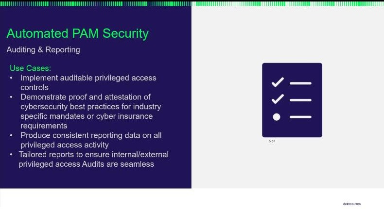

- Menerapkan kontrol akses privileged yang **bisa diaudit**
- Menunjukkan **bukti & atestasi** best practice keamanan untuk **regulasi industri** atau **syarat cyber insurance**
- Menghasilkan data reporting yang **konsisten** untuk semua aktivitas akses privileged
- Report yang disesuaikan agar audit akses privileged **internal & eksternal** berjalan mulus

### Access Activity — Built-In Auditing
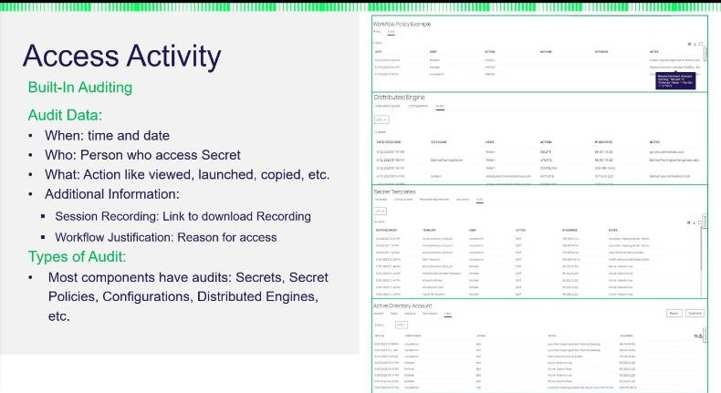

| Audit Data | Isi |
|---|---|
| **When** | Waktu & tanggal |
| **Who** | Orang yang mengakses Secret |
| **What** | Aksi: *viewed, launched, copied*, dll. |
| **Additional Info** | **Session Recording** → link untuk mengunduh rekaman · **Workflow Justification** → alasan akses |

**Types of Audit:** hampir semua komponen punya audit — **Secrets, Secret Policies, Configurations, Distributed Engines**, dll. (screenshot di slide: audit Workflow Policy, Distributed Engine, Secret Templates, Active Directory Account).

> Audit logging **otomatis** — tidak perlu dinyalakan — dan memberi **catatan historis lengkap** atas setiap aksi pada setiap item di vault.

### Reporting & Dual Controls
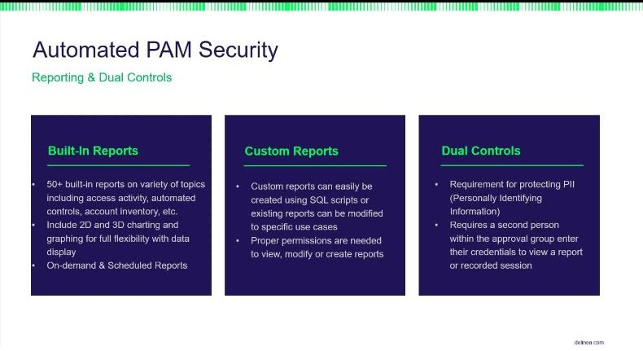

| **Built-In Reports** | **Custom Reports** | **Dual Controls** |
|---|---|---|
| **50+ report bawaan**: access activity, automated controls, account inventory, dll. | Dibuat dengan **SQL script** atau memodifikasi report yang ada | Kebutuhan untuk **melindungi PII** (data pribadi) |
| Grafik **2D & 3D** | Butuh **permission khusus** untuk melihat, mengubah, atau membuat report | Butuh **orang kedua** di approval group memasukkan credential-nya untuk **melihat report atau rekaman sesi** |
| **On-demand & Scheduled** | | |

> **Dual Controls** = prinsip *four-eyes* untuk **melihat data**, bukan hanya untuk memberi akses. Seperti brankas bank yang butuh dua kunci dipegang dua orang berbeda.

### Core PAM Use Cases: Reports to Know
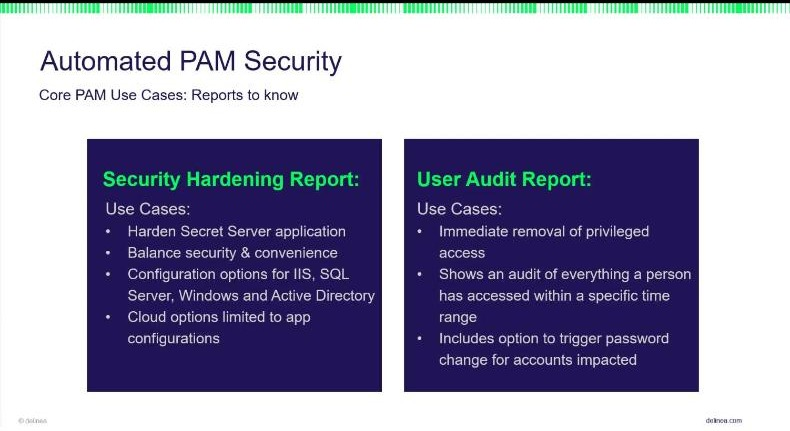

| **Security Hardening Report** | **User Audit Report** |
|---|---|
| Hardening aplikasi Secret Server | **Pencabutan akses privileged segera** |
| Menyeimbangkan keamanan & kenyamanan | Menampilkan **semua yang diakses seseorang** dalam rentang waktu tertentu |
| Opsi konfigurasi untuk **IIS, SQL Server, Windows, dan Active Directory** | Ada opsi untuk **memicu penggantian password** akun-akun yang terdampak |
| Versi cloud: terbatas pada konfigurasi aplikasi | |

### Catatan Senior Engineer (di luar materi video)
- **User Audit Report = senjata incident response & offboarding.** Skenario nyata di bank:
  - **Admin resign / dipecat** → tarik semua secret yang pernah ia lihat 90 hari terakhir → **rotasi semuanya** dengan satu klik.
  - **Akun admin terindikasi compromise** → tentukan blast radius (secret apa saja yang diakses sejak waktu indikasi) → rotasi.
  Ini jauh lebih cepat daripada menebak-nebak.
- **Dual Controls ⇄ rekaman = data sensitif** (ingat sub-bab 1.1 Lesson 5). Rekaman layar bisa berisi data nasabah; Dual Controls adalah kontrol teknis yang mendukung kepatuhan **UU PDP**.
- **Custom report via SQL = kekuatan sekaligus risiko.** Siapa pun yang bisa membuat report bisa membaca metadata vault (siapa punya akses ke apa). Batasi permission pembuat report seketat admin.
- **Audit tersimpan di database Secret Server.** DBA dengan akses ke database secara teori bisa mengubah tabel audit. Untuk integritas bukti, **teruskan audit ke SIEM** (sistem terpisah, akses terpisah) → kemungkinan dibahas di Lesson 3.
- **Security Hardening Report wajib dijalankan saat go-live & berkala** untuk Secret Server on-prem — PAM yang tidak di-hardening adalah crown jewel yang terbuka.
- **Cyber insurance** disebut eksplisit: makin banyak polis asuransi siber yang **mensyaratkan PAM & MFA** untuk akses privileged; report ini dipakai sebagai bukti.

### Cek Pemahaman
1. Sebutkan 4 elemen data yang dicatat audit Secret Server untuk akses ke Secret.
2. Apa yang diaudit secara otomatis selain Secret?
3. Berapa jumlah built-in report, dan bagaimana cara membuat custom report?
4. Apa itu **Dual Controls** dan data apa yang dilindunginya?
5. Seorang admin baru saja resign. Report apa yang Anda jalankan dan tindakan apa yang bisa langsung dipicu dari report itu?
6. Kenapa audit log sebaiknya juga dikirim ke SIEM, bukan hanya disimpan di database Secret Server?

[⬆ Kembali ke daftar lesson](#daftar-lesson)

---

<a id="lesson-3"></a>

## Lesson 3 — Delinea Platform: Event Subscriptions & Pipelines

> **Sumber:** Delinea University → *Delinea Platform Guard: Posture* → *Auditing, Analytics, and Alerting* → Lesson 3
> **Tipe:** Video, 5:37 (tanpa subtitle; catatan disusun dari slide + deskripsi lesson)
> ⚠️ Slide penutup berjudul **"Sales Enablement"**.

### Learning Objectives
1. Mendefinisikan **event subscriptions** sebagai mekanisme **notifikasi real-time** di Delinea Platform.
2. Mendefinisikan **event pipelines** dan 3 blok pembangunnya: **trigger, filter, task**.
3. Mengenali use case nyata: **security monitoring, compliance tracking, automated remediation**.

### Overview
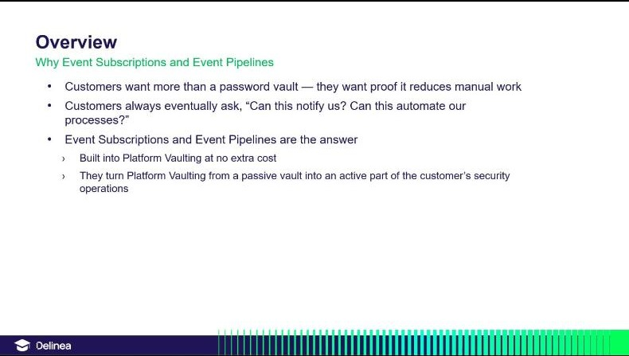

- Customer ingin lebih dari sekadar password vault — mereka ingin bukti bahwa ia **mengurangi kerja manual**
- Pertanyaan yang pasti muncul: *"Bisa kasih notifikasi? Bisa otomatisasi proses kami?"*
- Jawabannya: **Event Subscriptions** dan **Event Pipelines** — built-in di Platform Vaulting **tanpa biaya tambahan**, mengubah vault yang **pasif** jadi bagian **aktif** dari security operations

### Event Subscriptions
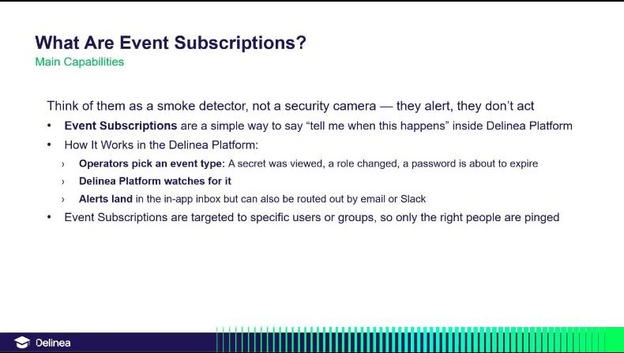

> *"Seperti **detektor asap**, bukan kamera keamanan — mereka **memberi tahu**, bukan **bertindak**."*

- Cara sederhana bilang *"kasih tahu saya kalau ini terjadi"*
- Cara kerja:
  1. Operator memilih **event type**: secret dilihat, role berubah, password hampir kedaluwarsa
  2. Delinea Platform **memantau** event itu
  3. Alert masuk ke **in-app inbox**, bisa juga diteruskan via **email atau Slack**
- Ditargetkan ke **user atau grup tertentu** → hanya orang yang tepat yang dapat notifikasi

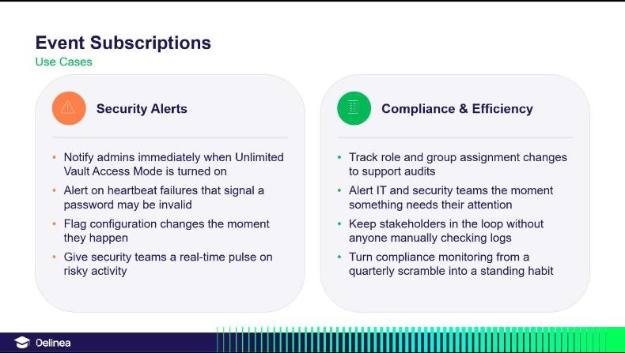

| **Security Alerts** | **Compliance & Efficiency** |
|---|---|
| Beri tahu admin **segera** saat **Unlimited Vault Access Mode** dinyalakan | Lacak perubahan **role & group assignment** untuk audit |
| Alert saat **heartbeat gagal** — tanda password mungkin tidak valid | Beri tahu tim IT & security saat ada yang perlu perhatian |
| Tandai **perubahan konfigurasi** saat itu juga | Stakeholder tetap terinformasi tanpa cek log manual |
| Beri tim security **denyut real-time** atas aktivitas berisiko | Compliance monitoring dari "kepanikan tiap kuartal" jadi **kebiasaan rutin** |

### Event Pipelines
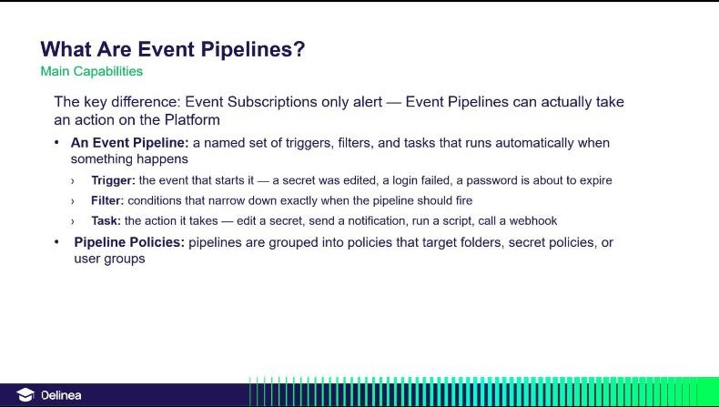

> **Perbedaan kunci:** Event Subscriptions hanya **memberi alert** — Event Pipelines bisa **mengambil tindakan** di Platform.

**Event Pipeline** = kumpulan *trigger, filter, task* yang berjalan **otomatis** saat sesuatu terjadi:

| Blok | Fungsi | Contoh |
|---|---|---|
| **Trigger** | Event yang memulai | Secret diedit, login gagal, password hampir kedaluwarsa |
| **Filter** | Kondisi yang mempersempit kapan pipeline harus jalan | Hanya untuk folder X, hanya user grup Y |
| **Task** | Aksi yang dijalankan | **Edit secret, kirim notifikasi, jalankan script, panggil webhook** |

**Pipeline Policies:** pipeline dikelompokkan ke dalam policy yang menargetkan **folder, secret policy, atau user group**.

> **Analogi:** Subscription = alarm rumah yang bunyi. Pipeline = alarm yang bunyi **+ otomatis mengunci pintu + menelepon satpam**.

### Subscriptions vs Pipelines
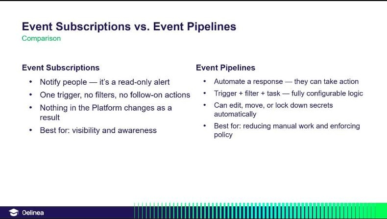

| | **Event Subscriptions** | **Event Pipelines** |
|---|---|---|
| Sifat | **Notify** — alert read-only | **Automate response** — bisa bertindak |
| Logika | **Satu trigger, tanpa filter, tanpa aksi lanjutan** | **Trigger + filter + task** — logika penuh |
| Dampak ke Platform | **Tidak ada yang berubah** | Bisa **edit, move, atau lock down** secret otomatis |
| Terbaik untuk | **Visibilitas & awareness** | **Mengurangi kerja manual & menegakkan policy** |

### Skenario
| Elevated access is never invisible | Offboarding that secures itself |
|---|---|
| 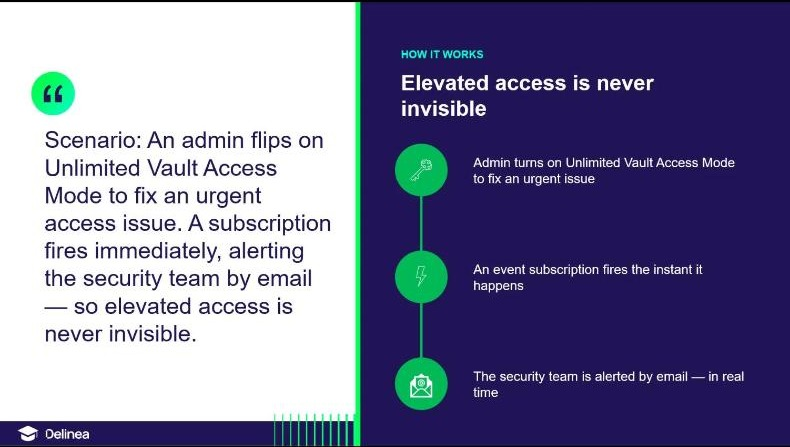 | 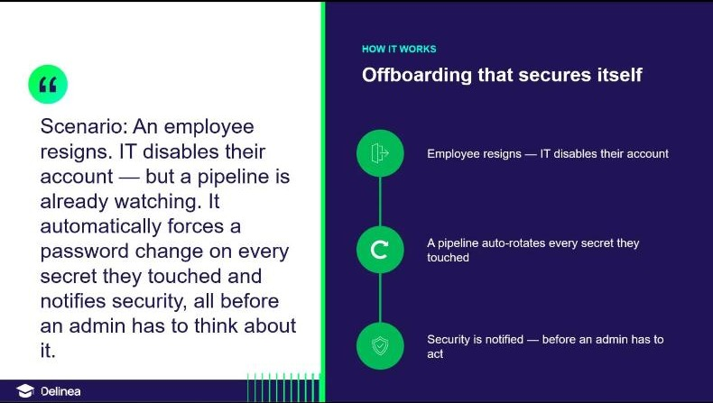 |
| Admin menyalakan **Unlimited Vault Access Mode** untuk memperbaiki masalah akses mendesak → **subscription** langsung menyala → tim security dapat **email real-time** | Karyawan resign → IT men-disable akunnya → **pipeline** otomatis **merotasi semua secret yang pernah ia sentuh** → security diberi tahu, sebelum admin perlu bertindak |
| → **Subscription** (alert saja) | → **Pipeline** (aksi otomatis) |

### Summary (Sales Enablement)
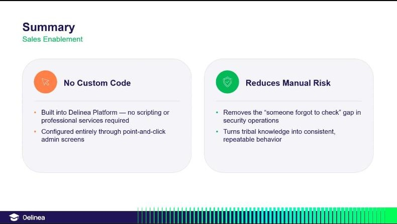
- **No custom code** — built-in, dikonfigurasi lewat layar point-and-click, tanpa scripting atau professional services
- **Reduces manual risk** — menutup celah *"ada yang lupa ngecek"*; mengubah *tribal knowledge* jadi perilaku yang konsisten & berulang

### Catatan Senior Engineer (di luar materi video)
- **Unlimited Vault Access Mode (UVAM)** = mode "break-glass" admin yang bisa melihat **semua** secret. Ini event dengan risiko tertinggi di Secret Server → **wajib** di-alert, dan idealnya juga diteruskan ke SIEM.
- **Heartbeat failure itu sinyal keamanan, bukan cuma masalah operasional.** Heartbeat = Secret Server rutin mengecek apakah password di vault masih cocok dengan di target. Gagal → ada yang **mengganti password di luar vault** (admin bandel, atau attacker yang mengambil alih akun). Investigasi, jangan cuma di-reset.
- **Email/Slack bukan integrasi SIEM.** Untuk SOC, alert perlu masuk ke **SIEM (ArcSight)** agar terkorelasi dan punya jejak case. Task **"call a webhook"** di pipeline bisa jadi jembatan ke SOAR/ticketing; untuk log mentah, gunakan integrasi syslog/SIEM.
- **Pipeline = SOAR mini di dalam vault.** Kekuatan besar = risiko besar:
  - **Trigger yang salah bisa memicu rotasi massal.** Contoh: script AD yang keliru men-disable 200 akun → pipeline offboarding merotasi ratusan secret → service account ikut berubah → **outage**. Selalu pakai **filter** & uji di scope kecil.
  - **Hati-hati loop.** Task "edit secret" bisa memicu event "secret edited" lagi kalau trigger tidak dibatasi.
  - Task **"run a script"** = eksekusi kode dengan konteks privileged → siapa pun yang bisa **mengedit pipeline** adalah admin de facto. Batasi & audit perubahan pipeline.
- **"No custom code" vs "run a script".** Klaim sales vs kenyataan: konfigurasinya point-and-click, tapi task yang paling kuat tetap butuh script/webhook.
- **Skenario offboarding = otomatisasi dari User Audit Report (Lesson 2).** Report memberi visibilitas; pipeline menjalankan tindakannya tanpa menunggu manusia.

### Cek Pemahaman
1. Apa beda utama Event Subscription dan Event Pipeline?
2. Sebutkan 3 blok pembangun Event Pipeline dan contohnya.
3. Ke mana saja notifikasi Event Subscription bisa dikirim?
4. Pipeline Policies bisa menargetkan apa saja?
5. Admin menyalakan Unlimited Vault Access Mode. Fitur mana yang cocok: subscription atau pipeline? Kenapa?
6. Kenapa heartbeat failure perlu diperlakukan sebagai sinyal keamanan?
7. Sebutkan satu risiko operasional dari pipeline yang otomatis merotasi password.

[⬆ Kembali ke daftar lesson](#daftar-lesson)
