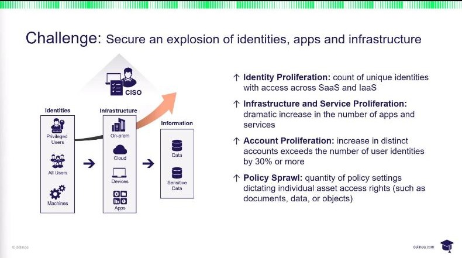
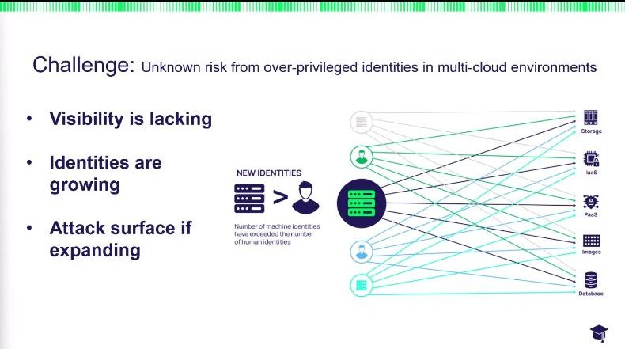
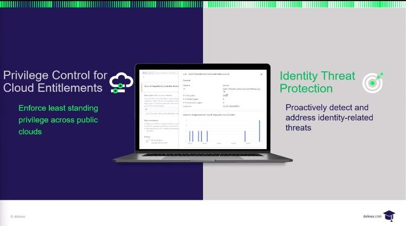

# 2.2 Delinea Platform Guard: Entitlement and Identity Threat Protection (PCCE/ITP)

> **Bab 2. Delinea Platform Guard : Posture** · Course e-learning, 1 lesson (video)

## Daftar Lesson
| # | Lesson | Durasi | Inti |
|---|---|---|---|
| 1 | [Delinea Platform Entitlement and Identity Threat Protection: Overview](#lesson-1) | 4:25 | Identity sprawl; PCCE = CIEM (least privilege di public cloud); ITP = ITDR (deteksi & respons ancaman identitas) |

## Ringkasan Satu Kalimat
> **PCCE** menjawab *"siapa punya hak apa di cloud, dan apakah itu kebanyakan?"* (**CIEM**). **ITP** menjawab *"identitas mana yang sedang diserang atau disalahgunakan?"* (**ITDR**). Bersama, keduanya memberi satu tampilan keamanan identitas lintas multi-cloud, SaaS, dan on-prem.

---

## Lesson 1 — Delinea Platform Entitlement and Identity Threat Protection: Overview

> **Sumber:** Delinea University → *Delinea Platform Guard: Posture* → *Entitlement and Identity Threat Protection (PCCE/ITP)* → Lesson 1
> **Tipe:** Video, 4:25 (tanpa subtitle; catatan disusun dari slide + deskripsi lesson)

### Learning Objectives
1. Menjelaskan tantangan manajemen identitas yang mendorong adopsi ITP & PCCE: **identity sprawl**, level privilege yang tidak konsisten, dan **minim visibilitas** di multi-cloud & SaaS.
2. Mendefinisikan **PCCE (Privileged Control for Cloud Entitlements)** dan kapabilitas utamanya: **CIEM** (Cloud Infrastructure Entitlement Management) untuk menegakkan zero trust di multi-cloud.
3. Mendefinisikan **ITP (Identity Threat Protection)** dan kapabilitas utamanya: **ITDR** (Identity Threat Detection and Response) untuk menemukan, menginvestigasi, dan meremediasi ancaman berbasis identitas.
4. Menjelaskan bagaimana ITP & PCCE bekerja bersama di Delinea Platform untuk pengalaman manajemen keamanan identitas yang **terpadu**.

### Challenge 1 — Ledakan identitas, aplikasi, dan infrastruktur

Alur: **Identities** (privileged users, all users, machines) → **Infrastructure** (on-prem, cloud, devices, apps) → **Information** (data, data sensitif) — dengan **CISO** di atas yang harus mengamankan semuanya.

| Tren ↑ | Artinya |
|---|---|
| **Identity Proliferation** | Jumlah identitas unik yang punya akses di **SaaS & IaaS** meningkat |
| **Infrastructure & Service Proliferation** | Jumlah aplikasi & layanan naik drastis |
| **Account Proliferation** | Jumlah akun **melebihi jumlah identitas user sebesar 30% atau lebih** (satu orang punya banyak akun) |
| **Policy Sprawl** | Makin banyak setting policy yang mengatur hak akses per aset (dokumen, data, objek) |

### Challenge 2 — Risiko tak terlihat dari identitas over-privileged di multi-cloud

- **Visibility is lacking** — tidak jelas siapa bisa mengakses apa
- **Identities are growing** — **jumlah machine identity sudah melebihi human identity**
- **Attack surface is expanding** — diagram: identitas (manusia & mesin) terhubung silang ke Storage, IaaS, PaaS, Images, Database

> **Analogi:** Gedung kantor yang setiap tahun menambah lantai, pintu, dan kartu akses — tapi tidak pernah ada yang mencabut kartu lama. Lama-lama tidak ada yang tahu kartu mana membuka pintu mana.

### Solusi — PCCE + ITP

| | **PCCE** — Privilege Control for Cloud Entitlements | **ITP** — Identity Threat Protection |
|---|---|---|
| Tagline | *Enforce least standing privilege across public clouds* | *Proactively detect and address identity-related threats* |
| Kategori pasar | **CIEM** (Cloud Infrastructure Entitlement Management) | **ITDR** (Identity Threat Detection and Response) |
| Pertanyaan yang dijawab | "Siapa **punya hak** apa di cloud? Apakah **berlebihan**?" | "Identitas mana yang **sedang diserang / disalahgunakan**?" |
| Sifat | **Postur** — preventif (kurangi hak sebelum dipakai attacker) | **Deteksi & respons** — saat/sesudah ada aktivitas mencurigakan |
| Contoh temuan | Role AWS dengan `*:*` yang tidak pernah dipakai; service account dengan izin admin di semua subscription | Akun ditarget credential stuffing; login dari IP yang mencurigakan (screenshot UI: *"Account Targeted by Credential Stuffing"*, # failed logins, aktivitas dari IP 3 bulan terakhir) |

> **Analogi:** PCCE = **auditor** yang memeriksa siapa pegang kunci apa dan mencabut yang tidak perlu. ITP = **satpam** yang memperhatikan siapa yang mencoba membuka pintu dengan cara mencurigakan.

### Posisi di gambar besar
| | Fokus | Sub-bab |
|---|---|---|
| Platform Analytics | Perilaku **user Delinea** (login ke platform/vault) | 2.1 |
| **PCCE** | **Hak akses (entitlement)** di AWS/Azure/GCP | 2.2 |
| **ITP** | **Ancaman identitas** lintas IdP, AD, cloud, SaaS | 2.2 |
| ITP/PCCE Collections | Pengelompokan **identitas & hak** (bukan mesin) — ingat bedanya dengan Platform Collections | 1.2 |

### Catatan Senior Engineer (di luar materi video)
- **CIEM & ITDR = istilah analis (Gartner).** Banyak vendor menjualnya; Delinea mengemasnya sebagai PCCE & ITP. Di exam, hafal pasangannya: **PCCE ↔ CIEM**, **ITP ↔ ITDR**.
- **Machine identity > human identity** — service account, API key, role cloud, token CI/CD, dan sekarang **agen AI**. Inilah yang sering paling over-privileged dan paling jarang direview.
- **Masalah klasik cloud:** izin diberikan "biar jalan dulu" (`AdministratorAccess`, `Owner`) lalu tidak pernah dicabut. CIEM membandingkan **izin yang diberikan vs izin yang benar-benar dipakai** → dasar *right-sizing*.
- **Account Proliferation 30%+**: satu orang punya akun AD, akun admin terpisah, akun cloud, akun SaaS → setiap akun ekstra = satu pintu lagi untuk attacker & satu akun yatim saat offboarding.
- **ITP ≠ SIEM.** ITP fokus ke sinyal identitas (IdP, AD, cloud IAM). Untuk SOC, teruskan temuan ITP ke ArcSight agar bisa dikorelasikan dengan EDR/firewall. Banyak serangan modern **tanpa malware** — hanya pakai credential sah (T1078 Valid Accounts) — dan di situlah ITDR bernilai.
- **Konteks bank:** kalau bank belum banyak pakai public cloud, PCCE nilainya terbatas; ITP lebih relevan untuk AD & IdP (mis. Entra ID/Okta). Cek dulu sumber data apa saja yang didukung connector ITP sebelum berasumsi.
- **Materi ini level overview/marketing** — belum ada cara kerja teknis (connector, sumber data, tipe deteksi). Pendalaman kemungkinan di Bab 3 (Continuous Identity Discovery).

### Cek Pemahaman
1. Sebutkan 4 bentuk "proliferation/sprawl" yang jadi tantangan.
2. Apa kepanjangan PCCE dan kategori pasarnya (CIEM/ITDR)?
3. Apa kepanjangan ITP dan kategori pasarnya?
4. Apa beda pendekatan PCCE (postur) dan ITP (deteksi & respons)?
5. Kenapa machine identity jadi perhatian khusus?
6. Apa beda **ITP/PCCE Collections** dengan **Platform Collections** (sub-bab 1.2)?

[⬆ Kembali ke daftar lesson](#daftar-lesson)
