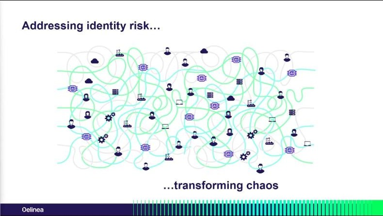
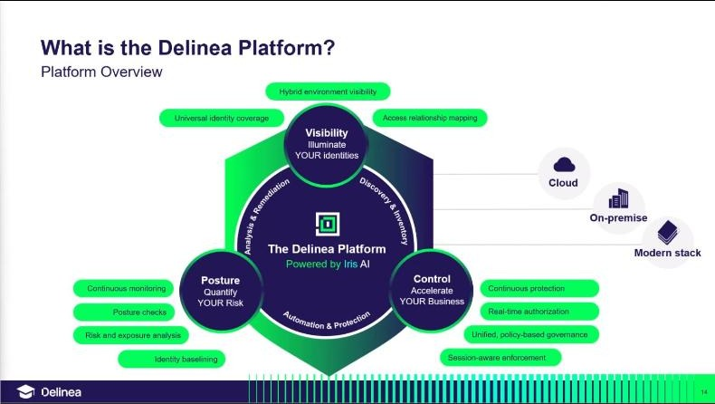
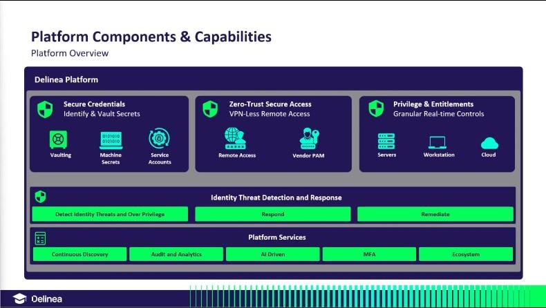
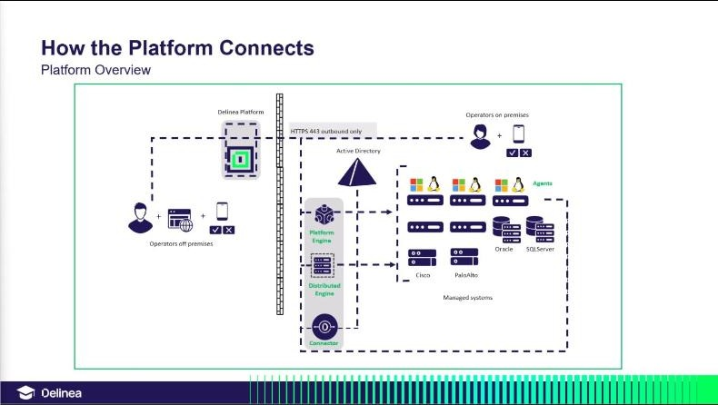
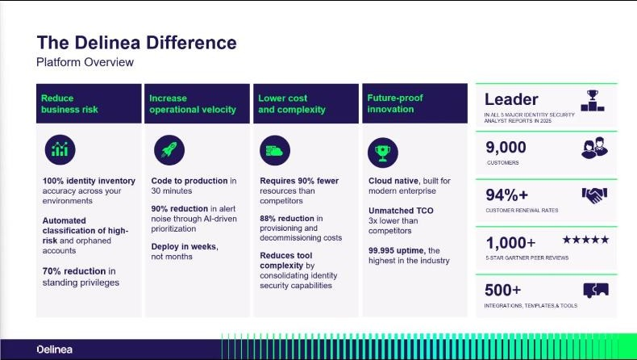

# 3.1 Delinea Platform Guard: Platform Overview

> **Bab 3. Delinea Platform Guard : Visibility** · Course e-learning, 2 lesson (1 video + 1 quiz)

## Daftar Lesson
| # | Lesson | Durasi | Inti |
|---|---|---|---|
| 1 | [Delinea Platform: Overview](#lesson-1) | 5:46 | 3 outcome (Visibility, Control, Posture); komponen platform; arsitektur koneksi; business value |
| 2 | Quiz | – | ⏳ |

## Ringkasan Satu Kalimat
> Delinea Platform adalah platform keamanan identitas **cloud-native** yang mengubah "kekacauan identitas" (terlalu banyak akun, terlalu banyak izin, terlalu sedikit visibilitas) menjadi **kontrol berbasis policy** — lewat tiga outcome: **Visibility, Control, Posture**.

> 💡 **Ini peta seluruh learning plan.** Tiga bab yang kita pelajari = tiga outcome di slide "What is the Delinea Platform?".

---

<a id="lesson-1"></a>

## Lesson 1 — Delinea Platform: Overview

> **Sumber:** Delinea University → *Delinea Platform Guard: Visibility* → *Platform Overview* → Lesson 1
> **Tipe:** Video, 5:46 (tanpa subtitle; catatan disusun dari slide + deskripsi lesson)

### Learning Objectives
1. Menjelaskan **tiga outcome** inti Delinea Platform: **Visibility, Control, Posture**.
2. Mengenali area kapabilitas utama: **discovery & inventory, secure vaulting, zero-trust remote access, least privilege enforcement, identity threat detection & response**.
3. Mengartikulasikan business value: **risiko turun, biaya & kompleksitas turun, kecepatan operasional, inovasi yang future-proof**.

### Addressing Identity Risk… Transforming Chaos


Benang kusut yang menghubungkan manusia, mesin, server, cloud, perangkat, dan **agen AI** — gambaran *identity sprawl*: **terlalu banyak akun, terlalu banyak izin, terlalu sedikit visibilitas & kontrol**. Solusinya: kontrol identitas yang kohesif + pendekatan **policy-driven** untuk least privilege & zero trust.

### What is the Delinea Platform? — 3 Outcome


**The Delinea Platform, powered by Iris AI** — menjangkau **Cloud, On-premise, Modern stack**.

| Outcome | Tagline | Kapabilitas | Bab di repo ini |
|---|---|---|---|
| **Visibility** | *Illuminate YOUR identities* | Universal identity coverage · Hybrid environment visibility · Access relationship mapping | **Bab 3** |
| **Control** | *Accelerate YOUR Business* | Continuous protection · Real-time authorization · Unified, policy-based governance · Session-aware enforcement | **Bab 1** |
| **Posture** | *Quantify YOUR Risk* | Continuous monitoring · Posture checks · Risk & exposure analysis · Identity baselining | **Bab 2** |

Siklus yang menghubungkan ketiganya: **Discovery & Inventory → Automation & Protection → Analysis & Remediation**.

> **Analogi:** Visibility = **peta** (tahu semua identitas & hubungannya). Control = **kunci & pintu** (siapa boleh masuk, kapan). Posture = **laporan kesehatan** (seberapa berisiko kondisi sekarang).

### Platform Components & Capabilities


| Blok | Isi | Sub-bab terkait |
|---|---|---|
| **Secure Credentials** — *Identify & Vault Secrets* | Vaulting · Machine Secrets · Service Accounts | 1.1, 3.3 |
| **Zero-Trust Secure Access** — *VPN-less Remote Access* | Remote Access · Vendor PAM | 1.1 |
| **Privilege & Entitlements** — *Granular Real-time Controls* | Servers · Workstation · Cloud | 1.3, 2.2 |
| **Identity Threat Detection and Response** | Detect identity threats & over-privilege · Respond · Remediate | 2.2 |
| **Platform Services** | Continuous Discovery · Audit & Analytics · AI Driven · MFA · Ecosystem | 2.1, 3.2 |

### How the Platform Connects


```
Operator (luar kantor) ─ browser + MFA ─► Delinea Platform (cloud)
                                              ▲
                                              │ HTTPS 443 OUTBOUND ONLY
──────────────── firewall ────────────────────┼─────────────────
                                              │
   [ Platform Engine ]  [ Distributed Engine ]  [ Connector ] ── Active Directory
            │                    │
            ▼                    ▼
   Managed systems: Windows/Linux (sebagian dengan Agent),
   Oracle, SQL Server, Cisco, Palo Alto

Operator (di kantor) ─ MFA ─► Platform
```

| Komponen on-prem | Peran (dari materi sebelumnya) |
|---|---|
| **Platform Engine** | Menjalankan workload PCS: Audit Collector & Command Relay (1.3) |
| **Distributed Engine** | Engine Secret Server: rotasi password, discovery, proxy di site lain |
| **Connector** | Jembatan ke AD & sistem internal untuk platform |
| **Agent** | Di server yang butuh kontrol di dalam mesin (PCS) |

Semua komponen on-prem **hanya butuh HTTPS 443 keluar** — tidak ada port inbound dari internet.

### The Delinea Difference (Business Value)


| **Reduce business risk** | **Increase operational velocity** | **Lower cost & complexity** | **Future-proof innovation** |
|---|---|---|---|
| 100% akurasi identity inventory | Code to production dalam 30 menit | Butuh 90% lebih sedikit resource dibanding kompetitor | Cloud native |
| Klasifikasi otomatis akun **high-risk & orphaned** | 90% pengurangan alert noise via prioritisasi AI | 88% pengurangan biaya provisioning/decommissioning | TCO 3x lebih rendah |
| 70% pengurangan standing privilege | Deploy dalam minggu, bukan bulan | Konsolidasi tool keamanan identitas | Uptime 99.995% |

Klaim pendukung: Leader di 5 laporan analis identity security 2025 · 9.000 customer · 94%+ renewal · 1.000+ review 5 bintang Gartner Peer · 500+ integrasi.

### Catatan Senior Engineer (di luar materi video)
- **Angka di slide terakhir = klaim marketing vendor** ("90% lebih sedikit resource", "TCO 3x lebih rendah"). Jangan dikutip ke manajemen tanpa sumber independen atau PoC sendiri. Untuk exam, cukup hafal **4 kategori business value**-nya.
- **Pakai slide 3 outcome sebagai kerangka berpikir**, bukan hafalan. Setiap fitur yang kamu temui, tanyakan: ini masuk Visibility, Control, atau Posture? Ini juga cara terbaik menjawab soal exam yang menukar nama fitur.
- **Urutan implementasi yang realistis:** Visibility dulu (tidak bisa melindungi yang tidak terlihat) → Control (vault, PRA, PCS) → Posture (analytics, risk). Banyak proyek PAM gagal karena langsung ke Control tanpa inventory yang benar.
- **Cloud-native = pertanyaan data residency** untuk bank Indonesia (lihat catatan di 1.3). Arsitektur "outbound 443" memudahkan firewall, tapi data audit tetap tinggal di cloud vendor.
- **Engine & Connector = tier-0.** Mereka punya jalur ke sistem kritikal (Oracle, Palo Alto, AD) sekaligus ke cloud.

### Cek Pemahaman
1. Sebutkan 3 outcome Delinea Platform beserta taglinenya.
2. Kapabilitas "Access relationship mapping" masuk outcome yang mana? "Identity baselining"? "Session-aware enforcement"?
3. Sebutkan 5 Platform Services.
4. Komponen on-prem apa saja yang menghubungkan managed systems ke platform, dan port/arah apa yang dibutuhkan?
5. Sebutkan 4 kategori business value Delinea.

[⬆ Kembali ke daftar lesson](#daftar-lesson)
