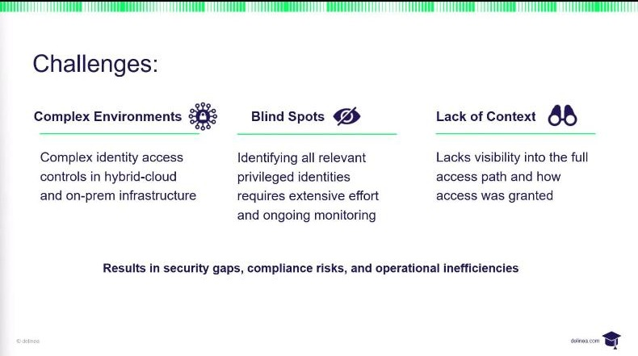
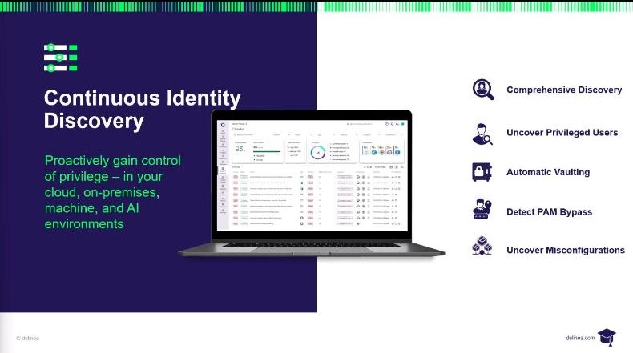
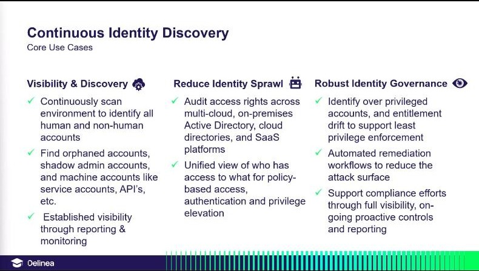
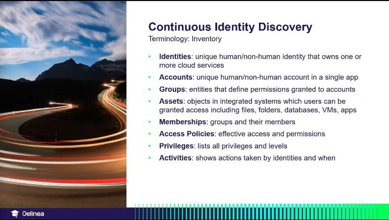
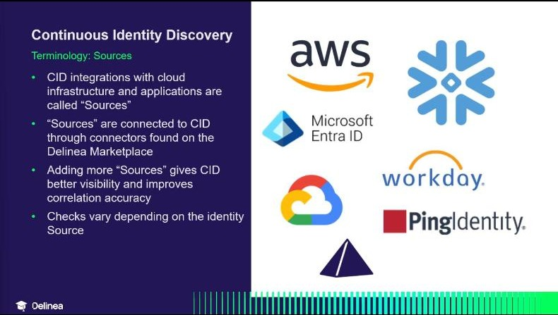
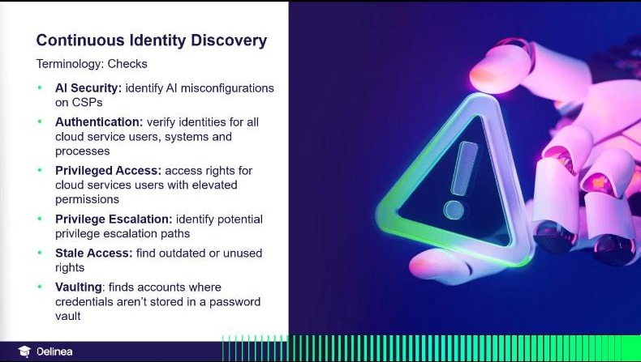
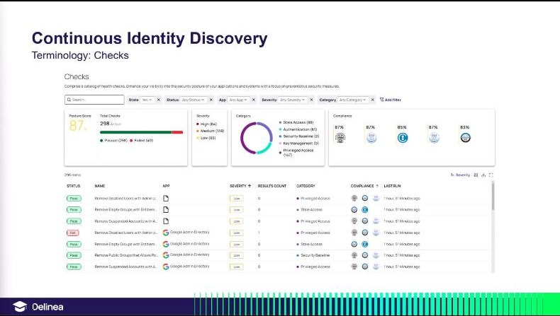

# 3.2 Delinea Platform Guard: Continuous Identity Discovery

> **Bab 3. Delinea Platform Guard : Visibility** · Course e-learning, 3 lesson (2 video + 1 quiz)

## Daftar Lesson
| # | Lesson | Durasi | Inti |
|---|---|---|---|
| 1 | [Continuous Identity Discovery (CID): Overview](#lesson-1) | 2:21 | 3 tantangan (complex env, blind spots, lack of context); 5 kapabilitas CID termasuk **Detect PAM Bypass** |
| 2 | [Continuous Identity Discovery: Use Cases, Terminology and Integrations](#lesson-2) | 5:27 | 3 core use case; 8 istilah Inventory; Sources (connector Marketplace); 6 kategori Checks; Posture Score |
| 3 | Quiz | – | ⏳ |

## Ringkasan Satu Kalimat
> **CID** menemukan **semua identitas privileged** — manusia (karyawan, kontraktor, admin) dan mesin (service account, **agen AI**, script) — secara **real-time & terus-menerus** di on-prem dan hybrid cloud, supaya yang tak terlihat bisa dikelola.

---

<a id="lesson-1"></a>

## Lesson 1 — Continuous Identity Discovery (CID): Overview

> **Sumber:** Delinea University → *Delinea Platform Guard: Visibility* → *Continuous Identity Discovery* → Lesson 1
> **Tipe:** Video, 2:21 (tanpa subtitle; catatan disusun dari slide + deskripsi lesson)

### Learning Objectives
1. Memahami tantangan yang mendorong adopsi CID: **identity sprawl**, level privilege yang tidak konsisten, dan **kurangnya visibilitas**.
2. Mendefinisikan CID dan perannya sebagai kapabilitas **discovery real-time & berkelanjutan** di Delinea Platform.
3. Menjelaskan bagaimana identity sprawl mempersulit penerapan **zero trust** dan **least privilege**.

### Challenges


| **Complex Environments** | **Blind Spots** | **Lack of Context** |
|---|---|---|
| Kontrol akses identitas yang kompleks di hybrid-cloud & on-prem | Mengidentifikasi semua identitas privileged butuh usaha besar & pemantauan terus-menerus | Tidak terlihat **jalur akses penuh** dan **bagaimana akses itu diberikan** |

→ Hasilnya: **celah keamanan, risiko compliance, dan inefisiensi operasional**.

### CID — Kapabilitas


*"Proactively gain control of privilege — in your cloud, on-premises, machine, and AI environments"*

| Kapabilitas | Artinya |
|---|---|
| **Comprehensive Discovery** | Menemukan identitas & aset di semua lingkungan |
| **Uncover Privileged Users** | Menandai siapa yang sebenarnya punya hak istimewa |
| **Automatic Vaulting** | Akun yang ditemukan bisa langsung dimasukkan ke vault |
| **Detect PAM Bypass** | Mendeteksi akses privileged yang **tidak lewat PAM** |
| **Uncover Misconfigurations** | Menemukan konfigurasi identitas/izin yang salah |

> **Analogi:** CID = **sensus penduduk** yang berjalan setiap hari, bukan sekali per 10 tahun. Siapa pun yang baru datang, pindah, atau tiba-tiba punya kunci gudang langsung tercatat.

### Kenapa "Continuous"?
Discovery satu kali (mis. saat proyek PAM dimulai) langsung basi: akun baru dibuat, service account ditambah developer, role cloud diberikan "sementara". Tanpa discovery berkelanjutan, vault hanya melindungi **akun yang kebetulan kita tahu**.

### Catatan Senior Engineer (di luar materi video)
- **"Detect PAM Bypass" menjawab celah terbesar dari Bab 1.** Sejak sub-bab 1.1 kita bilang: rekaman PAM bersih bukan bukti, karena admin bisa login langsung. CID mengklaim mendeteksi itu secara native. **Tetap bangun rule SIEM sendiri** (logon ke server kritikal dari IP yang bukan Engine/proxy Delinea) sebagai lapisan independen — jangan bergantung pada satu tool untuk mengawasi dirinya sendiri.
- **Automatic Vaulting itu berisiko kalau ceroboh.** Memasukkan service account ke vault lalu **merotasi password-nya** tanpa tahu di mana password itu dipakai (scheduled task, IIS app pool, connection string) = **aplikasi mati**. Urutan yang benar: discover → petakan dependensi → vault → baru rotasi.
- **"Lack of context" = pertanyaan "bagaimana akses itu diberikan".** Contoh: user bukan admin langsung, tapi anggota grup bersarang (nested group) yang punya hak admin → ini yang sering luput dari review manual. Konsepnya mirip yang dipetakan BloodHound di AD.
- **Agen AI & script disebut eksplisit sebagai identitas mesin.** Agen AI yang diberi API key ber-izin luas = service account baru yang jarang ditinjau.
- **Untuk audit bank:** inventory akun privileged yang lengkap & up-to-date adalah pertanyaan pertama auditor TI. CID adalah sumber datanya.

### Cek Pemahaman
1. Sebutkan 3 tantangan yang ditampilkan di slide.
2. Sebutkan 5 kapabilitas CID.
3. Kenapa discovery perlu berjalan terus-menerus, bukan sekali saja?
4. Apa risiko "Automatic Vaulting" pada service account kalau langsung diikuti rotasi password?
5. Kenapa Detect PAM Bypass di CID tidak sebaiknya jadi satu-satunya deteksi bypass?

[⬆ Kembali ke daftar lesson](#daftar-lesson)

---

<a id="lesson-2"></a>

## Lesson 2 — Continuous Identity Discovery: Use Cases, Terminology and Integrations

> **Sumber:** Delinea University → *Delinea Platform Guard: Visibility* → *Continuous Identity Discovery* → Lesson 2
> **Tipe:** Video, 5:27 (tanpa subtitle; catatan disusun dari slide + deskripsi lesson)

### Learning Objectives
1. Mendefinisikan 3 core use case CID: **comprehensive identity visibility, managing identity sprawl, security posture assessment & enforcement**.
2. Memahami tantangan dari lingkungan hybrid dan **ledakan non-human identity** (service account, API, agen AI).
3. Menjelaskan hubungan **Inventory, Checks, dan Sources** dalam alur kerja CID.

### Core Use Cases


| **Visibility & Discovery** | **Reduce Identity Sprawl** | **Robust Identity Governance** |
|---|---|---|
| Scan terus-menerus untuk menemukan **semua akun manusia & non-manusia** | Audit hak akses di multi-cloud, **AD on-prem**, cloud directory, dan SaaS | Temukan akun **over-privileged** dan **entitlement drift** → dukung least privilege |
| Temukan **orphaned accounts**, **shadow admin accounts**, dan akun mesin (service account, API, dll.) | **Satu tampilan** siapa punya akses ke apa → dasar akses, autentikasi, & elevasi berbasis policy | **Workflow remediasi otomatis** untuk mengecilkan attack surface |
| Visibilitas lewat reporting & monitoring | | Dukung compliance dengan visibilitas penuh, kontrol proaktif, & reporting |

| Istilah | Artinya |
|---|---|
| **Orphaned account** | Akun yang pemiliknya sudah tidak ada (resign, proyek selesai) tapi akunnya masih aktif |
| **Shadow admin** | Akun yang **tidak terlihat seperti admin** (tidak ada di grup Domain Admins) tapi punya hak setara admin lewat delegasi/ACL/nested group |
| **Entitlement drift** | Hak akses yang pelan-pelan menumpuk melebihi kebutuhan (pindah tim tapi hak lama tidak dicabut) |

### Terminology: Inventory (8 objek)


| Objek | Definisi |
|---|---|
| **Identities** | Identitas unik manusia/non-manusia yang **memiliki satu atau lebih** layanan cloud |
| **Accounts** | Akun unik manusia/non-manusia **di satu aplikasi** |
| **Groups** | Entitas yang mendefinisikan permission yang diberikan ke akun |
| **Assets** | Objek di sistem terintegrasi yang bisa diakses: file, folder, database, VM, aplikasi |
| **Memberships** | Grup dan anggotanya |
| **Access Policies** | Akses & permission **efektif** |
| **Privileges** | Daftar semua privilege dan levelnya |
| **Activities** | Aksi yang dilakukan identitas dan **kapan** |

> **Identity vs Account:** *Budi* adalah **satu identity**. Budi punya akun `budi@bank.co.id` di Entra ID, `budi.adm` di AD, dan `budi-dev` di AWS = **tiga account**. CID menautkan ketiganya ke satu identitas — tanpa itu, "account proliferation 30%+" (sub-bab 2.2) tidak bisa dihitung.

> Ini adalah objek yang dikelompokkan oleh **ITP/PCCE Collections** (sub-bab 1.2) — bukan computers/apps seperti Platform Collections.

### Terminology: Sources


- Integrasi CID dengan infrastruktur cloud & aplikasi disebut **"Sources"**
- Sources terhubung lewat **connector di Delinea Marketplace**
- **Makin banyak Sources → visibilitas makin baik & korelasi makin akurat**
- **Checks berbeda tergantung Source identitasnya**
- Contoh logo di slide: **AWS, Microsoft Entra ID, Google Cloud, Snowflake, Workday, Ping Identity**, dan Active Directory

### Terminology: Checks (6 kategori)


| Kategori | Yang dicari |
|---|---|
| **AI Security** | Miskonfigurasi AI di cloud service provider (CSP) |
| **Authentication** | Verifikasi identitas untuk semua user, sistem, & proses cloud |
| **Privileged Access** | Hak akses user cloud dengan permission tinggi |
| **Privilege Escalation** | **Jalur potensial privilege escalation** |
| **Stale Access** | Hak akses yang **usang atau tidak dipakai** |
| **Vaulting** | Akun yang credential-nya **belum disimpan di password vault** |

### Checks Dashboard (UI)


Yang terlihat di screenshot:
- **Posture Score** (contoh 87%) dan **Total Checks** (298 aktif: passed vs failed)
- Ringkasan **Severity** (High/Medium/Low) dan **Category** (Stale Access, Authentication, Security Baseline, Key Management, Privileged Access)
- Panel **Compliance** — persentase kepatuhan per framework
- Tabel check: Status (Pass/Fail), Name (mis. *"Remove Disabled Users with Admin..."*, *"Remove Empty Groups with Entitlements"*, *"Remove Public Groups that Allows Pri..."*), App (mis. Google Admin Directory), Severity, Results Count, Category, Compliance, Last Run

### Alur Kerja CID: Sources → Inventory → Checks
```
SOURCES (connector Marketplace: AD, Entra ID, AWS, GCP, Workday, Snowflake, Ping...)
   │  tarik data identitas & izin
   ▼
INVENTORY (Identities, Accounts, Groups, Assets, Memberships, Access Policies, Privileges, Activities)
   │  dievaluasi oleh
   ▼
CHECKS (AI Security, Authentication, Privileged Access, Priv. Escalation, Stale Access, Vaulting)
   │  menghasilkan
   ▼
POSTURE SCORE + temuan → remediasi (vault akun, cabut akses, perbaiki konfigurasi)
```

> **Analogi:** Sources = **kamera** yang dipasang di berbagai gedung. Inventory = **daftar penghuni & kunci** yang tersusun dari rekaman kamera. Checks = **inspektur** yang memeriksa daftar itu dengan checklist ("ada yang pegang kunci tapi sudah pindah?").

### Catatan Senior Engineer (di luar materi video)
- **Kualitas CID = kualitas Sources.** Satu Source yang tidak terhubung (mis. aplikasi core banking yang tidak punya connector) = blind spot. Petakan dulu sistem mana yang **tidak** ada connector-nya sebelum klaim "visibilitas penuh".
- **Workday sebagai Source itu penting:** HR system = sumber kebenaran siapa yang masih bekerja. Mengorelasikan HR dengan akun = cara paling andal menemukan **orphaned account**.
- **Shadow admin** adalah jalur favorit attacker di AD: user dengan hak `GenericAll`/`WriteDACL` atas objek sensitif, atau anggota grup bersarang. Kategori check **Privilege Escalation** menyasar ini.
- **Check "Vaulting"** = jembatan langsung ke Secret Server (Bab 3.3): daftar akun privileged yang **belum** dikelola PAM = backlog onboarding vault.
- **Posture Score bisa menipu.** 87% kelihatan bagus, tapi kalau 13% sisanya adalah check severity High di AD produksi, risikonya tetap besar. Baca **failed checks berdasarkan severity**, bukan skor agregat.
- **Mode read-only dulu.** Connector CID biasanya butuh izin baca yang luas (directory read, IAM read). Pastikan izinnya **read-only** dan service account connector-nya sendiri dimasukkan ke vault & dimonitor — connector dengan izin tulis adalah target bernilai tinggi.
- **Untuk SOC:** temuan Stale Access & Privilege Escalation = bahan **threat hunting** yang bagus; kirim ke SIEM untuk dikorelasikan dengan aktivitas login.

### Cek Pemahaman
1. Sebutkan 3 core use case CID.
2. Apa beda **orphaned account** dan **shadow admin account**?
3. Apa beda **Identity** dan **Account** di Inventory CID?
4. Sebutkan 8 objek Inventory.
5. Apa itu **Sources** dan dari mana connector-nya didapat?
6. Sebutkan 6 kategori Checks.
7. Jelaskan alur Sources → Inventory → Checks.
8. Kenapa Posture Score tinggi belum tentu berarti risiko rendah?

[⬆ Kembali ke daftar lesson](#daftar-lesson)
