# 3.3 Delinea Platform Guard: Vaulting with Secret Server

> **Bab 3. Delinea Platform Guard : Visibility** · Course e-learning, 5 lesson (4 video + 1 quiz)

## Daftar Lesson
| # | Lesson | Durasi | Inti |
|---|---|---|---|
| 1 | [Secret Server Vaulting: Overview](#lesson-1) | 6:24 | 5 core capabilities; 4 tingkat use case; terminologi Secrets, Templates, Folders, Secret Policies, Roles & Permissions |
| 2 | [Secret Server Discovery: Overview](#lesson-2) | 4:39 | Inventory akun tak dikenal; 6 built-in discovery; Extensible Discovery; Discovery Rules |
| 3 | [Secret Server Remote Password Changing: Overview](#lesson-3) | 4:55 | RPC (rotasi otomatis); service account & dependency; custom password changer (PowerShell, SQL, SSH) |
| 4 | [Secret Server Vaulting: Heartbeat Overview](#lesson-4) | 4:33 | Engine Heartbeat vs Credential Heartbeat; 4 status (Success, Processing, Failed, Unable to Connect) |
| 5 | Quiz | – | ⏳ |

## Ringkasan Satu Kalimat
> Vaulting bukan sekadar menyimpan password — tapi sistem berlapis: **penyimpanan aman, kontrol akses granular, autentikasi fleksibel, kontrol otomatis, dan auditabilitas mendalam**, dari password wifi tamu sampai domain admin, semuanya diatur oleh **policy dan role**.

---

<a id="lesson-1"></a>

## Lesson 1 — Secret Server Vaulting: Overview

> **Sumber:** Delinea University → *Delinea Platform Guard: Visibility* → *Vaulting with Secret Server* → Lesson 1
> **Tipe:** Video, 6:24 (tanpa subtitle; catatan disusun dari slide + deskripsi lesson)

### Learning Objectives
1. Kapabilitas inti vaulting Secret Server: **penyimpanan & sharing aman, RBAC, autentikasi/MFA, remote access, audit/reporting**.
2. Rentang use case vaulting: dari credential personal terkait kerja sampai akun privileged bersama & **elevated privileged** (domain admin, root).
3. Definisi **Heartbeat**, use case, dan cara kerjanya *(dibahas di Lesson 4)*.
4. Definisi **Remote Password Changing (RPC)** dan best practice service account *(dibahas di Lesson 3)*.
5. Terminologi kunci: **Secrets, Secret Templates, Folders, Secret Policies, Roles & Permissions, Heartbeat**.

### Core Capabilities
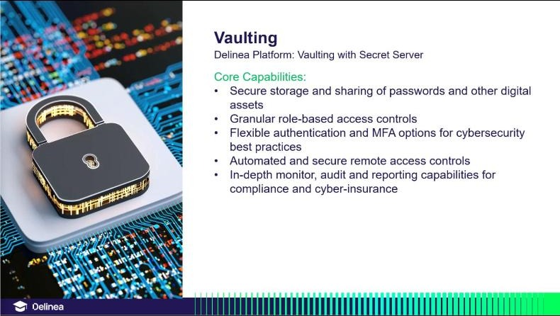

1. **Penyimpanan & sharing aman** untuk password dan aset digital lain
2. **Role-based access control** yang granular
3. **Autentikasi fleksibel & opsi MFA**
4. **Kontrol remote access** yang otomatis & aman
5. **Monitoring, audit, & reporting** mendalam untuk compliance & cyber insurance

### Vaulting Use Cases — 4 tingkat
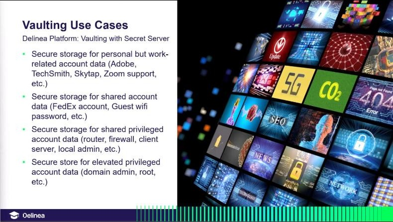

| Tingkat | Contoh |
|---|---|
| **Personal tapi terkait kerja** | Akun Adobe, TechSmith, Skytap, Zoom support |
| **Shared account** | Akun FedEx kantor, password wifi tamu |
| **Shared privileged** | Router, firewall, server klien, **local admin** |
| **Elevated privileged** | **Domain admin, root** |

> Makin ke bawah, makin ketat kontrol yang dibutuhkan: rotasi, workflow approval, CheckOut, session recording.

### Core Vaulting Terminology

#### Secrets & Folders
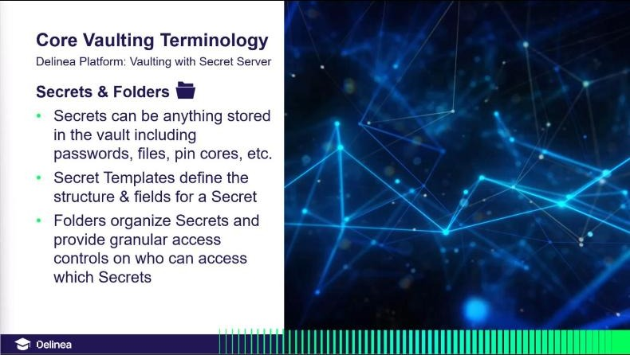

| Istilah | Definisi |
|---|---|
| **Secret** | Apa pun yang disimpan di vault: password, file, PIN code, dll. |
| **Secret Template** | Mendefinisikan **struktur & field** sebuah Secret (mis. template "Windows Account": machine, username, password) |
| **Folder** | Mengorganisasi Secret **dan** memberi kontrol akses granular — siapa bisa mengakses Secret mana |

#### Secret Policies
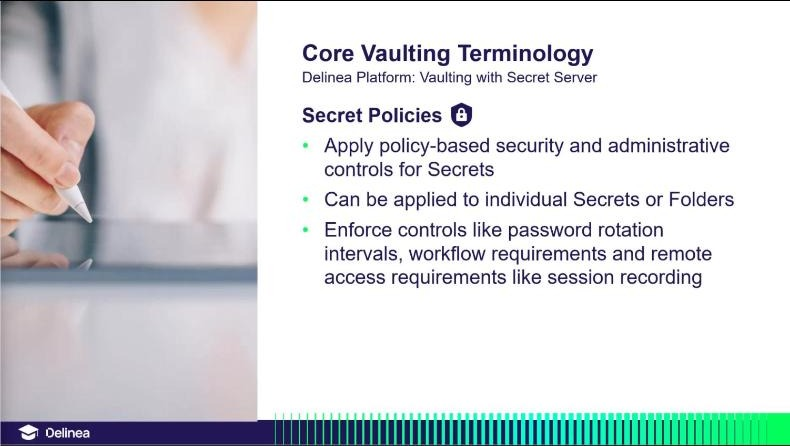

- Menerapkan kontrol keamanan & administratif **berbasis policy** untuk Secret
- Bisa diterapkan ke **Secret individual atau Folder**
- Menegakkan kontrol seperti **interval rotasi password**, **syarat workflow**, dan **syarat remote access seperti session recording**

> 📌 **Catatan exam Bab 1:** ini menjawab soal *"How can session recording be turned on?"* — recording adalah setting di level **Secret** dan bisa di-enforce lewat **Secret Policy**. Template hanya mengatur *struktur data*, audit-log hanya *mencatat event*.

#### Roles & Permissions
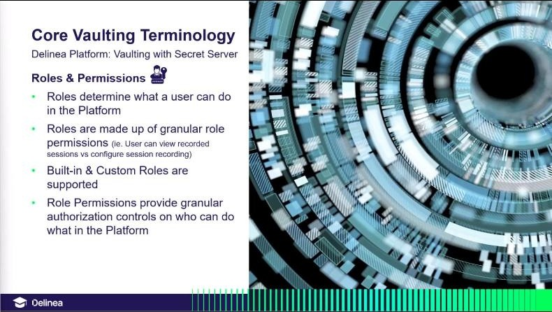

- **Role** menentukan apa yang bisa dilakukan user di Platform
- Role terdiri dari **role permission granular** (mis. *bisa melihat recorded session* vs *bisa mengonfigurasi session recording*)
- Mendukung **built-in & custom roles**
- Role Permissions = otorisasi granular **siapa bisa melakukan apa** di Platform

### Template vs Policy vs Folder vs Role — jangan tertukar
| | Mengatur | Analogi |
|---|---|---|
| **Secret Template** | **Bentuk** data (field apa saja) | Formulir kosong |
| **Folder** | **Siapa bisa akses** secret mana | Lemari arsip berkunci per divisi |
| **Secret Policy** | **Perilaku keamanan** secret (rotasi, workflow, recording) | SOP yang ditempel di lemari |
| **Role** | **Apa yang bisa dilakukan user** di platform (fitur/admin) | Jabatan & wewenang pegawai |

> Bandingkan dengan **two-layer permission** di Collections (1.2): role-level vs object-level. Polanya sama di Secret Server: **Role** = apa yang boleh dilakukan secara umum, **Folder/Secret permission** = ke objek mana.

### Catatan Senior Engineer (di luar materi video)
- **Desain folder = desain keamanan.** Struktur folder yang buruk (semua secret di satu folder "IT") membuat least privilege mustahil. Pola umum: per **divisi/tim** × per **tingkat sensitivitas** (Prod/Non-Prod, Tier 0/1/2).
- **Pakai Secret Policy di folder, bukan setting per secret.** Ratusan secret dengan setting manual = konfigurasi drift. Policy di folder memastikan secret baru otomatis ikut aturan.
- **Inheritance permission folder** bisa membocorkan akses: secret sensitif di subfolder ikut terbuka kalau permission parent terlalu luas. Untuk Tier 0 (domain admin), putus inheritance & beri izin eksplisit.
- **Role "Unlimited Administrator"** (ingat UVAM di 2.1) = role paling berbahaya. Sedikit orang, wajib di-alert, review berkala.
- **Use case "personal tapi kerja"** sering diremehkan — padahal akun SaaS yang dishare via chat/Excel adalah sumber kebocoran yang umum. Ini jembatan ke **Credential Manager** (1.1 Lesson 4).

### Cek Pemahaman
1. Sebutkan 5 core capabilities vaulting.
2. Sebutkan 4 tingkat use case vaulting dari yang paling ringan ke paling kritikal.
3. Apa beda **Secret Template** dan **Secret Policy**?
4. Secret Policy bisa diterapkan ke apa saja, dan kontrol apa yang bisa ditegakkan?
5. Apa beda fungsi **Folder** dan **Role** dalam kontrol akses?
6. Beri contoh dua role permission yang berbeda terkait session recording.

[⬆ Kembali ke daftar lesson](#daftar-lesson)

---

<a id="lesson-2"></a>

## Lesson 2 — Secret Server Discovery: Overview

> **Sumber:** Delinea University → *Delinea Platform Guard: Visibility* → *Vaulting with Secret Server* → Lesson 2
> **Tipe:** Video, 4:39 (tanpa subtitle; catatan disusun dari slide + deskripsi lesson)

### Learning Objectives
1. Risiko keamanan & compliance dari akun privileged yang **tidak dikenal, tidak dikelola, dan orphaned**.
2. Use case utama Discovery: **scan jaringan** untuk meng-inventaris dan mengeliminasi akun privileged yang tidak dikenal.
3. Jenis akun yang ditemukan Windows Discovery: **akun domain AD, akun lokal, dan service account** yang menjalankan **IIS app pool, Windows service, dan scheduled task**.
4. Definisi **Extensible Discovery** dan target yang bisa dijangkaunya di luar scanner bawaan.

### Account Inventory — Use Cases
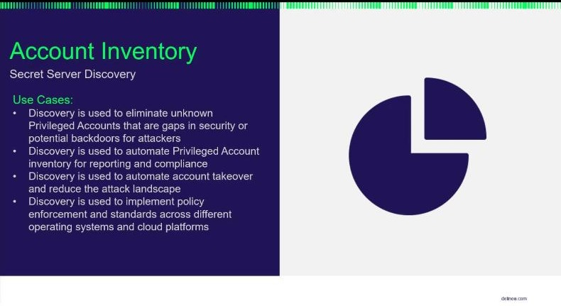

Discovery dipakai untuk:
- **Mengeliminasi akun privileged yang tidak dikenal** — celah keamanan & potensi **backdoor** bagi attacker
- **Mengotomatisasi inventaris** akun privileged untuk reporting & compliance
- **Mengotomatisasi account takeover** (vault mengambil alih pengelolaan akun) dan mengecilkan attack surface
- Menerapkan **policy & standar** lintas OS dan cloud platform

### Built-In Discovery — 6 tipe
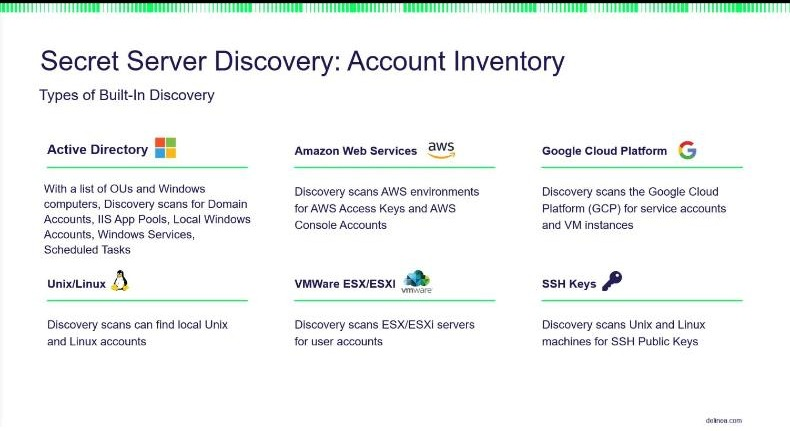

| Target | Yang ditemukan |
|---|---|
| **Active Directory** | Dari daftar OU & komputer Windows: **domain accounts, IIS App Pools, local Windows accounts, Windows Services, Scheduled Tasks** |
| **Amazon Web Services** | **AWS Access Keys** dan **AWS Console accounts** |
| **Google Cloud Platform** | **Service accounts** dan **VM instances** |
| **Unix/Linux** | Akun **lokal** Unix & Linux |
| **VMware ESX/ESXi** | Akun **user** di server ESX/ESXi |
| **SSH Keys** | **SSH public keys** di mesin Unix/Linux |

> **Kenapa IIS App Pool, Windows Service, Scheduled Task penting?** Di situlah password **service account** tertanam. Discovery menemukan **dependensi** ini — tanpanya, rotasi password service account = aplikasi mati (lihat Lesson 3 RPC).

### Extensible Discovery
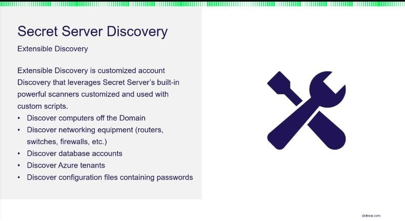

Discovery **kustom** yang memakai scanner bawaan Secret Server + **custom script**. Menjangkau target yang tidak terjangkau scanner bawaan:
- Komputer **di luar domain** (non-domain-joined)
- **Network equipment** (router, switch, firewall)
- Akun **database**
- **Azure tenants**
- **File konfigurasi yang berisi password**

### Discovery Rules
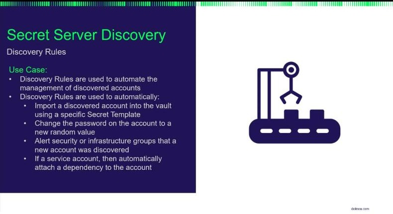

Mengotomatisasi pengelolaan akun hasil discovery. Rules bisa otomatis:
1. **Import** akun yang ditemukan ke vault dengan **Secret Template** tertentu
2. **Mengganti password** akun ke nilai acak baru
3. **Memberi alert** ke tim security/infrastruktur bahwa ada akun baru
4. Jika **service account**, otomatis **menempelkan dependency** ke akun tersebut

### Alur Discovery
```
Scan (built-in / extensible)
   ▼
Akun & dependensi ditemukan (domain, lokal, service account, keys)
   ▼
Discovery Rules: import ke vault (template) → rotasi password → alert → attach dependency
   ▼
Akun "takeover" — dikelola vault (RPC + Heartbeat)
```

### Discovery (Secret Server) vs CID (Platform)
| | **Secret Server Discovery** | **Continuous Identity Discovery** (3.2) |
|---|---|---|
| Fokus | **Akun & credential** yang bisa di-vault, plus dependensinya | **Identitas & hak akses** lintas IdP, cloud, SaaS |
| Cara | Scan jaringan/sistem (via Distributed Engine) | Integrasi **Sources** (connector) |
| Output | Akun siap di-import ke vault + dependency | Inventory identitas + **Checks** + Posture Score |
| Tujuan akhir | **Account takeover** (vault mengelola password) | **Visibilitas & governance** identitas |

### Catatan Senior Engineer (di luar materi video)
- **Discovery harus sebelum vaulting.** Kalau tidak, vault hanya berisi akun yang "kebetulan diingat" admin — yang paling berbahaya justru yang dilupakan.
- **Scan butuh credential berhak tinggi** (domain account dengan hak baca ke banyak mesin). Account scanner itu sendiri wajib masuk vault, dimonitor, dan dibatasi.
- **Scan jaringan memicu alert keamanan.** Discovery terlihat seperti reconnaissance (banyak koneksi ke banyak host). **Koordinasikan dengan SOC** & whitelist IP Distributed Engine — atau justru jadikan baseline: aktivitas serupa dari IP lain = recon sungguhan.
- **Rule "auto rotate" untuk service account = berbahaya tanpa dependency.** Pastikan dependency (app pool, service, task) sudah terpetakan sebelum rule rotasi otomatis aktif.
- **Extensible Discovery "file konfigurasi berisi password"** = temuan emas untuk audit: password plaintext di `web.config`, `.env`, script → wajib dipindah ke vault.
- **SSH keys** sering terlupakan: key lama milik mantan karyawan masih di `authorized_keys` = backdoor permanen.

### Cek Pemahaman
1. Sebutkan 4 use case Discovery.
2. Sebutkan 6 tipe built-in discovery dan apa yang ditemukan di masing-masing.
3. Akun apa saja yang ditemukan oleh Active Directory discovery?
4. Apa itu Extensible Discovery dan target apa yang bisa dijangkaunya?
5. Sebutkan 4 aksi yang bisa diotomatisasi oleh Discovery Rules.
6. Apa beda Secret Server Discovery dengan CID?

[⬆ Kembali ke daftar lesson](#daftar-lesson)

---

<a id="lesson-3"></a>

## Lesson 3 — Secret Server Remote Password Changing (RPC): Overview

> **Sumber:** Delinea University → *Delinea Platform Guard: Visibility* → *Vaulting with Secret Server* → Lesson 3
> **Tipe:** Video, 4:55 (tanpa subtitle; catatan disusun dari slide + deskripsi lesson)

### Learning Objectives
1. Kenapa rotasi password akun privileged adalah **use case PAM fundamental** dan **syarat compliance** yang umum.
2. Opsi penjadwalan & konfigurasi rotasi otomatis: **on-demand, bulk, dan terjadwal berbasis policy**.
3. Definisi **service account** dan kenapa ia jadi tantangan keamanan & manajemen yang besar.
4. Bagaimana Secret Server meng-inventaris service account, **melacak dependency**, dan memperbarui password service account **beserta dependency-nya sekaligus**.

### RPC — Use Cases
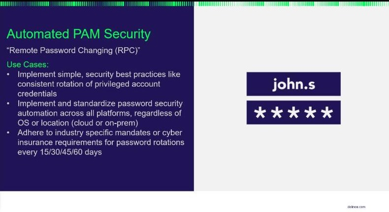

**Remote Password Changing (RPC)** = Secret Server mengganti password akun **langsung di sistem target** (AD, Linux, database, network device), lalu menyimpan password baru di vault.

- Menerapkan best practice sederhana: **rotasi credential privileged secara konsisten**
- Standarisasi otomatisasi keamanan password di **semua platform**, apa pun OS atau lokasinya (cloud/on-prem)
- Memenuhi regulasi industri atau syarat **cyber insurance** untuk rotasi tiap **15/30/45/60 hari**

**Mode rotasi** (dari deskripsi lesson):
| Mode | Kapan dipakai |
|---|---|
| **On-demand** | Ganti sekarang (mis. setelah karyawan resign, insiden) |
| **Bulk** | Ganti banyak secret sekaligus (mis. hasil User Audit Report di 2.1) |
| **Scheduled (policy-driven)** | Otomatis tiap N hari, diatur lewat **Secret Policy** (Lesson 1) |

### Service Account Management
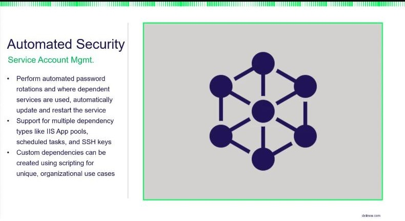

- Rotasi password otomatis, dan bila ada **service yang bergantung**, **otomatis update & restart service** tersebut
- Mendukung banyak tipe dependency: **IIS App Pools, Scheduled Tasks, SSH keys**
- **Custom dependency** bisa dibuat dengan scripting untuk kebutuhan unik organisasi

> **Service account** = akun yang dipakai **aplikasi/proses**, bukan manusia (mis. `svc_backup`, `svc_sql`). Masalahnya: password-nya tertanam di banyak tempat, jarang diganti ("takut aplikasi mati"), sering punya hak tinggi, dan jarang ada pemiliknya.

**Alur rotasi service account:**
```
1. Secret Server generate password baru
2. Ganti password akun di AD (RPC)
3. Update password di SEMUA dependency (app pool, service, scheduled task)
4. Restart service yang terdampak
5. Simpan password baru di vault → Heartbeat memverifikasi (Lesson 4)
```

### Custom Password Changers
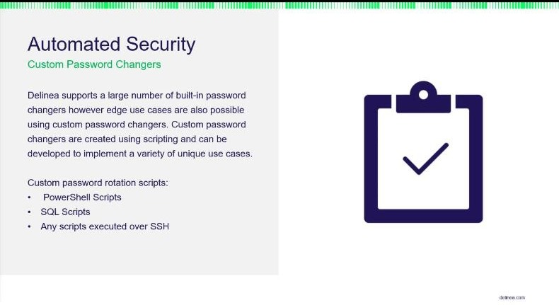

Delinea punya banyak **built-in password changer**, tapi untuk edge case bisa dibuat **custom password changer** via scripting:
- **PowerShell** scripts
- **SQL** scripts
- **Script apa pun yang dijalankan lewat SSH**

### Catatan Senior Engineer (di luar materi video)
- **Rotasi berkala vs rotasi setelah pakai.** Untuk akun Tier 0, lebih kuat **rotasi setiap check-in** (OTP, ingat CheckOut di 1.1 Lesson 3) daripada sekadar tiap 30 hari.
- **Catatan NIST SP 800-63B:** untuk password **manusia**, NIST tidak lagi merekomendasikan ganti password berkala tanpa alasan. Tapi untuk **akun privileged/shared yang dikelola vault**, rotasi otomatis tetap best practice — password-nya acak & tidak dihafal siapa pun, jadi rotasi tidak menurunkan kualitas.
- **Service account = penyebab #1 outage proyek PAM.** Selalu: discover → petakan dependency (Lesson 2) → uji rotasi di non-prod → baru aktifkan jadwal. Dependency yang tidak ditemukan (mis. password hardcode di config aplikasi) = aplikasi mati jam 2 pagi.
- **Lebih baik lagi: gMSA** (group Managed Service Account) di Windows — password dirotasi otomatis oleh AD tanpa PAM. PAM untuk yang tidak bisa pakai gMSA.
- **Custom password changer = kode yang berjalan dengan credential privileged.** Review script seperti kode produksi; siapa pun yang bisa mengedit script itu bisa membocorkan password.
- **Konteks bank:** kebijakan rotasi biasanya tertulis di kebijakan keamanan informasi internal & jadi poin audit. RPC + report rotasi = bukti kepatuhan otomatis.

### Cek Pemahaman
1. Apa itu RPC dan kenapa jadi use case PAM fundamental?
2. Sebutkan 3 mode rotasi password.
3. Apa itu service account dan kenapa sulit dikelola?
4. Apa yang dilakukan Secret Server terhadap dependency saat merotasi password service account?
5. Sebutkan 3 tipe dependency bawaan yang disebut di slide.
6. Bahasa/jalur apa saja yang bisa dipakai untuk custom password changer?

[⬆ Kembali ke daftar lesson](#daftar-lesson)

---

<a id="lesson-4"></a>

## Lesson 4 — Secret Server Vaulting: Heartbeat Overview

> **Sumber:** Delinea University → *Delinea Platform Guard: Visibility* → *Vaulting with Secret Server* → Lesson 4
> **Tipe:** Video, 4:33 (tanpa subtitle; catatan disusun dari slide + deskripsi lesson)

### Learning Objectives
1. Mendefinisikan **Heartbeat** sebagai mekanisme validasi berkelanjutan di Delinea Platform.
2. Membedakan **engine heartbeat** dan **credential heartbeat**: use case & konfigurasinya.
3. Mengenali status operasional & cara kerjanya.

### Main Capabilities
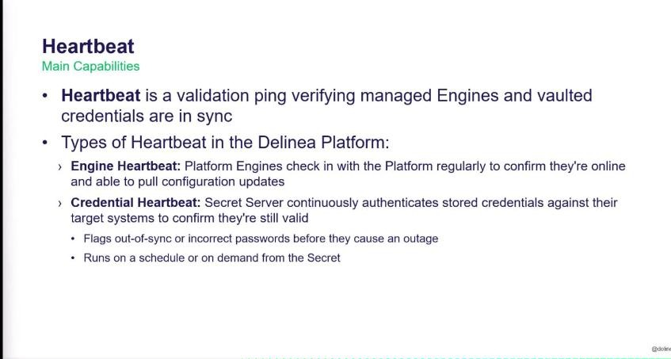

**Heartbeat** = *validation ping* yang memverifikasi bahwa **Engine** dan **credential di vault** tetap sinkron.

| Tipe | Apa yang dicek |
|---|---|
| **Engine Heartbeat** | Platform Engine rutin **check-in ke Platform** untuk memastikan **online** dan bisa **menarik update konfigurasi** |
| **Credential Heartbeat** | Secret Server terus **mencoba login** dengan credential tersimpan ke sistem target untuk memastikan **masih valid**. Menandai password yang out-of-sync **sebelum menyebabkan outage**. Berjalan **terjadwal** atau **on-demand** dari Secret |

> Credential Heartbeat adalah **konfigurasi di level Secret**.

### Use Cases
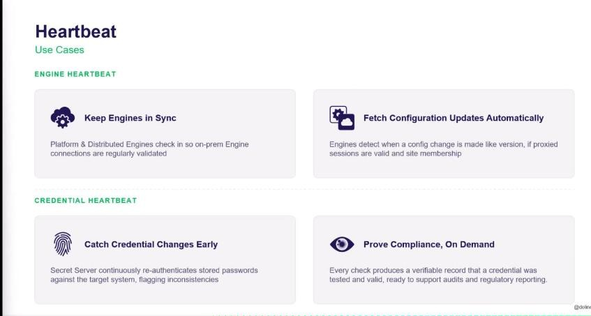

| **Engine Heartbeat** | | **Credential Heartbeat** | |
|---|---|---|---|
| **Keep Engines in Sync** | Platform & Distributed Engine check-in → koneksi engine on-prem tervalidasi rutin | **Catch Credential Changes Early** | Re-autentikasi terus-menerus → menandai ketidaksesuaian |
| **Fetch Config Updates Automatically** | Engine mendeteksi perubahan konfigurasi (versi, validitas proxied session, site membership) | **Prove Compliance, On Demand** | Setiap cek menghasilkan **catatan terverifikasi** bahwa credential diuji & valid → bukti audit |

### How It Works
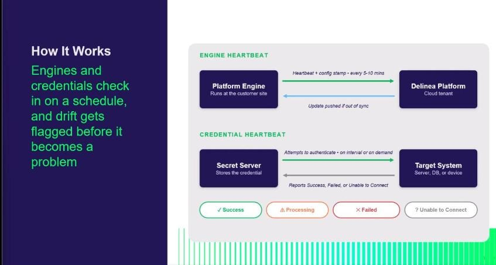

```
ENGINE HEARTBEAT
  Platform Engine (di site customer) ── heartbeat + config stamp, tiap 5–10 menit ──► Delinea Platform (cloud tenant)
                                     ◄── update di-push kalau out of sync ──────────

CREDENTIAL HEARTBEAT
  Secret Server (menyimpan credential) ── coba autentikasi (interval / on-demand) ──► Target System (server, DB, device)
                                       ◄── lapor: Success / Failed / Unable to Connect ─
```

| Status | Arti | Tindakan |
|---|---|---|
| ✅ **Success** | Password di vault = password di target | — |
| ⚠️ **Processing** | Heartbeat sedang berjalan | Tunggu |
| ❌ **Failed** | Bisa terhubung, tapi **password ditolak** → password di target sudah berubah di luar vault | **Investigasi** (siapa yang mengganti?) lalu sinkronkan |
| ❓ **Unable to Connect** | Target tidak bisa dijangkau (mati, firewall, DNS, engine bermasalah) | Masalah jaringan/infrastruktur, bukan password |

> **Analogi:** Credential Heartbeat = **satpam yang tiap malam mencoba kunci cadangan di setiap pintu**. Kalau kuncinya tidak pas lagi → ada yang mengganti gembok diam-diam.

### Heartbeat vs RPC — jangan tertukar
| | **Heartbeat** | **RPC** (Lesson 3) |
|---|---|---|
| Aksi | **Mengecek** (login uji) | **Mengganti** password |
| Mengubah target? | ❌ Tidak | ✅ Ya |
| Tujuan | Validasi & deteksi drift | Rotasi |

### Catatan Senior Engineer (di luar materi video)
- **Failed = sinyal keamanan** (sudah dibahas di 2.1): password diganti di luar vault oleh admin bandel **atau attacker**. Jadikan Event Subscription + kirim ke SIEM, jangan cuma di-reset otomatis.
- **Failed vs Unable to Connect** penting untuk triage: yang pertama soal **credential**, yang kedua soal **jaringan/target**. Soal exam suka menukar keduanya.
- **Heartbeat = login sungguhan ke target** → muncul sebagai **event logon** (mis. Windows 4624/4625) dari IP Distributed Engine. Untuk SOC: whitelist sebagai aktivitas yang diharapkan, tapi heartbeat **gagal berulang** bisa memicu **account lockout** di AD — atur interval & lockout policy dengan bijak.
- **Engine heartbeat hilang** = engine mati atau terputus → rotasi, discovery, heartbeat credential, dan proxied session ikut berhenti. Monitor seperti monitoring server kritikal.
- **Bukti compliance:** riwayat heartbeat sukses = bukti bahwa vault benar-benar memegang password yang berlaku, bukan password basi.

### Cek Pemahaman
1. Apa itu Heartbeat?
2. Apa beda Engine Heartbeat dan Credential Heartbeat?
3. Berapa interval Engine Heartbeat menurut slide?
4. Sebutkan 4 status Credential Heartbeat dan artinya.
5. Apa beda status **Failed** dan **Unable to Connect**?
6. Apa beda Heartbeat dan RPC?
7. Kenapa heartbeat Failed perlu diperlakukan sebagai sinyal keamanan?

[⬆ Kembali ke daftar lesson](#daftar-lesson)
