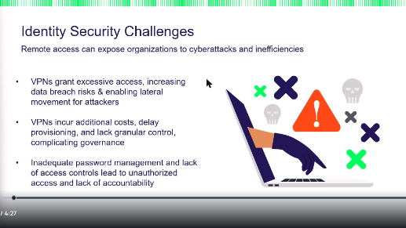
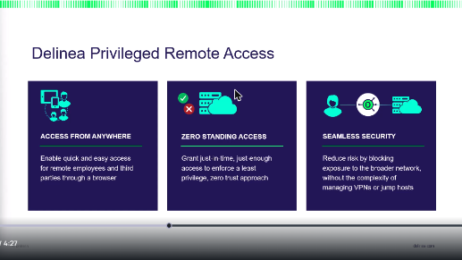
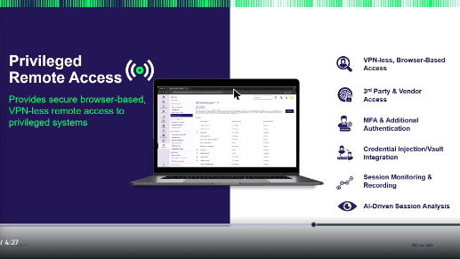

# Lesson 1 — Privileged Remote Access (PRA): Overview

> **Sumber:** Delinea University → Learning Plan *Delinea Platform Guard: Control* → Course *Securing Remote Access* → Lesson 1
> **Tipe:** Video, 4:27 (tanpa subtitle; catatan disusun dari slide + deskripsi lesson)

## Learning Objectives
1. Memahami bagaimana remote/hybrid work mengubah ancaman identity security dan kenapa model akses tradisional (VPN) tidak cukup.
2. Mengenali kapabilitas utama PRA: MFA, credential injection + unified vaulting, secure file transfer, session monitoring & recording (keystroke logging, command filtering).
3. Menjelaskan value PRA: akses privileged berbasis browser yang menegakkan policy identitas, mendukung compliance, dan menyederhanakan manajemen untuk IT internal maupun vendor.

---

## Slide 1 — Identity Security Challenges

*"Remote access can expose organizations to cyberattacks and inefficiencies"*

| Masalah | Dampak |
|---|---|
| VPN memberi akses berlebihan | Risiko breach naik, attacker mudah lateral movement |
| VPN mahal, provisioning lambat, kontrol tidak granular | Governance sulit |
| Password management lemah, access control kurang | Akses tidak sah, tidak ada akuntabilitas |

**Insight:** VPN bekerja di **layer network** — sekali tersambung, user jadi "orang dalam" subnet. Padahal kebutuhannya cuma **satu sesi ke satu server**. Selisih antara akses yang *dibutuhkan* dan yang *diberikan* = attack surface.

---

## Slide 2 — 3 Pilar Delinea PRA

| Pilar | Isi | Makna |
|---|---|---|
| **Access from Anywhere** | Akses mudah via **browser** untuk karyawan remote & pihak ketiga | Tidak perlu VPN client di laptop vendor yang tidak kita kontrol |
| **Zero Standing Access** | **Just-in-time, just-enough** access, least privilege, zero trust | Konsep terpenting di lesson ini |
| **Seamless Security** | Blok exposure ke network luas tanpa kompleksitas **VPN / jump host** | User konek ke *sesi*, bukan ke *jaringan* |

### Zero Standing Access (ZSA)
Default-nya **tidak ada yang punya akses permanen**. Akses hanya hidup saat dibutuhkan (JIT), sebatas yang diperlukan (JEA), lalu dicabut otomatis.

> **Analogi:** Standing access = karyawan pegang kunci ruang server 24/7 selama 5 tahun. ZSA = pinjam kunci ke security, dicatat, wajib kembali jam 5 sore.

Kalau akun vendor dibobol jam 2 pagi, akun itu **tidak punya akses apa pun** di jam tersebut → blast radius ≈ nol.

**Catatan:** Jump host juga termasuk standing access ke banyak server sekaligus — dan jump host sendiri jadi target bernilai tinggi.

---

## Slide 3 — Fitur PRA

*"Provides secure browser-based, VPN-less remote access to privileged systems"*

1. **VPN-less, Browser-Based Access** — RDP/SSH dijalankan di browser
2. **3rd Party & Vendor Access** — use case utama
3. **MFA & Additional Authentication** — verifikasi identitas sebelum sesi dibuka
4. **Credential Injection / Vault Integration** — password diambil dari Secret Server dan disuntik ke sesi; **user tidak pernah melihat password**
5. **Session Monitoring & Recording** — termasuk keystroke logging & command filtering
6. **AI-Driven Session Analysis** — menandai sesi mencurigakan agar reviewer tidak perlu menonton semua rekaman *(tidak ada di learning objective → kemungkinan kecil keluar di quiz)*

---

## Ringkasan Satu Kalimat
> **PRA mengganti "akses permanen ke jaringan" (VPN/jump host + password dipegang user) dengan "akses ke satu sesi, sementara, terverifikasi, password tidak terlihat, dan direkam."**

---

## Catatan Senior Engineer (di luar materi video)
- **Command filtering bisa di-bypass** — sifatnya blacklist (script, encoding, alias). Anggap sebagai lapisan tambahan, bukan kontrol utama.
- **Recording tanpa review = cuma storage.** Yang bernilai adalah alert & review berbasis risiko.
- **PAM jadi crown jewel baru.** Kalau Secret Server jebol, semua kunci jebol → hardening, MFA admin PAM, prosedur break-glass wajib.
- **Konteks perbankan:** akses vendor ke sistem kritikal adalah temuan audit klasik. PRA + Workflow + Recording menjawab: *siapa, kapan, di-approve siapa, ngapain, mana buktinya?*
- **Integrasi SOC:** audit/session log Secret Server bisa dikirim ke SIEM (syslog/CEF) → use case: login vendor di luar maintenance window, command filter ter-trigger, akses tanpa approval.
- Video ini **level marketing**. Cara kerja teknis (Distributed Engine, launcher, workflow JIT) dibahas di lesson berikutnya.

## Cek Pemahaman
1. Kenapa memberi vendor VPN lebih berisiko daripada PRA? (2 kalimat)
2. Apa beda **credential injection** dengan "password disimpan di vault"?
3. Vendor upload script lewat PRA lalu script itu menghapus data — kontrol mana yang gagal, dan kontrol mana yang tetap memberi bukti?
4. Jelaskan Zero Standing Access dan beri satu skenario di bank di mana ZSA mencegah insiden yang tidak dicegah VPN.
