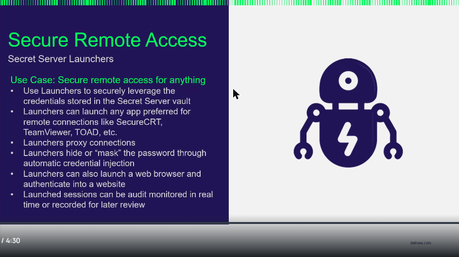
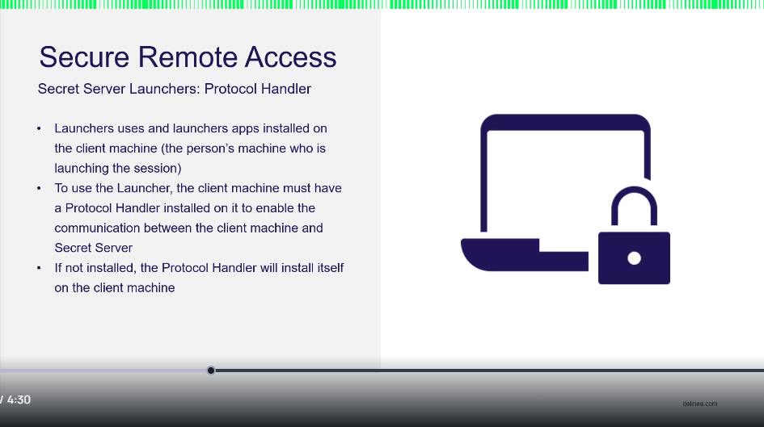
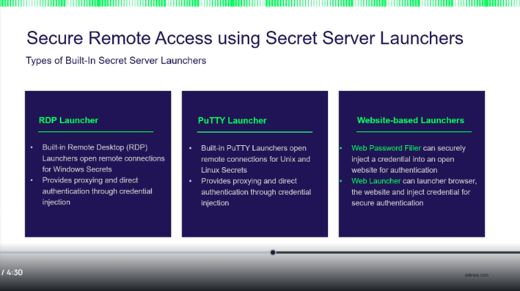
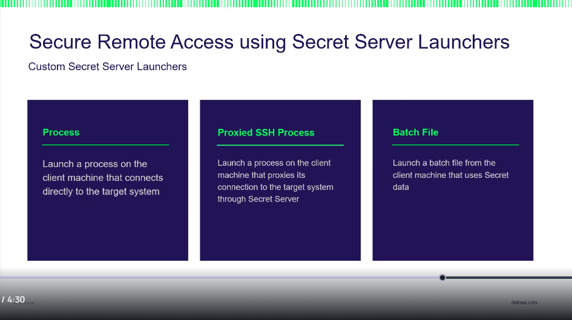

# Lesson 2 — Secret Server Launchers: Overview

> **Sumber:** Delinea University → *Delinea Platform Guard: Control* → *Securing Remote Access* → Lesson 2
> **Tipe:** Video, 4:30 (tanpa subtitle; catatan disusun dari slide + deskripsi lesson)

## Learning Objectives
1. Use case utama Launcher: mengamankan remote access & autentikasi dengan **menyuntikkan credential dari vault** ke koneksi remote.
2. Jenis resource yang bisa dihubungkan: **server, workstation, network equipment, cloud account, website**.
3. Sesi yang di-launch dari Secret Server bisa **di-proxy, dimonitor, dan direkam** untuk compliance.

---

## Slide 1 — Use Case: Secure remote access for anything

- Launcher memakai credential yang tersimpan di vault Secret Server
- Bisa menjalankan **aplikasi apa pun** yang dipakai user: SecureCRT, TeamViewer, TOAD, dll.
- Launcher bisa **mem-proxy** koneksi
- Password **disembunyikan / di-mask** lewat automatic credential injection
- Bisa membuka browser dan login ke website
- Sesi bisa **dimonitor real-time** atau **direkam** untuk review

**Definisi singkat:** Launcher = tombol "Launch" di sebuah Secret. Klik → aplikasi terbuka dalam kondisi **sudah login**, tanpa user pernah melihat password.

> **Analogi:** Vault = brankas kunci. Launcher = petugas yang membukakan pintu untuk kamu. Kamu masuk ruangan, tapi kunci tidak pernah berpindah ke tanganmu.

---

## Slide 2 — Protocol Handler

- Launcher memakai aplikasi yang **terinstal di client machine** (komputer orang yang membuka sesi)
- Client wajib punya **Protocol Handler** agar client ↔ Secret Server bisa berkomunikasi
- Kalau belum terinstal, Protocol Handler akan **meng-install dirinya sendiri**

**Cara kerja:** Secret Server berjalan di browser, tapi `mstsc.exe` / PuTTY / TOAD ada di laptop user. Protocol Handler adalah "jembatan" kecil di endpoint yang menerima perintah dari browser (via custom URI scheme) lalu menjalankan aplikasi lokal dengan credential dari vault.

---

## Slide 3 — Built-in Launchers

| Launcher | Untuk | Catatan |
|---|---|---|
| **RDP Launcher** | Secret Windows | Proxying & direct authentication via credential injection |
| **PuTTY Launcher** | Secret Unix/Linux | Proxying & direct authentication via credential injection |
| **Web Password Filler** | Website yang sudah terbuka | Menyuntikkan credential ke halaman login |
| **Web Launcher** | Website | Membuka browser + website + inject credential |

---

## Slide 4 — Custom Launchers

| Tipe | Fungsi | Contoh |
|---|---|---|
| **Process** | Menjalankan proses di client yang konek **langsung** ke target | SSMS, TOAD, WinSCP dengan argumen credential |
| **Proxied SSH Process** | Menjalankan proses di client yang koneksinya **di-proxy lewat Secret Server** | SecureCRT via SSH proxy |
| **Batch File** | Menjalankan batch file di client yang memakai data Secret | Script admin yang butuh credential |

---

## Konsep Kunci: Direct vs Proxied

| | **Direct** | **Proxied** |
|---|---|---|
| Jalur | Client → Target | Client → Secret Server proxy → Target |
| Credential | Diteruskan ke app di client | Disuntik di proxy |
| Target perlu terbuka dari client? | Ya | Tidak (cukup dari proxy) |
| Monitoring/recording | Terbatas (bergantung agent di client) | Lebih kuat, semua lewat satu titik |
| Rekomendasi untuk vendor | ❌ | ✅ |

---

## Catatan Senior Engineer (di luar materi video)
- **"Masked" ≠ "tidak pernah ada di endpoint".** Pada mode *direct*, credential tetap dikirim ke client untuk diberikan ke aplikasi lokal. User biasa tidak melihatnya, tapi orang dengan admin lokal + tool yang tepat berpotensi mengambilnya dari memory. Untuk pihak ketiga, **pakai mode proxied**.
- **Custom launcher bisa membocorkan password ke log.** Kalau password dioper sebagai argumen command line (`app.exe -u admin -p P@ss`), password muncul di process list, **Windows Event 4688 (command line logging)** dan **Sysmon Event ID 1**. Artinya password bisa masuk ke SIEM. Selalu cek bagaimana parameter dioper.
- **Protocol Handler "install itself" sering gagal di bank.** Endpoint biasanya dikunci (user non-admin, application whitelisting). Rencanakan deploy lewat SCCM/Intune dan masukkan ke whitelist.
- **Protocol Handler adalah software di endpoint** = attack surface tambahan → masuk patch management.
- **Web Password Filler lebih lemah** dari RDP/SSH proxy: credential berakhir di DOM halaman browser user.
- **Konteks bank:** TOAD/SQL Developer ke database core banking (Oracle) adalah kandidat utama custom launcher. DBA tidak perlu lagi tahu password `SYS`/`SYSTEM`.

## Cek Pemahaman
1. Apa fungsi Protocol Handler, dan kenapa dibutuhkan walaupun Secret Server diakses lewat browser?
2. Vendor eksternal perlu SSH ke server Linux produksi. Pilih **PuTTY direct** atau **proxied**? Jelaskan alasannya.
3. Tim DBA minta custom launcher TOAD dengan password di argumen command line. Apa risikonya dari sisi SOC?
4. Sebutkan 5 jenis resource yang bisa dihubungkan via Launcher.
