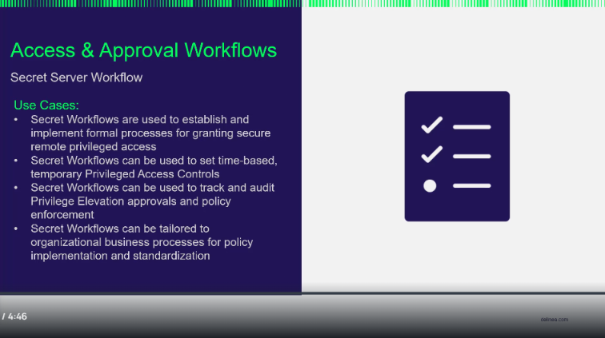
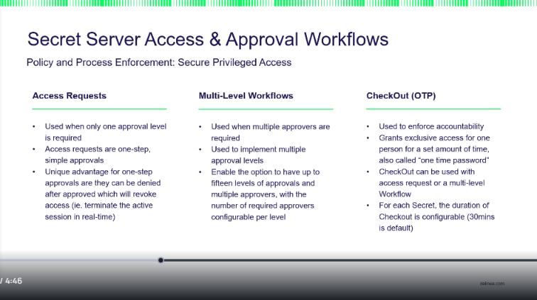
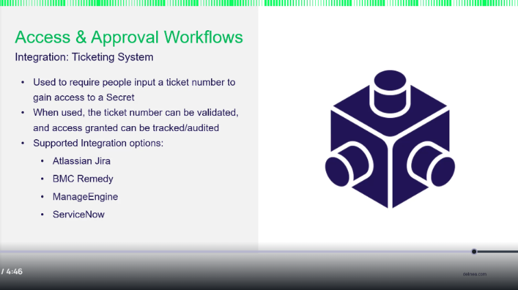

# Lesson 3 — Secret Server Workflow: Access & Approval Workflows

> **Sumber:** Delinea University → *Delinea Platform Guard: Control* → *Securing Remote Access* → Lesson 3
> **Tipe:** Video, 4:47 (tanpa subtitle; catatan disusun dari slide + deskripsi lesson)

## Learning Objectives
1. Use case utama: membangun proses **formal dan bisa diaudit** untuk meminta & memberi akses privileged.
2. Bagaimana workflow mendukung **penegakan policy dan standarisasi** di organisasi.
3. Konsep kunci: **CheckOut, Multi-Level Workflow, integrasi ticketing system**.

---

## Slide 1 — Use Cases


- Membangun proses formal untuk memberi akses remote privileged
- Membuat kontrol akses privileged yang **berbatas waktu & sementara**
- Melacak dan mengaudit **approval privilege elevation** serta penegakan policy
- Bisa disesuaikan dengan proses bisnis organisasi → standarisasi

**Posisi di gambar besar:** RBAC menjawab *"siapa BOLEH akses?"*. Workflow menjawab *"siapa yang MENGIZINKAN akses SEKARANG, untuk apa, dan berapa lama?"*. Workflow + CheckOut = implementasi nyata dari **Zero Standing Access / JIT** (Lesson 1).

---

## Slide 2 — 3 Mekanisme Inti


| | **Access Request** | **Multi-Level Workflow** | **CheckOut (OTP)** |
|---|---|---|---|
| Kapan dipakai | Cukup **1 level** approval | Butuh **banyak approver / level** | Menegakkan **akuntabilitas** |
| Ciri | One-step, simple | Hingga **15 level**, jumlah approver per level bisa diatur | Akses **eksklusif** untuk **1 orang** selama waktu tertentu ("one time password") |
| Keunggulan | Approval bisa **dibatalkan (deny) setelah di-approve** → **sesi aktif diputus real-time** | Cocok untuk sistem sangat kritikal | Bisa digabung dengan Access Request / Multi-Level |
| Default | – | – | Durasi CheckOut **30 menit** (bisa diatur per Secret) |

### CheckOut, dijelaskan
- Saat satu orang check-out sebuah Secret, **orang lain tidak bisa memakainya** sampai di-check-in kembali.
- Jadi setiap aktivitas dengan akun itu di rentang waktu tersebut **pasti milik satu orang** → non-repudiation.
- Disebut "OTP" karena idealnya password **dirotasi saat check-in**, sehingga password yang sempat dipakai tidak berlaku lagi.

---

## Slide 3 — Integrasi Ticketing System


- User wajib memasukkan **nomor tiket** untuk mengakses Secret
- Nomor tiket bisa **divalidasi**, akses yang diberikan bisa dilacak/diaudit
- Integrasi yang didukung: **Atlassian Jira, BMC Remedy, ManageEngine, ServiceNow**

---

## Alur Lengkap (gabungan Lesson 1–3)
```
Vendor login (MFA)
  → Request akses ke Secret + nomor tiket (divalidasi ke ITSM)
    → Approval (1 level / multi-level)
      → CheckOut (eksklusif, 30 menit)
        → Launcher (proxied) → sesi direkam
          → Check-in → password dirotasi
```

---

## Catatan Senior Engineer (di luar materi video)
- **Prinsip 4-eyes / maker-checker.** Di bank ini sudah jadi bahasa audit. Pastikan **requester tidak bisa meng-approve dirinya sendiri** (approver group jangan berisi requester).
- **Approval fatigue.** Kalau approver menerima 50 request/hari, mereka akan klik "Approve" tanpa membaca. Ukur: waktu rata-rata approval, deny rate. Deny rate ≈ 0% = rubber stamp.
- **15 level itu kemampuan, bukan rekomendasi.** Lebih dari 2–3 level biasanya bikin proses macet dan orang mencari jalan pintas.
- **"Ticket validated" — validasi apa?** Cek apakah hanya format nomor, atau benar-benar memeriksa tiket **open, approved, assigned ke requester, dan dalam change window**. Kalau cuma format, siapa pun bisa mengetik nomor asal.
- **CheckOut tanpa rotasi saat check-in = bukan OTP.** Aktifkan rotasi password saat check-in untuk akun kritikal.
- **Break-glass.** Insiden jam 2 pagi, approver tidur → harus ada prosedur emergency access yang tercatat dan di-review sesudahnya. Tanpa ini, tim ops akan menyimpan password di luar vault "buat jaga-jaga".
- **Use case SOC/SIEM:**
  - Approval di luar jam kerja / di luar change window
  - Satu approver meng-approve volume tidak wajar
  - Request di-deny lalu akun yang sama tetap dipakai dari jalur lain
  - CheckOut diperpanjang berulang kali
  - Nomor tiket yang sama dipakai berkali-kali

## Cek Pemahaman
1. Apa beda **Access Request** dan **Multi-Level Workflow**, dan kapan memilih masing-masing?
2. Kenapa CheckOut disebut memberi **akuntabilitas**? Apa yang terjadi kalau dua admin bisa memakai akun `root` yang sama secara bersamaan?
3. Vendor sudah di-approve dan sedang dalam sesi. Tim SOC melihat aktivitas mencurigakan. Fitur workflow apa yang memungkinkan sesi diputus seketika?
4. Kenapa "CheckOut tanpa rotasi password saat check-in" tidak benar-benar memenuhi konsep OTP?
