# Lesson 4 — Delinea Platform: Credential Manager & Connection Manager

> **Sumber:** Delinea University → *Delinea Platform Guard: Control* → *Securing Remote Access* → Lesson 4
> **Tipe:** Video, 6:24 (tanpa subtitle; catatan disusun dari slide + deskripsi lesson)
> ⚠️ Slide penutup berjudul **"Sales Enablement"** → materi ini aslinya untuk tim sales/partner. Isinya positioning, bukan teknis.

## Learning Objectives
1. Apa itu **Connection Manager** dan bagaimana ia menyederhanakan remote access ke server untuk IT/privileged admin.
2. Apa itu **Credential Manager** dan bagaimana ia memperluas akses aman ke aplikasi bisnis **di luar IT**.
3. Bagaimana keduanya bekerja lewat **satu vault**, beserta contoh penggunaannya.

---

## Overview — Dua Jalan Menuju Satu Vault
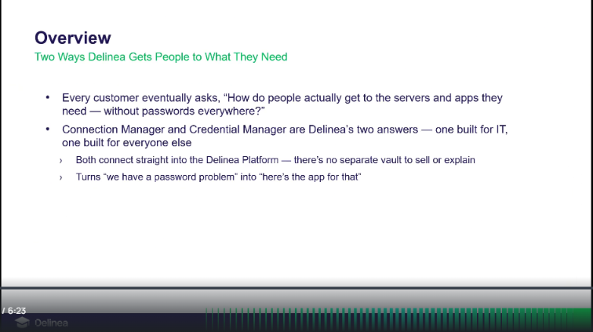

Pertanyaan yang pasti muncul dari setiap customer: *"Bagaimana orang bisa mengakses server & aplikasi yang mereka butuhkan tanpa password tersebar di mana-mana?"*
- **Connection Manager** → untuk **IT**
- **Credential Manager** → untuk **semua orang lainnya**
- Keduanya langsung terhubung ke **Delinea Platform** — tidak ada vault terpisah

---

## Connection Manager
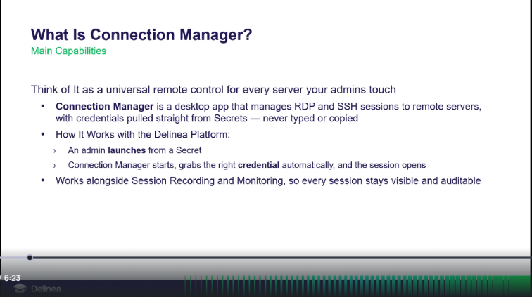

> *"Universal remote control untuk setiap server yang disentuh admin"*

- **Aplikasi desktop** yang mengelola sesi **RDP & SSH** ke banyak server; credential diambil langsung dari Secret — **tidak pernah diketik atau di-copy**
- Alur: admin **launch** dari Secret → Connection Manager terbuka → ambil credential otomatis → sesi terbuka
- Bekerja bersama **Session Recording & Monitoring**

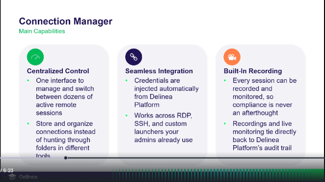

| Centralized Control | Seamless Integration | Built-In Recording |
|---|---|---|
| Satu interface untuk mengelola & berpindah antar puluhan sesi aktif | Credential disuntik otomatis dari Delinea Platform | Setiap sesi bisa direkam & dimonitor |
| Simpan & atur koneksi, tidak perlu cari di folder berbagai tool | Mendukung RDP, SSH, dan custom launcher | Rekaman & live monitoring terhubung ke audit trail platform |

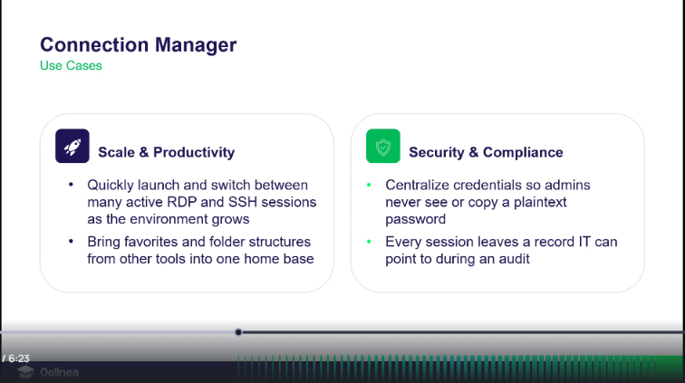

- **Scale & Productivity:** launch & berpindah antar banyak sesi RDP/SSH; impor favorites & struktur folder dari tool lain
- **Security & Compliance:** admin tidak pernah melihat/menyalin password plaintext; setiap sesi meninggalkan jejak untuk audit

---

## Credential Manager
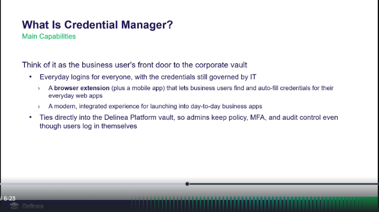

> *"Pintu depan user bisnis menuju vault perusahaan"*

- Login sehari-hari untuk semua orang, credential tetap **diatur IT**
  - **Browser extension** (+ mobile app) untuk mencari & auto-fill credential aplikasi web
  - Pengalaman terintegrasi untuk membuka aplikasi bisnis harian
- Terhubung langsung ke vault Delinea Platform → admin tetap pegang **policy, MFA, dan audit** walau user login sendiri

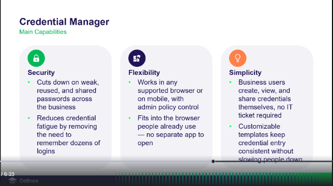

| Security | Flexibility | Simplicity |
|---|---|---|
| Mengurangi password lemah, reuse, dan shared | Jalan di browser yang didukung & mobile, dengan kontrol policy admin | User bisnis bisa **membuat, melihat, dan berbagi** credential sendiri tanpa tiket IT |
| Mengurangi *credential fatigue* | Masuk ke browser yang sudah dipakai | Template kustom menjaga konsistensi input |

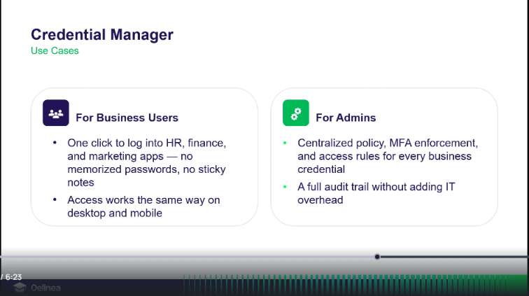

- **Business users:** satu klik ke aplikasi HR, finance, marketing — tanpa hafal password, tanpa sticky note; sama di desktop & mobile
- **Admins:** policy terpusat, MFA, aturan akses untuk setiap credential bisnis; audit trail tanpa beban IT tambahan

---

## Perbandingan
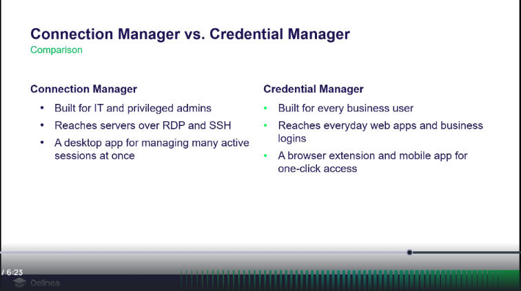

| | **Connection Manager** | **Credential Manager** |
|---|---|---|
| Untuk siapa | IT & privileged admin | Semua user bisnis |
| Target | Server via **RDP/SSH** | **Web app** & login bisnis |
| Bentuk | **Aplikasi desktop**, banyak sesi sekaligus | **Browser extension + mobile app**, one-click |

## One Vault, Two Front Doors
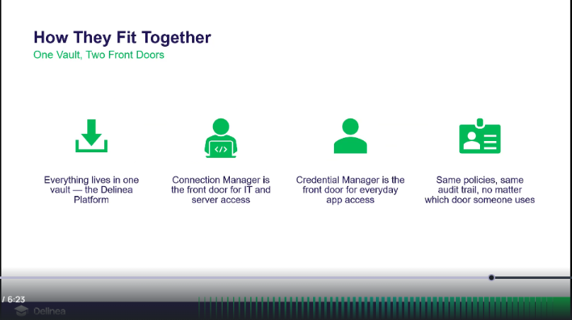

1. Semua tinggal di **satu vault** — Delinea Platform
2. Connection Manager = pintu untuk **IT & server**
3. Credential Manager = pintu untuk **aplikasi harian**
4. **Policy sama, audit trail sama**, apa pun pintunya

## Skenario
| | |
|---|---|
| 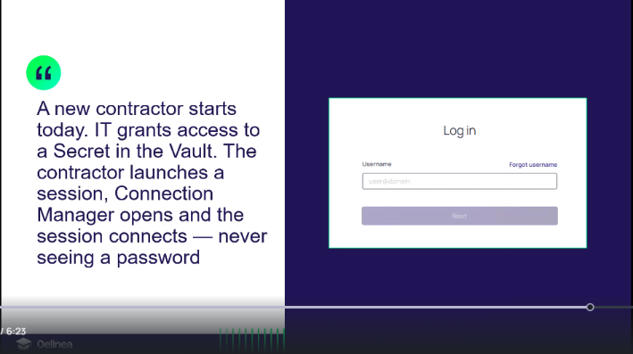 | 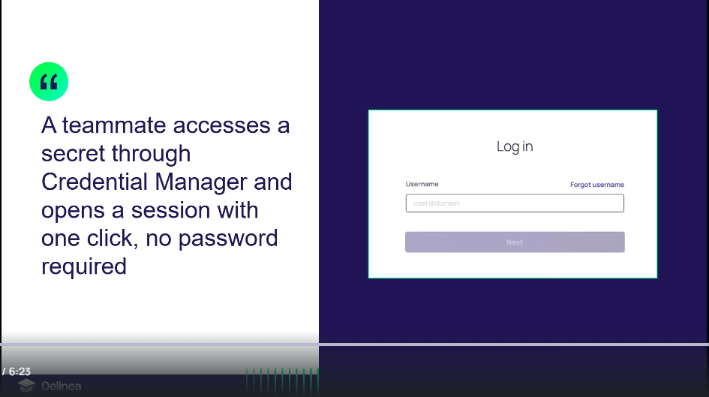 |
| Kontraktor baru → IT beri akses ke Secret → kontraktor launch sesi → Connection Manager terbuka dan sesi tersambung, **tanpa melihat password** | Rekan kerja mengakses Secret lewat Credential Manager → sesi terbuka **dengan satu klik**, tanpa password |

## Summary (Sales Enablement)
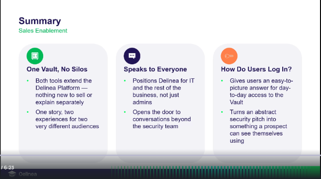
- **One vault, no silos** — keduanya perluasan Delinea Platform
- **Speaks to everyone** — Delinea diposisikan untuk IT *dan* bisnis
- **How do users log in?** — jawaban konkret untuk akses harian ke vault

---

## Posisi terhadap Lesson 2 (Launchers)
| | Launcher | Connection Manager |
|---|---|---|
| Apa | **Mekanisme** membuka 1 aplikasi dengan credential dari vault | **Aplikasi desktop** yang menampung banyak sesi RDP/SSH dalam satu jendela |
| Analogi | Petugas yang membukakan 1 pintu | Lobi dengan banyak pintu yang semuanya sudah dibukakan |

---

## Catatan Senior Engineer (di luar materi video)
- **Musuh sebenarnya Connection Manager: RDCMan, mRemoteNG, MobaXterm, Royal TS.** Tool ini menyimpan password **di file config lokal** laptop admin. Contoh nyata: `confCons.xml` milik mRemoteNG bisa didekripsi kalau master password tidak diset — teknik ini dipakai attacker & pentester. Satu laptop admin jebol = credential puluhan server ikut bocor.
- **Credential Manager = enterprise password manager** (kelasnya mirip 1Password/Bitwarden Business), bedanya terhubung ke vault PAM.
- **"User bisa share credential sendiri tanpa tiket IT"** = convenience sekaligus risiko governance. Tanpa review berkala, ini jadi *shadow sharing* yang rapi.
- **Credential Manager bukan pengganti SSO.** Kalau aplikasi mendukung SAML/OIDC, pakai SSO. Password manager untuk aplikasi yang **tidak** mendukung SSO (portal vendor, portal eksternal, akun bersama).
- **Blast radius.** Menaruh credential workforce dan credential privileged di platform yang sama memudahkan manajemen, tapi kalau platform kena, dampaknya lebih luas. Pisahkan dengan folder/policy dan role admin yang ketat.
- **Browser extension = attack surface** (malicious extension lain, XSS di halaman target). Kontrol daftar extension lewat policy browser.
- **Konteks bank:** akun bersama untuk portal eksternal (portal pelaporan, portal vendor, akun media sosial resmi) adalah kandidat paling cocok untuk Credential Manager — lengkap dengan MFA & audit siapa yang memakai.

## Cek Pemahaman
1. Apa beda Connection Manager dan Credential Manager dari sisi **user, target, dan bentuk aplikasi**?
2. Apa beda **Launcher** (Lesson 2) dengan **Connection Manager**?
3. Kenapa mengganti RDCMan/mRemoteNG dengan Connection Manager adalah peningkatan keamanan, bukan cuma kenyamanan?
4. Aplikasi HR internal sudah mendukung SAML. Perlu Credential Manager untuk aplikasi itu? Kenapa?
