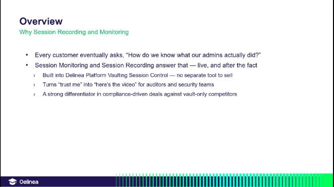
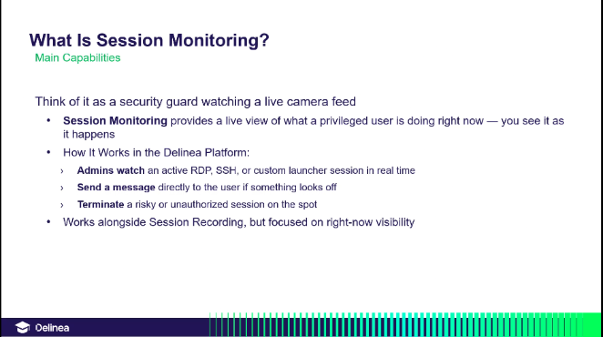
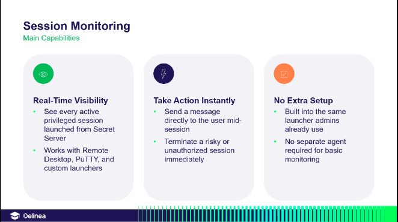
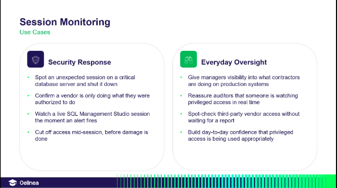
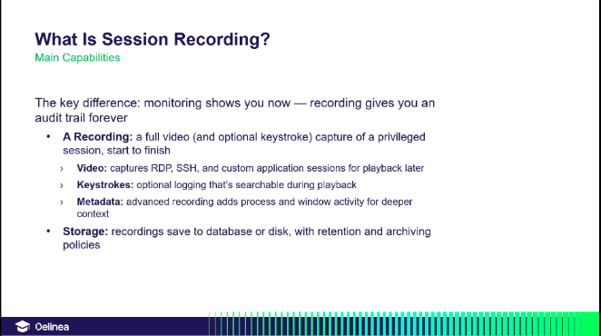
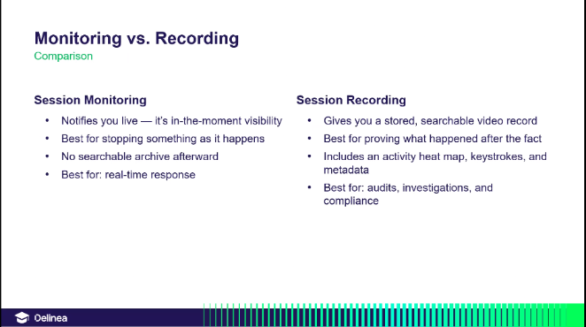
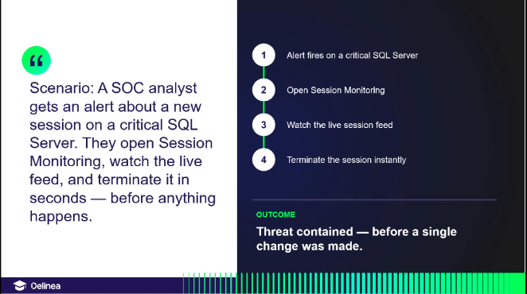
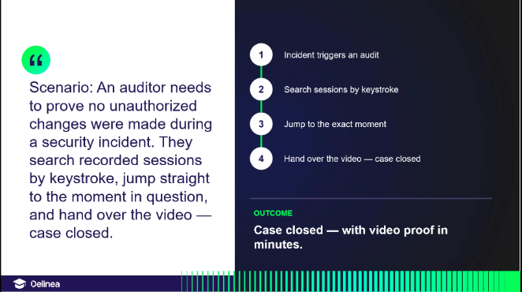
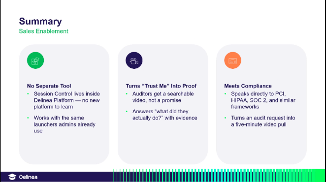

# Lesson 5 — Secret Server Vaulting: Session Recording & Monitoring

> **Sumber:** Delinea University → *Delinea Platform Guard: Control* → *Securing Remote Access* → Lesson 5
> **Tipe:** Video, 5:42 (tanpa subtitle; catatan disusun dari slide + deskripsi lesson)
> ⚠️ Slide penutup berjudul **"Sales Enablement"** → materi positioning, bukan deep-dive teknis.

## Learning Objectives
1. Definisi **session monitoring** dan kapabilitasnya: visibilitas real-time, pesan di tengah sesi, terminasi sesi.
2. Definisi **session recording** dan 3 komponen capture-nya: **video, keystrokes, metadata**.

---

## Overview

Pertanyaan yang pasti muncul: *"Bagaimana kita tahu apa yang sebenarnya dilakukan admin?"*
- Monitoring menjawabnya **saat kejadian (live)**, Recording menjawabnya **setelah kejadian**
- Sudah built-in di **Delinea Platform Vaulting Session Control** — tidak perlu tool terpisah
- Mengubah *"percayalah"* menjadi *"ini videonya"* untuk auditor & tim security

---

## Session Monitoring

> *Analogi: satpam yang menonton CCTV secara live*

- Melihat **langsung** apa yang dilakukan privileged user saat ini
- Cara kerja di Delinea Platform:
  - Admin **menonton** sesi RDP, SSH, atau custom launcher secara real-time
  - **Mengirim pesan** langsung ke user kalau ada yang janggal
  - **Memutus** sesi berisiko/tidak sah saat itu juga

| Real-Time Visibility | Take Action Instantly | No Extra Setup |
|---|---|---|
| Lihat semua sesi privileged aktif yang di-launch dari Secret Server | Kirim pesan ke user di tengah sesi | Built-in di launcher yang sudah dipakai |
| Remote Desktop, PuTTY, custom launcher | Terminate sesi berisiko seketika | **Tidak perlu agent** untuk monitoring dasar |

| Security Response | Everyday Oversight |
|---|---|
| Lihat sesi tak terduga di database server kritikal → matikan | Manajer bisa melihat apa yang dilakukan kontraktor di production |
| Pastikan vendor hanya melakukan yang diizinkan | Meyakinkan auditor bahwa akses privileged diawasi real-time |
| Tonton sesi SQL Management Studio saat alert muncul | Spot-check akses vendor tanpa menunggu laporan |
| Putus akses di tengah sesi sebelum kerusakan terjadi | Membangun keyakinan bahwa akses privileged dipakai dengan benar |

---

## Session Recording

> *Monitoring = sekarang. Recording = audit trail selamanya.*

Rekaman penuh (video + keystroke opsional) dari awal sampai akhir sesi:

| Komponen | Isi |
|---|---|
| **Video** | Sesi RDP, SSH, dan custom application untuk diputar ulang |
| **Keystrokes** | Opsional; **bisa dicari (searchable)** saat playback |
| **Metadata** | *Advanced recording* menambahkan **aktivitas proses & window** untuk konteks forensik |
| **Storage** | Disimpan ke **database atau disk**, dengan kebijakan **retensi & arsip** |

---

## Monitoring vs Recording

| | **Session Monitoring** | **Session Recording** |
|---|---|---|
| Sifat | Live, saat kejadian | Tersimpan, searchable |
| Terbaik untuk | **Menghentikan** sesuatu saat terjadi | **Membuktikan** apa yang terjadi |
| Arsip | Tidak ada arsip yang bisa dicari | Activity heat map, keystrokes, metadata |
| Use case | Respons real-time | Audit, investigasi, compliance |

---

## Skenario
| SOC Analyst | Auditor |
|---|---|
|  |  |
| 1. Alert di SQL Server kritikal → 2. Buka Session Monitoring → 3. Tonton live → 4. Terminate. **Hasil:** ancaman tertahan sebelum ada perubahan | 1. Insiden memicu audit → 2. Cari sesi berdasarkan keystroke → 3. Lompat ke momen yang dicari → 4. Serahkan video. **Hasil:** kasus selesai dengan bukti video dalam hitungan menit |

## Summary (Sales Enablement)

- **No separate tool** — ada di dalam Delinea Platform, pakai launcher yang sama
- **"Trust me" → proof** — auditor dapat video yang bisa dicari
- **Compliance** — PCI, HIPAA, SOC 2, dll.; permintaan audit jadi tarik video 5 menit

---

## Catatan Senior Engineer (di luar materi video)
- **Skenario SOC di video itu versi ideal.** Agar realistis butuh:
  1. **Sumber alert**: event Secret Server dikirim ke SIEM (syslog/CEF) → rule korelasi di SIEM
  2. **Hak akses**: analis SOC butuh role di Delinea untuk melihat & memutus sesi
  3. **Kecepatan manusia**: alert → buka console → menonton → memutuskan butuh menit. `DROP TABLE` butuh 1 detik. Monitoring live adalah **deteksi & containment**, bukan **pencegahan**. Pencegahan ada di workflow & least privilege.
- **Recording hanya merekam yang lewat PAM.** Kalau admin masih bisa RDP langsung ke server (bypass Delinea), rekaman bersih **bukan bukti** tidak ada perubahan. Wajib: firewall yang membuat **PAM satu-satunya jalur** ke server kritikal.
  - **Use case SOC emas:** logon ke server kritikal (Windows 4624 tipe 10 / SSH accepted) dengan source IP **bukan** dari proxy/engine Delinea = **bypass PAM** → alert prioritas tinggi.
- **Keystroke search punya celah.** Command yang di-*paste*, hasil tab-completion, atau script yang dijalankan tidak selalu muncul sebagai keystroke yang utuh. Pencarian "DROP" bisa luput.
- **Keystroke log menangkap password yang diketik** (mis. `sudo`, `mysql -p`, login ke sistem lain dalam sesi). Rekaman = **data sensitif** → batasi siapa yang boleh memutar ulang, dan setiap playback harus ter-audit.
- **Privasi & legal:** rekaman layar bisa memuat data pribadi nasabah → pertimbangkan UU PDP (UU 27/2022) dalam kebijakan akses & retensi rekaman.
- **Storage:** video privileged session besar. Menyimpan di database membuat DB membengkak; pakai disk/archive dengan retensi sesuai kebijakan retensi bank.
- **Integritas bukti:** kalau rekaman dipakai untuk investigasi/hukum, pastikan proteksi dari modifikasi dan jejak siapa yang mengakses (chain of custody).
- **Basic vs Advanced:** monitoring/recording dasar tanpa agent; metadata proses & window (*advanced recording*) umumnya butuh komponen tambahan di target → cek di dokumentasi sebelum desain.

## Cek Pemahaman
1. Sebutkan **3 aksi** yang bisa dilakukan admin lewat Session Monitoring.
2. Sebutkan **3 komponen** Session Recording dan fungsi masing-masing.
3. Monitoring vs Recording: mana untuk **menghentikan**, mana untuk **membuktikan**?
4. Auditor bilang: "Rekaman PAM bersih, berarti tidak ada perubahan tidak sah." Apa sanggahan Anda?
5. Rancang 1 rule SIEM untuk mendeteksi **bypass PAM** ke server kritikal.
